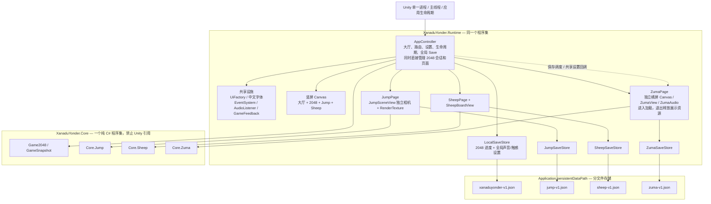
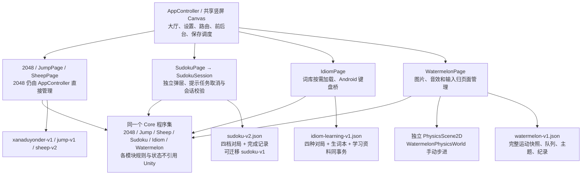

# Xanadu 小游戏架构审查（2026-10-28）

## 范围和结论

主要审查基线为 Zuma 独立工作树的 `1644d5ff9c88e3f8015be398e24daa3d925dd5bf`，分支 `p/duanyao.0516/feature/zuma-original-ui`；另通过 `git show ca50db0:路径` 补查最新本地 master 的数独、成语、西瓜与宿主完整架构调用链。下文未注明 ref 的源码行号均对应 Zuma 基线；标为 `master` 的行号固定对应 `ca50db0f381b96c7a024586792bdc60eb3f0fd3c`。同一工作树正在进行的 Zuma 说明页修改可能使工作文件行号后移。

**现状是同一 Unity 应用内的模块划分：游戏规则和游戏存档已分别管理，但还没有每款游戏的编译边界、统一宿主契约和完整故障隔离。** Core 与 Unity Runtime 的分层是真实的；各游戏之间主要依赖目录、命名空间和开发约定隔离。当前规模可以继续使用，优先补齐存储保护、保存调度和模块启动边界，无需整体重写。

分支范围必须区分：

| 源码位置 | 核查到的接入范围 | 本次审查程度 |
| --- | --- | --- |
| 当前 Zuma 工作树 `1644d5f` | 2048、跳一跳、旸了个旸、Zuma | 规则依赖、宿主、生命周期、资源和存档调用链 |
| 本地 `master` ref `ca50db0` | 2048、跳一跳、旸了个旸、成语、数独、合成大西瓜；尚无 Zuma | 补查数独、成语、西瓜的 Page / Session / Store / Codec / Core 依赖、资源与宿主调用链；核对新版 Sheep 存储契约 |
| 主 checkout | 检查时仍为 `4289660`，分支名为 `p/duanyao.0516/codex/sudoku` | 仅核对工作树/引用；分支名不代表数独已出现在该 HEAD |

补查完成时重新执行 `git worktree list --porcelain` 与 `git rev-parse master`：主 checkout 仍为 `42896603043a2a4b8dc4d8c3490f2399880adc5f` / `p/duanyao.0516/codex/sudoku`；`master` ref 仍为 `ca50db0`，同一提交也出现在 `feihualing-research` 工作树。后二者都不意味着主 checkout 已切换到 master。本次没有切换、合并或修改其他工作树。不能把当前 Zuma 分支的四款清单描述成最新 `master` 的全部游戏。

## 实际架构图

以下是 **Zuma 工作树基线**，不是拟议重构后的架构。

最新本地 `master@ca50db0` 在 AppController 下增加了成语、数独、西瓜页面，但仍使用同一组 Core / Runtime asmdef、逐款字段和逐款 Save 调用。其“unify minigame interfaces”提交名称不能作为存在 `IMiniGame` 或程序集隔离的证据：实际 `AppController.cs:23–50` 是具体页面字段，`:640–646` 是逐款保存。

以下补充图单独表示 **master 的六款**，并未将尚未合入的 Zuma 画成当前已发布模块：

## 隔离程度

| 方面 | 现状 | 依据与限制 |
| --- | --- | --- |
| 规则与 Unity | 有编译约束 | `Core/XanaduYonder.Core.asmdef:4,13`：引用为空，`noEngineReferences: true`；已检查的 Core 规则使用 System 类型，不引用 Unity 或 Runtime |
| 不同游戏规则 | 已按游戏组织，未发现这四款规则互调 | 2048 位于 Core 根目录；Jump / Sheep / Zuma 分命名空间；仍在同一程序集内，可以被未来代码相互引用 |
| Runtime 游戏模块 | 目录和对象职责隔离 | `Runtime/XanaduYonder.Runtime.asmdef:4` 统一引用 Core/UI；没有逐游戏 asmdef；AppController 明确依赖所有页面 |
| 游戏进度 | 分文件、分 Codec、分 Store | 四款文件名不重叠；都有写临时文件/替换和备份逻辑；不代表加载失败策略已经一致 |
| 全局设置 | 由宿主统一提供 | 声音/触感存在 2048 的 `SaveData` 中，Zuma 通过回调读取和更新，未另建冲突的设置副本 |
| UI / 输入 | 共用宿主输入设施，页面有输入门禁 | Jump/Sheep 接受宿主 `activePage/modal/paused/focused` 回调；Zuma 自管横屏、transition、foreground、dialog 和手势；共用一个 EventSystem 并非缺陷 |
| 相机 / Canvas | 部分独立 | 大厅、2048、Jump、Sheep 共用竖屏 Canvas；Jump 有专用相机且 cullingMask 限定独立层；Zuma 是另一张横屏 Overlay Canvas，进入时隐藏竖屏 Canvas |
| 生命周期与资源 | 模块负责暂停，但资源策略不统一 | Jump/Sheep Leave 会取消输入/动画并隐藏；Zuma Exit 会保存、释放展示资源并恢复竖屏；旧页面资源常驻直到对象销毁 |
| 异常隔离 | 局部存在 | Zuma 进入/加载有错误处理；宿主启动初始化旧页面没有逐模块失败边界；同进程不等于能屏蔽任意模块异常 |

### 按游戏核对的边界与差异

所有行仍共用 Core / Runtime 两个生产程序集；“独立”表示该行实际列出的对象、状态或存储边界，不表示独立进程或可独立发布。

| 游戏 / ref | 规则与会话归属 | 运行和资源生命周期 | 存档与保存调度 | 异常与异步边界 |
| --- | --- | --- | --- | --- |
| 2048 / 两个基线 | 独立 Game2048；会话和 UI 控制混在宿主 | 启动创建，竖屏 Canvas 常驻 | `xanaduyonder-v1.json`，含全局设置；有效移动触发全局 Save | 校验存档，但宿主初始化没有模块级恢复 |
| Jump / 两个基线 | Core.Jump + JumpPage | 启动创建专用相机、RT、材质；离开停止动画与相机，资源保留 | `jump-v1.json`；无变化仍可被宿主写盘 | 输入由宿主门禁控制；资源初始化异常向宿主传播 |
| Sheep / 两个基线 | Core.Sheep；master 增加 SheepSession 管理三种模式槽 | 启动创建，离开停止动画、隐藏页面 | Zuma 基线读 `sheep-v1.json`；master 读 `sheep-v2.json`；保存未去重 | master 明确不迁移 v1，见下方兼容契约 |
| Zuma / 当前工作树 | Core.Zuma + ZumaPage | 首次进入横屏时加载；退出保存、取消手势、释放展示、恢复竖屏 | `zuma-v1.json`；revision / dirty 去重；主备份未来版本保护 | 进入/加载错误可返回；navigationToken 防过期切屏回调 |
| 数独 / master | Core.Sudoku + SudokuSession + SudokuProfile | 启动解析全部题库并建页；页面保留；离开/后台取消提示和闪烁、暂停计时 | `sudoku-v2.json`；四档各一场对局；Save 无 dirty 跳过 | 提示 Task 有取消、owner/request/revision 校验；题库初始化异常未隔离 |
| 成语 / master | Core.Idiom + 四组 IdiomGame + 学习资料 | 首次进入加载；分帧解析词库；详情最多 4 分片，离开清空；键盘 OnDisable 卸载 | `idiom-learning-v1.json`；非活动页面且无保存失败时直接跳过；不兼容主档受保护 | 加载请求编号与 visible 校验；词库错误显示重试状态；Android 桥独立注册/反注册 |
| 合成大西瓜 / master | Core.Watermelon + WatermelonPhysicsWorld | 首次进入创建；专用本地 PhysicsScene2D 手动模拟；离开停输入/模拟，保留物理与图像对象 | `watermelon-v1.json`；运动期按 dirty 限频，但公开 Save 本身未去重 | 本地物理隔离真实存在；创建失败清理物理场景，但页面进入缺少宿主级失败恢复 |

### 补查三款的实际调用链（master）

- **数独**：`AppController.cs:338–347` → `SudokuPage.Initialize:50–77` → `SudokuProfileStore.Load` → `SudokuSession`，页面通过宿主回调读取共享声音/触感。题库在启动时校验，读到的存档题目还会与内置题库比对。`SudokuPage.cs:136–158` 在 Leave / SetForeground 中暂停、取消提示和保存；`:161–174` 维护计时、每十秒保存及销毁时取消提示。`SudokuPage.Dialogs.cs:123–156` 的后台提示只处理传出的快照，结果回 UI 后核对 owner 和 visible；`SudokuSession.cs:61–84` 再核对请求号与盘面 revision，防止旧局结果写入新局。Core 中提示引擎只依赖 System，未把 Unity UI 带入规则层。
- **成语**：`AppController.cs:199–238` 首次进入建页 → `IdiomPage.cs:121–152` 启动词库加载、校验请求编号后读盘恢复四组会话。`Resources/IdiomCatalogLoader.cs:42–109` 用 LoadAsync 加载，再分批解析；`:124–164` 管理最多四个释义分片和主动释放 TextAsset。`IdiomPage.cs:76–103` 保存草稿、停止加载协程、递增请求号并清空详情；`Platform/IdiomKeyboardViewport.cs:88–95` 卸载原生桥。`Assets/Plugins/Android/IdiomKeyboardBridge.java:22–45` 注册/移除 Activity 与布局监听，不改 Window flags；宿主 `AppController.cs:700–720` 区分软键盘失焦和应用退后台。实际入口只使用学习记录 Store，生词本内嵌在同一 JSON，不能因存在 `IdiomNotebookStore.cs` 就宣称会额外写另一份生词本文件。
- **西瓜**：`AppController.cs:241–264` 首次创建 WatermelonPage → `WatermelonPage.cs:47–68` 读盘、建图像/音效 → `Enter:132–160` 建局部物理世界。`WatermelonPhysicsWorld.cs:33–57` 创建 `LocalPhysicsMode.Physics2D` 场景，失败时 Dispose；`:101–124` 由页面手动步进/回传快照；`:277–294` 销毁碰撞体、材质并卸载场景，未修改全局 Physics2D 模拟模式或重力。`WatermelonPage.cs:144–154,342–361,377` 负责离开、保存和销毁；音效来自 Watermelon 目录，共享 GameFeedback 只用于触感。当前 Leave 不 Dispose，不应把“已停止模拟”写成“已释放所有资源”。

### 已存在的升级兼容契约（master）

| 游戏 | 当前协议与历史处理 | 应如何理解 |
| --- | --- | --- |
| 数独 | `SudokuProfileStore.cs:19–31,63–74`：仅在 v2 主/备份均不存在时迁移 `sudoku-v1.json`，保留旧文件；v2 一旦存在就不复活旧 v1 | 有显式单向迁移和新协议所有权，不能把损坏 v2 当作“再导入旧进度” |
| Sheep | `SheepSaveStore.cs:16–29` 仅访问 v2；`docs/architecture.md:67` 明确不迁移 v1；`Tests/SheepPersistence/Program.cs:409–419` 验证旧档字节保留 | 旧版本进度不会在新模式里自动续接，这是已声明的兼容边界，不作为本次新发现的遗漏；本次未运行该测试 |
| 成语 | `IdiomSaveStore.cs:8–10` 使用学习记录新文件；`IdiomSaveCodec.cs:83–100` 验证词库版本与四局/生词本/学习资料；`docs/architecture.md:75` 明确不迁移旧成语文件 | 保留旧文件与自动继承旧进度是两件事；词库版本变化也进入保护状态，后续升级若要继承须另做迁移方案 |

各游戏 Store 只操作自己的文件族，没有发现新三款直接改写其他游戏进度文件。共享设置的更新仍由 AppController 负责，数独/西瓜只通过回调使用，成语没有另外创建冲突的全局声音或触感设置。

## 有证据的问题与风险

### P2：旧存档把未知版本和损坏合并处理，降级启动可能覆盖较新存档

触发条件是同一路径存在旧客户端不认识的 schema，或主/备份读取失败。2048、Jump、Sheep 的 Codec 返回普通失败，Store 尝试备份后返回 null；页面随后创建新状态，而启动阶段的 Leave / ShowLobby 又会保存。若主文件属于较新 schema，旧客户端可能用旧备份或新局覆盖它。

证据：

- `Runtime/JsonSaveCodec.cs:59–60`、`Runtime/Jump/JumpSaveCodec.cs:72–73`、`Runtime/Sheep/SheepSaveCodec.cs:78–79` 拒绝非版本 1，但未返回独立的未来版本状态。
- `Runtime/LocalSaveStore.cs:19–32,48–56`、`Runtime/Jump/JumpSaveStore.cs:19–29,45–51`、`Runtime/Sheep/SheepSaveStore.cs:19–29,46–52` 读取失败后可继续替换主文件。
- `Runtime/AppController.cs:58–59,65–70,233,247`、`Runtime/Jump/JumpPage.cs:50–53,121–127`、`Runtime/Sheep/SheepPage.cs:37–40,101–104` 构成读取失败、创建默认状态、自动保存的完整路径。

Zuma 已更严格：`Runtime/Zuma/ZumaSaveStore.cs:46–62,79–86` 区分 Missing / Corrupt / UnsupportedVersion / IoError，并阻止覆盖受保护文件。建议将这些安全语义逐步补到旧 Store，保留各游戏独立 Codec 与文件格式；迁移前须验证主/备份组合、未来 schema、权限失败和恢复场景。这里是有明确触发条件的数据保护缺口，不是声称当前用户已经丢失进度。

**master 补查结果**：数独和西瓜有同类风险。数独 `SudokuProfileCodec.cs:56–57` 拒绝非 v2，`SudokuProfileStore.cs:19–31,48–53` 读失败返回 null 后仍可替换原文件，`SudokuPage.cs:59–60,136–158` 创建默认 Profile 并在启动 Leave 中保存。西瓜 `WatermelonSaveCodec.cs:70–71`、`WatermelonSaveStore.cs:18–28,45–51`、`WatermelonPage.cs:54–57,342–348` 同样没有保护未来主档；它在第一次有效保存时覆盖，而不是应用启动即覆盖。新版 Sheep v2 的 Store 同样不区分未知版本与普通损坏。

成语不是上述“自动新建覆盖坏主档”的情况：`IdiomFileStore.cs:42–74,105–121` 遇到版本不兼容会禁止写入，恢复需要归档原文件。不过其 `:114–127` 保存前只重读主档，未像 Zuma 一样检查待覆盖备份版本；“主档可读、备份属于未来版本”组合仍需补保护。不能据此把所有 Store 的安全策略描述为完全一致。

### P2：模块初始化和首次进入的失败恢复未统一

`AppController.Awake` 在同一调用链顺序执行 BuildGame / BuildJump / BuildSheep / BuildZuma，之后才完成状态区和 ShowLobby，未设置逐模块失败边界。Jump 缺少 shader 或 Sheep 缺少牌面资源时，构造直接抛出异常；结果会中断该次 Awake，而不是仅禁用出错游戏。

证据：`Runtime/AppController.cs:51–72,224–247`；`Runtime/Jump/JumpSceneView.cs:59–66`；`Runtime/Sheep/SheepBoardView.cs:33–43`。

建议将较重模块改为首次进入时初始化，并让宿主能够收回部分构造的页面、显示失败原因和返回大厅。共同字体等必需资源仍可作为应用级前置条件。不要用全局吞异常掩盖状态损坏。

**master 补查结果**：数独 `SudokuPage.cs:55–58` 在题库缺失/格式不符时直接抛异常，其调用仍在 `AppController.Awake:75`，会中断后续大厅完成流程。西瓜虽然懒加载，但 `AppController.cs:250–260` 已隐藏大厅并设置 activePage 才调用 Initialize；`WatermelonArtwork.cs:29–33` 遇缺图抛出异常时没有统一回收部分页面/恢复大厅的路径。成语的词库和存档加载已有请求校验与 LoadFailed 页面，不应将同一缺口一概归给其词库加载过程。

### P2：全局保存把一款游戏的操作变成多款游戏的同步磁盘写入

2048 每个有效移动调用 AppController.Save；该函数先调用 Jump、Sheep、Zuma Save。Jump / Sheep 没有 dirty / revision 跳过逻辑，每次重新序列化并写临时文件、Flush(true)、替换文件。修改声音或触感也触发这条链，因此游戏文件虽然独立，保存调度并未隔离。

证据：`Runtime/AppController.cs:337–346,473–495`；`Runtime/Jump/JumpPage.cs:256–262`；`Runtime/Sheep/SheepPage.cs:230–241`；`Runtime/Jump/JumpSaveStore.cs:38–49`；`Runtime/Sheep/SheepSaveStore.cs:39–50`。Zuma 在 `ZumaPage.Save` 中以 dirty / snapshot revision / profile revision 去重，避免无变化文件重写。

这会增加主线程同步 I/O 和无意义的备份轮换。没有运行 profiler，不能据此断言已发生卡顿或量化耗时。建议各游戏只在自身状态变动时标脏，应用退后台/退出时统一 flush 有变化的模块；设置更新单独提交。

**master 补查结果**：`AppController.cs:640–646` 继续逐款调用 Save。`SudokuPage.cs:149–159` 每次编码整个四槽 Profile，没有 dirty 门禁；`WatermelonPage.cs:342–361` 也总写盘，`:183–187` 的 dirty 只控制 Update 定时保存，不能阻止宿主保存无变化的西瓜局。西瓜至少进入一次后才有该对象，因此尚未进入西瓜的用户不会触发它的文件写入。成语 `IdiomPage.cs:212–217` 明确跳过已离开且没有保存失败的页面，是已有的正确优化例外。

### P3：宿主承担 2048 业务，全局设置与其存档绑在一起

AppController 直接拥有 Game2048、BoardView、移动、胜负和重开流程；其他游戏用独立 Page。新增游戏时要修改宿主字段、枚举、建页、路由、状态、暂停和保存多处。`SaveData.cs:7–10` 又把 2048 Game / BestScore 和全局 SoundEnabled / HapticsEnabled 放在同一个文件里，所以该文件加载失败也会让所有游戏设置回到默认值。

证据：`Runtime/AppController.cs:21–49,274–320,337–414,473–511`；`Runtime/SaveData.cs:7–10`；`Runtime/AppController.cs:58–60,191–197`。此外 `Runtime/GameFeedback.cs:28–33` 这个共享组件直接加载 Jump 的专属音效，说明资源归属还没有完全收口。

建议先抽出 Game2048Page，让宿主统一管理 Enter / Suspend / Leave / SaveDirty 等最小生命周期；宿主服务通过明确接口/组合传入，不建立包含所有游戏玩法的公共基类。公共设置将来可独立为 SettingsStore，但必须保留旧文件读取、一次迁移和失败回退，不能简单换文件名让既有设置丢失。

### P3：旧游戏在大厅阶段创建并保留展示资源，游戏增多后需要资源预算

启动时就创建 Jump 场景、几何、材质和 RenderTexture，以及 Sheep 的背景和 16 张图案纹理。Jump Leave / OnDisable 只隐藏 stage 并关闭相机；RenderTexture、材质、mesh 在 OnDestroy 才释放。Sheep 页面常驻持有纹理。当前这是可识别的常驻资源策略，不能直接称为内存泄漏。

证据：`Runtime/AppController.cs:65–66`；`Runtime/Jump/JumpSceneView.cs:67–116,515–539`；`Runtime/Sheep/SheepBoardView.cs:22–23,33–43`。Zuma 的资源释放可作为另一种已有策略参考：`Runtime/Zuma/ZumaAssets.cs:152–168` 及 `ZumaPage.ReleasePresentation`。

建议先用设备内存快照明确预算，再选择首次进入加载、离开释放 RenderTexture 或保留轻量缓存。不要只为“隔离”立即把所有小资源改成复杂下载或 Addressables 框架。

**master 补查结果**：数独在启动时常驻解析后的题库与页面（`SudokuPage.cs:55–77`）。成语与西瓜已避免启动就加载完整游戏资源；成语离开清详情缓存、保留词库索引，西瓜离开保留局部物理场景、按需图片缓存和音效（`WatermelonPage.cs:144–154,377`、`WatermelonArtwork.cs:12–14,29–34,54–57`）。各自都属于有界常驻策略，目前未证明持续增长泄漏；应测量再决定缓存预算。

## 本次 Zuma UI 修改的归属

返回大厅按钮应走现有 ZumaPage.Exit，使保存、手势取消、音频停止、横屏资源释放、竖屏恢复及宿主回调仍然成对执行。不能只把 Canvas 隐藏后直接打开大厅。

玩法说明、中文文案和瞄准线大小属于 Zuma 展示/输入反馈层。说明页放在 Zuma 自己的横屏 Canvas 内，可复用 UiFactory 的 Xanadu 字体和颜色；不需要调用宿主的竖屏 CreateModal，也不需要改变 Core 射击、碰撞和消除规则。说明弹层应阻断底层点按，并复用现有后退/焦点处理。没有理由因为这次按钮与样式调整重构全部游戏。

## 渐进改进顺序与验证边界

1. 先补旧 Store 的未来版本/读写错误保护、各游戏保存去重。这两项能在不改变玩法与界面的情况下改善数据安全和磁盘调度。
2. 引入最小宿主生命周期契约并抽离 2048Page；逐步为每个模块补初始化失败恢复和统一暂停规则，不强迫不同游戏共享业务状态机。
3. 根据设备测量改成按需资源加载。若多人并行接入继续增长，再拆 `Game.Contracts`、各游戏 Core / Runtime asmdef，明确依赖方向；目录隔离不能替代编译边界。

本次为静态源码与 Git 引用审查，覆盖两个指定基线的宿主架构及数独/成语/西瓜的规则依赖、会话、存档、资源、输入和生命周期全链；没有逐一证明所有玩法算法正确。主线六款的审查没有运行其构建或设备矩阵，也未测量帧率或内存，不能将源码中的取消/释放逻辑等同于设备回归通过。当前隔离分支的自动回归、Zuma 构建和交互验证另见 [本轮验证记录](verification-zuma-help.md)。已确认的问题不等于本次全部已修改；本次产品修改仍限制在 Zuma 界面、说明与瞄准反馈。
