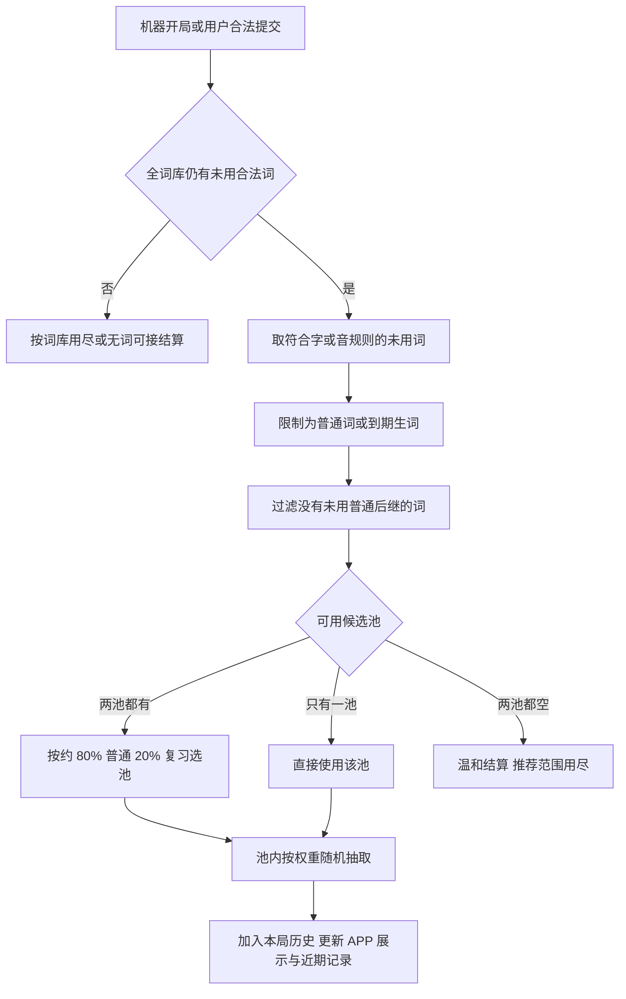

# 成语接龙学习机制与选词算法

本文是成语接龙学习机制的统一说明，涵盖词库、输入规则、APP 回复、提示、生词复习、个人熟悉词和本地保存。内容对应 2026-10-27 已落地的实现，代码入口与复核命令见文末。

玩法完全离线，不调用大模型。目标是让 APP 多说用户能理解、还能接下去的词，偶尔带用户复习生词，同时避免每次都选同一个最高分词。当前采用“候选质量过滤 → 普通或复习池 → 池内加权随机”，没有最高分独占机制。参数是产品启发式，不代表词频、掌握程度的科学测量或间隔重复记忆模型。

## 玩法与数据基础

人机对战和双人本地对战各支持同字、同音两种规则，共四个独立续玩槽位。人机开局选择机器先开始或人先开始；双人选择左方或右方先开始。双方共用本局已用词集合，一局内不能重复，历史消息、提示与随机状态分别保存。

| 规则 | 实际判定 |
| --- | --- |
| 输入格式 | 只去除首尾空白，必须恰好四个汉字 Unicode 码点，且正文精确命中当前可玩词库；不做模糊纠错或简繁自动替换。 |
| 同字接龙 | 上个成语的末字等于下个成语的首字。 |
| 同音接龙 | 比较词条在完整语境中的首尾音节键，忽略声调；保留 ü/u、平翘舌和前后鼻音区别，不临时猜多音字。 |
| 合法输入 | 在完整词库中、符合字或音规则、本局未用即可；不要求属于常用词或还有普通后继。 |
| 无效输入 | 不追加历史，不增加学习次数，不消耗随机状态。 |

当前资源含 **42,851** 个可玩成语，公共常用表为 **1,534** 个，目录版本为 `f1a8938cc8af8eb4fed5fb1c`。来源是固定版本的景墨词库和新华成语词库，由确定性脚本清洗、归并同库及跨库重复。原始读音或释义有未解决冲突的词不进入游戏；不由大模型补写拼音、释义或典故。用户查看的资料包含成语、带调拼音、释义、可用的典故与出处、可选例句。

公共常用表从 431 扩充到 1,534 词，是编辑策划的推荐范围，不是权威词频表，也不代表所有用户都认识。只改变常用标签，不改写源释义；未通过清洗门槛的熟悉表达也不能直接补入。具体数据流程见 [清洗说明](idiom-data.md)，策划标准和覆盖统计见 [常用词库审计](idiom-common-vocabulary.md)。

## 词的三种来源

| 集合 | 来源与用途 |
| --- | --- |
| C：公共常用词 | 随包发布的人工策划表，所有设备一致；完整词库的子集。 |
| F：个人熟悉词 | 用户在人机对战中独立合法说过的词，或明确点“我记住了”的词；只保存在本机。 |
| N：生词本 | 用户主动加入的词，带离线释义；表示希望继续学习，优先于 C/F 的推荐身份。 |

普通推荐范围为 `(C ∪ F) − N`，复习范围为 N。公共标签与个人学习记录不互相覆盖。F 中的词加入 N 后暂停熟悉推荐；只移出 N 不新增熟悉证据，已有的 F 证据可以恢复作用。“我记住了”会移出 N 并明确加入 F，不伪造独立回忆次数。

用户输入始终使用全部 42,851 个可玩词校验，不因推荐表中没有这个词而拒绝。双人对战共用生词本和个人资料，因此既有 F/N 会影响双人提示；双方输入均不自动积累机主的 F，也不累计独立或辅助使用次数。手动“我记住了”仍是用户主动维护资料的入口。

## APP 如何选词

1. 从首字/首音索引取得符合当前字/音规则的词；排除本局双方已用词和当前词库不存在的条目。
2. 枚举每个候选的后继，排除本局已用词及候选自己。至少存在一个普通范围中的后继，才允许 APP 推荐这个候选。只在完整词库存在冷僻后继不算通过。
3. 通过质量条件的普通词进入普通池。N 中通过条件且距上次 APP 正式说出已满 86,400 秒的词进入自动复习池；尚未被 APP 说出的生词立即有资格。这里的展示时间只指 APP 的正式开局或回复，不包括提示、释义查看。
4. 两池都有候选时，以 80% 选择普通池、20% 选择复习池。只有一个非空池时使用该池。两个池都空时，以“本轮适合的词先接到这里”结束；不继续选冷僻词凑数。
5. 在选中的池内按正权重随机抽取一个。不会只保留最高分；一个候选权重更高只意味着更容易抽到。

例如“一望无际”已进入公共常用表，但同字规则下“际”开头的三个词都没有被策划为公共常用词。空的个人资料下，APP 会温和结束这一轮；如果用户将有普通后继的“际…”词明确记为熟悉词，它们才可能进入推荐。同音规则可从 `ji` 开头的常用词中随机选择。扩充常用表并不代表所有末字都能继续接下去。

这些条件也用于机器开局；尚无上一个词时从全目录选候选。冷却与最近记录跨字/音两个人机对局共享。没有用户名、联网服务或跨设备同步。



这是只检查下一步可接性的局部策略，没有搜索整条最长接龙，也不保证永远有词可接。候选后继必须来自普通范围，即使某个生词可接，也不能替代这项条件；最多计数三个普通后继用于权重。正式选词前还会检查全词库是否确实已无合法词，相关终态在下文单独区分。

### 权重公式与抽样示例

设 `k = min(未用普通后继数量, 3)`，合格候选的 k 至少为 1。

- 普通常用基础权重：100。
- 个人熟悉基础权重：`120 + 5 × min(独立使用次数, 6)`，上限 150；同时属于公共和熟悉时采用熟悉权重，不叠加。
- 后继倍率：`(100 + 10 × k) / 100`，即 1.1、1.2、1.3；只温和偏向较好接的词。
- 最近 10 条 APP 正式输出（含开局）出现过：权重乘 0.25；跨局生效，仍有正概率。
- 复习基础权重：`100 + 3 × d + 2 × max(0, 6 − min(独立使用次数, 6))`，其中 `d = max(0, min(等待完整天数, 7))`。等待时间从上次 APP 展示计算；未展示时从加入 N 计算，设备时间回退时 d 最低为 0。再乘后继倍率与近期降权。

实现先计算整数 `W = 基础权重 × (100 + 10 × k)`；近期出现则执行整数 `W / 4`。省略的公共除数 100 不改变相对权重，所有合格候选的权重仍大于零。

例如同一普通池有三个候选，均有两个普通后继：

| 候选情况 | 整数权重 | 该池内的近似抽中概率 |
| --- | ---: | ---: |
| 仅公共常用，近期未出现 | 100 × 120 = 12,000 | 39.22% |
| 个人熟悉，独立说过两次，近期未出现 | 130 × 120 = 15,600 | 50.98% |
| 仅公共常用，最近十条 APP 消息出现过 | 100 × 120 ÷ 4 = 3,000 | 9.80% |

抽样将各权重累加，生成随机值后定位其落入的权重区间。第二项权重最高，也没有必选权；若普通池和复习池同时存在，上表概率还要乘选到普通池的约 80%。只有复习池非空时，直接从复习池选词，复习比例可以是 100%。

实现使用 `xorshift32` 伪随机数和取模完成选池、选词，因此这里的百分比是目标比例或近似概率，并非无偏抽样的精确统计承诺。20% 不是每五回合必有一次，也不保证连续两局一定不同。等待时间仅调节权重，不承诺每日固定复习计划；设备时钟向前变化可能提前到期，向后变化只会延后到期。

### 随机性与恢复的一致性

- 候选按稳定 ID 顺序索引，固定词库、对局、个人资料、时间和随机状态时，结果可复现；不是预先为每个成语绑定唯一后继。
- 新对局从 UTC 时钟与系统运行计时生成种子；种子不保证绝不碰撞，随机选择也允许在不同对局恰好相同。
- APP 与提示各有一个随机状态，生成提示只推进提示状态。保存与恢复保留两者，退出重进不会额外重抽已有回复或当前提示。
- 提示可能让之后的用户输入被记为辅助输入，继而影响熟悉词资料；“随机流分离”只保证提示不直接消耗 APP 的随机数，不意味着提示对之后的学习和推荐绝无影响。

### 自动复习的时间边界

生词未被 APP 正式说出过时，无需等待加入生词本满一天。已经说出过则满足 `当前 UTC 秒 − 上次 APP 展示 UTC 秒 ≥ 86400` 才进入自动复习池，恰好 24 小时可用。

记录覆盖所有 APP 正式输出：一个词即使先作为普通词被 APP 说出，随后才加入生词本，也沿用那次展示时间。移出再加入不清空展示历史；重新加入的时间只在没有 APP 展示记录时作为等待天数的计算起点。提示和查看释义不会重置冷却，用户主动查阅和合法输入始终不受冷却限制。

## 提示与“独立输入”的定义

每次提示先在普通池按相同权重无放回抽最多两项，再在生词池抽最多一项；不足三个时合并剩余候选继续加权抽取。每组最多三个且不重复，不占用本局已用词，也不自动提交。提示使用同样的规则合法性与普通后继质量条件，但主动查看生词不受 24 小时自动复习冷却限制。没有合格提示时不增加提示次数，允许用户继续输入完整词库中的合法词，不直接判用户无词可接。

提示免费，不设账户或跨局总次数限制；单局使用三次是本轮结束条件。当前回合的一组提示生成后缓存，重复打开不会消耗随机数，也不重复计次。人机第 3 次新提示立即回顾本轮；双人每人各 3 次，任一方用满立即结算。第三组提示保留在小结中可查看释义、加入生词本，不再允许发送下一条。

“独立输入”指在人机对战中合法提交，且该词没有在**当前等待用户输入的回合**被展示为提示或成功打开释义。整组提示都算展示，不局限于点选填入的那一项；从生词本打开释义也算。辅助状态随存档保存，退出再进入不能消除来源。跨回合不追溯辅助来源。

| 事件 | 学习结果 |
| --- | --- |
| 人机独立提交，词不在 N | 累计独立使用，第一次即可进入 F。 |
| 人机独立提交，词在 N | 累计独立回忆，仍留在 N，不自动认定记住。 |
| 人机辅助后提交 | 正常计分，记辅助使用，不新增独立使用或 F。 |
| APP 说出 N | 记录再次见到与展示时间，不自动移出 N 或加入 F。 |
| 双人本地提交 | 只更新对局，不积累机主的个人熟悉词。 |
| 用户点“我记住了” | 明确移出 N、加入 F。 |
| 用户点“移出生词本” | 仅取消生词标记，不生成掌握证据。 |

只有通过格式、词库、去重、接龙规则校验的提交才产生使用记录。即使有效输入随后使 APP 无法继续，该输入本身仍计入学习。辅助来源以词 ID 标记：同回合看了甲词的释义，并不会让未展示过的乙词也算辅助；成功提交后清除当前辅助集合，下一回合重新判断。

人机合法提交先更新个人资料，再选择当次 APP 回复，因此新的熟悉证据立即生效；刚提交的词仍受本局去重约束，APP 不能马上把它复述回来。独立说对一个仍在 N 的词，只增加回忆次数，不自动毕业；当前也没有随时间遗忘、达到次数自动毕业或根据错误输入扣除熟悉状态的机制。

APP 说出的词已进入本局去重集合，用户不能在本局再说一次。因此本版本是生词再遇见机制，不是要求用户立即回忆同词的测验。

## 结算与学习页面

| 情况 | Core 状态与页面行为 |
| --- | --- |
| 全词库尚可接，但没有合格推荐 | `RecommendationExhausted`；显示“这一轮适合的词先接到这里”，一起回顾收获，不判用户失败。 |
| 全词库没有未用合法后继 | 依轮到的一方记录 `AppNoMoves` 或 `PlayerNoMoves`；双人模式中 App 枚举代表左方。 |
| 全词库全部用完 | `DictionaryExhausted`，优先于某方无词可接。 |
| 人机第三次提示或双人任一方第三次提示 | `HintLimit`，展示最后一组提示后立即回顾，不增加接龙消息。 |
| 用户主动结束 | `EndedByPlayer`，保留历史供回顾。 |

对话页左右消息可点开释义；右上角本子图标进入生词本二级列表。释义弹窗展示带调拼音、词义、可用典故与出处、来源，长内容可滚动，支持点击周围阴影关闭。未加入的词显示“加入生词本”；已加入的词提供“我记住了”与“移出生词本”两个不同动作。前者明确新增熟悉身份，后者只取消生词标记。

小结显示本轮完成数量，双人另有双方数量，以鼓励和回顾为主，提供“再来一局”“生词本”“回看本轮”。已经生成的提示和历史不因之后编辑生词本而改写。

## 状态所有权与保存

Core 纯 C# 接收共享 `IdiomLearningProfile` 与 UTC 秒时钟，不依赖 Unity 或磁盘。生产页面显式注入时钟，独立测试可注入固定时间。四个可续玩对局共享同一个 profile；个人学习变化影响下一次尚未生成的选择，不重写已生成的回复、提示及结算。

Presentation 成功展示释义后调用 `RecordDefinitionViewed`；有效提交与 APP 输出的学习变更在 Core 动作内执行一次。普通 Save 只复制快照，不重放事件，所以重复保存不会重复计数。

`Application.persistentDataPath/idiom-learning-v1.json` 使用 `schemaVersion = 1`、`gameId = idiom-learning`，将四组对局与学习状态一起原子保存，文件上限为 64 MiB。

| 保存内容 | 字段与用途 |
| --- | --- |
| 四组续玩 | 人机同字、人机同音、双人同字、双人同音；各含历史、先手、结束原因、提示、草稿与纪录。 |
| 随机与辅助来源 | 每局 `randomState`、`hintRandomState`、当前 `assistedEntryIds`，恢复后延续选择与辅助判定。 |
| F/N 身份 | `familiarIds`、`notebookIds`，两者允许同时有记录，但 N 优先。 |
| 学习次数 | `uses` 中的独立与辅助使用次数；辅助次数仅记录，不用于提升熟悉权重。 |
| 再遇见记录 | `appExposures` 保存每词最近一次 APP 正式展示时间；`recentAppIds` 保存最近十条 APP 消息，包含机器开局，跨局降权。 |
| 生词加入时间与释义 | `notebookAdded` 与 `notebook` 保存一致的身份和加入时间；生词本另保存加入时词条、拼音、词义、义项 ID 与词库版本。 |
| 推荐穷尽依据 | `endSelectionContext` 保存当时普通和复习范围，只用于还原历史终态。 |

编码前验证、写入临时文件、持久刷盘后替换主文件，并保留可用备份。写失败时保留上一份完整文件；普通游戏动作维持内存进度并显示保存错误，可重试。生词本编辑写失败时同时回滚内存的生词本与共享 profile，避免半成功。备份恢复沿用本游戏的文件保护机制，不影响其他小游戏。

本次按用户要求不做旧存档迁移；历史 `idiom-v1.json` 与 `idiom-notebook-v1.json` 不读取、不覆盖。新协议校验类型、范围、唯一性、词条身份与 Notebook/Profile 一致性，并要求存档目录版本与当前词库一致。主文件缺失或损坏时尝试备份；主文件版本不兼容则直接保护原文件，不尝试备份。版本不兼容或没有可用备份时等待用户确认归档重建，不能静默清空资料。

推荐池用尽是独立的 `RecommendationExhausted` 终态，与完整词库无合法词的 `AppNoMoves`/`PlayerNoMoves` 区分。恢复时使用终态当时的推荐范围见证进行校验，不拿后来的生词本变化重新判定历史结算。

## 实现入口与验证

| 职责 | 代码或数据入口 |
| --- | --- |
| 四字词身份、首字与首音索引 | [`IdiomLexicon.cs`](../Assets/Scripts/Core/Idiom/IdiomLexicon.cs)：`TryGetWord`、`Following`。 |
| 合法输入、去重、选池、抽样、提示与终态 | [`IdiomGame.cs`](../Assets/Scripts/Core/Idiom/IdiomGame.cs)：`Submit`、`Candidates`、`ChooseApp`、`Pick`、`RequestHint`、`NaturalEnd`。 |
| C/F/N 关系、学习事件、冷却与权重 | [`IdiomLearningProfile.cs`](../Assets/Scripts/Core/Idiom/IdiomLearningProfile.cs)：`Ordinary`、`ReviewDue`、`Weight`、`RecordUse`、`RecordApp`、`Remember`。 |
| 时钟、种子、四槽位共享资料与快照 | [`IdiomPage.cs`](../Assets/Scripts/Runtime/Idiom/Presentation/IdiomPage.cs)：`NewSeed`、`RestoreGames`、`CaptureSave`。 |
| 释义辅助标记、记住与移除、编辑失败回滚 | [`IdiomPage.Dialogs.cs`](../Assets/Scripts/Runtime/Idiom/Presentation/IdiomPage.Dialogs.cs)：`ShowDefinition`、`SaveNotebook`。 |
| 存储协议与恢复校验 | [`IdiomSaveCodec.cs`](../Assets/Scripts/Runtime/Idiom/Storage/IdiomSaveCodec.cs)、[`IdiomFileStore.cs`](../Assets/Scripts/Runtime/Idiom/Storage/IdiomFileStore.cs)。 |
| 常用词表与资源摘要 | [`common-idioms.txt`](../Data/Idioms/common-idioms.txt)、[`manifest.json`](../Assets/Resources/Idioms/manifest.json)。 |
| 学习策略边界测试 | [`LearningTests.cs`](../Tests/Idiom/LearningTests.cs)，覆盖分池、权重、24 小时、辅助、熟悉、生词和历史恢复。 |

在仓库根目录可复跑以下检查。规则与存储脚本使用 .NET 10，资源脚本使用 Python；UI 检查需要本机 Unity，运行前确认当前项目没有被其他 Unity 进程占用。

```bash
scripts/test-idiom.sh
scripts/test-idiom-persistence.sh
scripts/test-idiom-resources.sh
scripts/test-idiom-ui.sh

# 本地已有清洗结果时追加真实完整词库验证
scripts/test-idiom.sh --catalog artifacts/idiom-cleaned/game-index.json
```

回归应关注：低权重合格词仍可选、只有一池的回退、24 小时精确边界、加入生词前的 APP 展示、整组提示的辅助来源、双人不积累个人使用、“记住”与“移出”的差别、随机状态恢复，以及存储失败不出现半份学习记录。自动化与模拟器、真机的具体已验证范围见 [学习机制验证记录](verification-idiom-personalization.md)；不能把规则测试当作所有机型验证。

## 当前限制与调参原则

同字模式仍容易遇到推荐范围用尽。仅公共表、且只把一个输入词标记为已用的静态审计中，至少存在合格回复的输入占全库 27.87%，同音为 87.98%；这不是整局完成率，也不是设备实测成功率。后续已用词会缩小候选，F 可以扩大普通范围，N 则会改变普通与复习池。

当前没有词频模型、服务端用户画像、自动掌握分级、错误遗忘曲线或每日复习任务。后续调整先观察短局比例、普通后继覆盖及复习重复情况，再改变公共词表或少量参数；这些是评估方向，当前没有自动采集上报。不要只提高冷僻候选权重掩盖覆盖问题。

修改选词、学习或存储语义时，应同步更新本文件对应公式、事件表和边界测试；修改公共词表时还需重新导出资源与覆盖审计，并处理目录版本变化对存档的影响。
