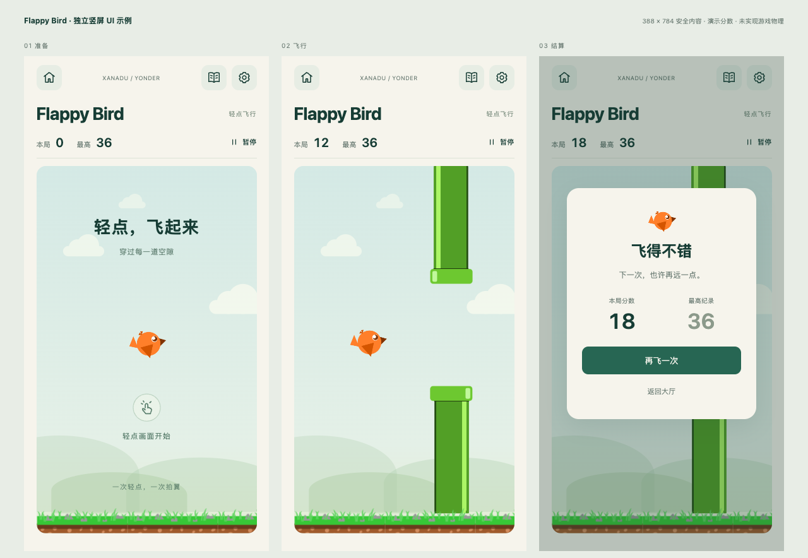

# Flappy Bird UI 设计示例

2026-10-28，基于主线 `0f6e4fd`；状态为待评审设计，不是正式游戏。

[设计与玩法调研](../../superpowers/specs/2026-10-28-flappy-bird-design.md) · [打开示例](index.html)

示例使用合集的纸白和深绿配色、统一导航语义，以及 Peleila 的真实圆鸟图集。主视图按 388×784 安全内容设计，不额外绘制系统栏。外侧的状态/尺寸切换仅用于设计评审，正式 APP 中不出现。分数均为演示数据，状态切换不会创建玩家存档。

从仓库根目录运行：

```sh
python3 -m http.server 8765 --bind 127.0.0.1
```

在浏览器打开 `http://127.0.0.1:8765/docs/prototypes/flappy-bird/`。页面及图片保存在仓库中；截图输出在本目录 `screenshots/`，反映浏览器实际渲染，不代表 Unity 或真机完成。



## 本轮浏览器检查

在真实 Chrome 中检查 388×784、320×640、388×896 三种尺寸和六种主要状态，共 18 组；内容无溢出，场地保持 3:5。交互检查覆盖准备页帮助、飞行中帮助/设置返回暂停、继续三秒倒数、退出确认、准备态暂停恢复、结算帮助/设置恢复，以及未保存提示与重试。重试示例保留内存分数 37，场地矩形不变；未保存时退出有明确提示。浏览器未记录 pageerror，页面 JavaScript 语法检查通过。

预览场景使用演示数据，不能验证生产规则、多指输入或跨页面真实存档；完整 Android 生命周期和手感仍需 Unity 实现后验收。原图哈希已再次核对一致。

## 素材来源

- 作者：Peleila。来源：[作者发布页](https://opengameart.org/content/flappy-bird)。
- 原文件：[default.png](https://opengameart.org/sites/default/files/default.png)，本地 `assets/peleila-atlas.png`，794×1123 RGBA PNG。
- 发布页列出多种许可，本项目选择其中的 [CC0 1.0](https://creativecommons.org/publicdomain/zero/1.0/)，仍保留作者署名 `By Peleila`。
- 获取日期：2026-10-28。原图未修改；通过 CSS 背景位置展示局部，不把裁切前的透明边界视作碰撞范围。
- SHA-256：`6468487709449dda2e31f1e49731a0ce4a4166c5f2e3a4d640b02ba97741279d`。
- 图集中有不同姿态和旋转角度；这不证明所有姿态都是顺序扑翼帧。正式动画帧、锚点、碰撞几何另行确认。
- 当前图片仅用于设计示例，未导入 Unity Resources；金币不进入首版玩法。没有引入 Kenney、MegaCrash 或其他备选的实际文件。

界面沿用项目设计；浏览器字体与 Unity Noto 的渲染可能不同。后续实现须用相同可用尺寸和同一局面对照，不以本示例声称已经实现像素级还原。
