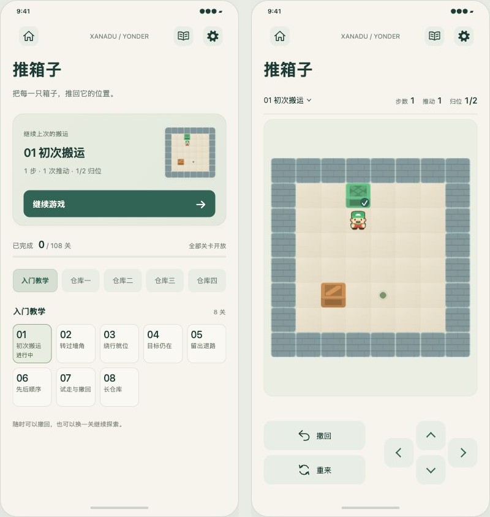

# 推箱子入口与游戏页示例

本轮用于评审「关卡入口 → 继续 / 挑选一关 → 游戏」的交互和布局。**仅修改浏览器原型，尚未把这次修订接入 Unity。** 旧版自动适配加缩放的生产页面不受这些文件影响。

在仓库根目录运行：

```bash
python3 -m http.server 8765 --bind 127.0.0.1
```

打开 <http://127.0.0.1:8765/docs/prototypes/sokoban/>。图片使用本地 `ThirdParty/Sokoban/`，关卡从同源 `Assets/Resources/Sokoban/campaign.json` 读取，不需要 CDN。正式应用仍由 Unity/C# 实现，没有引入 WebView。

## 本轮示例

- 默认先展示入口页，保留 Home、居中品牌、Book、Settings 和统一标题。首屏主卡片显示当前关卡的小棋盘、真实演示步数、推动数和归位数，点击「继续游戏」回到同一局及其撤回历史。
- 初始状态为第一关合法向上推动一次：1 步、1 次推动、1/2 归位。这是明确标注的演示进度，不冒充玩家存档；当前完成数为真实的 0/108。
- 六个章节与 108 个关卡都来自实际发布目录。章节标签可横向滚动，关卡网格可纵向滚动；普通关卡卡片点击一次即可开始，点击当前活动关卡继续原局。切换关卡仅替换本页内存中的活动尝试。
- 选关卡片收紧为 64 CSS px 高、16 px 编号，常规宽度每行 5 个，容器不超过 350 px 时每行 4 个；保留关卡名和状态。弹层普通选关行高 44 px，有进度的行随内容增高。已检查教学长名称、三位关卡编号和窄屏文字无截断、无横向溢出。
- 页外提供「关卡入口 / 游戏页面 / 高地图」三种评审入口。「查看首次游玩状态」清空本次演示，展示「从第 1 关开始」；也可使用 `?state=new` 直接打开该状态。`#game`、`#tall` 可直接预览相应游戏页。
- 游戏页保留单行关卡与计数，棋盘使用淡绿纸色圆角背景，内部预留 12 CSS px。地图只做完整自动适配，没有缩放按钮、倍率、拖动平移或棋盘手势。
- 左侧撤回和重来各占一行，48 CSS px 高。操作区内撤回与向上键均位于 `y=24`，重来与向下键均位于 `y=80`；左右键仍位于原来的 `y=52`、`x=0/104`。已删除方向盘中心圆点。
- 游戏内点击关卡名打开最大宽度 320 CSS px 的窄版弹层，展示章节、关卡名、当前进度和已完成纪录，不再显示泛化的「进入」状态。
- 通关后显示结果与下一关；回到入口时主卡明确表示该关已完成，并提供下一关动作。最后一关通关后改为「再玩这一关」，不显示不存在的下一关。
- Home 仍表示合集大厅；独立原型用占位弹层说明，并提供回到关卡入口的按钮。Book 和 Settings 不改变当前局面。

## 状态与验证边界

原型只维护当前标签页内存，不使用 `localStorage`、正式存档、音频或触感。刷新即重置。完成集合和个人步数纪录由实际演示操作产生，没有预置虚假完成量。完整目录加载失败时明确降为两张原创地图，并显示加载提示，不继续声称已加载 108 关。

本轮已运行 `node --check docs/prototypes/sokoban/prototype.js` 和 `git diff --check`。浏览器实际检查及独立复核已完成：

- 108 关分为 8 + 20×5，全部编号可选，本地图片均正常加载。
- 继续游戏、移动、回到入口、再次继续和撤回，局面与历史一致。首次游玩为 0 步；第一关键盘回放 `UDDLLDRR` 得到 8 步 / 3 推动的通关结果，回入口显示 1/108 并提供下一关。
- 390×844 画框下棋盘区域仍为 349×452.58 CSS px；增加圆角背景与内边距后，8×8 棋盘为 325×325，高图约 264×429，整图完整可见。
- 导航、标题、单行数据栏与操作区保留原几何位置；方向键和撤回/重来两行对齐，左右键位置不变。选关弹层实际宽 320 CSS px，没有“进入”文本。
- 360×800 浏览器下，页面、手机框、信息栏、操作区与入口网格均无水平溢出。检查后已恢复浏览器默认尺寸。

本轮没有改动 Unity 页面，也没有为这次示例执行 Unity 编译或 Android 真机验收。

## 示例截图

左为关卡入口，右为调整后的游戏页；截图中的 1 步是原型初始演示状态。



[高地图完整显示](preview-tall-v2.png)

## 稳定验证选择器

| 对象 | 选择器 |
| --- | --- |
| 载入完成与当前页面 | `.phone[data-catalog="ready"]`、`.phone[data-view="entry"]` / `[data-view="game"]` |
| 页外预览切换 | `[data-preview="entry"]`、`[data-preview="game"]`、`[data-preview="tall"]` |
| 继续 / 新玩家 | `[data-action="continue"]`、`[data-action="preview-new"]` |
| 入口章节与网格 | `#entry-chapters [data-chapter]`、`#entry-level-grid [data-start]` |
| 游戏计数 | `[data-stat="moves"]`、`[data-stat="pushes"]`、`[data-stat="goals"]` |
| 游戏操作 | `[data-action="undo"]`、`[data-action="restart"]`、`[data-move="up/down/left/right"]` |
| 棋盘 | `.board-area`、`.board` |
| 窄版选关弹层 | `#modal.level-dialog`、`.modal-chapters [data-modal-chapter]`、`.modal-level-list [data-start]` |
| 弹层关闭 / 返回入口 | `#close-modal`、`[data-action="entry"]` |

建议验证：继续后撤回回到 0 步；返回入口再继续仍保留当前局面；六章总计 108 关；切到高地图完整可见；入口页方向键不移动人物；弹层中方向键不移动人物；撤回/向上与重来/向下两行精确对齐；360 宽浏览器无水平溢出；最后一关完成后入口主按钮仍是有效动作。
