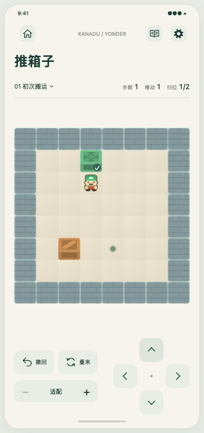
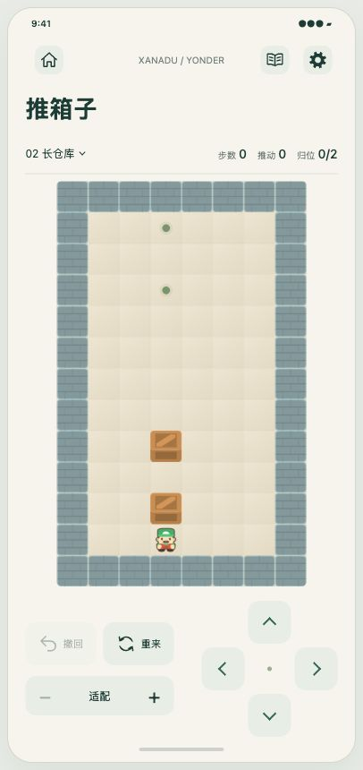

# 推箱子布局原型

用于评审统一的单页推箱子界面，不是 Unity 游戏页面。完整方案见 [设计稿](../../superpowers/specs/2026-10-28-sokoban-design.md)。

从仓库根目录运行：

```bash
python3 -m http.server 8765 --bind 127.0.0.1
```

打开 <http://127.0.0.1:8765/docs/prototypes/sokoban/>。所有图片使用本地 `ThirdParty/Sokoban/`，不需要 CDN 或在线服务。正式应用仍使用 Unity/C#，没有引入 WebView 或 Node 运行时。

## 当前界面

- 单一 390×844 手机页面；页外可切换 8×8、8×13 两张原创演示地图。
- 导航对齐数独/扫雷的纸色、深绿图标和圆角按钮：Home、居中单行 `XANADU / YONDER`、Book、Settings。SVG 使用现有 `UiIconGraphic.cs` 坐标；标题沿用 49/720 的字号比例和左对齐。
- 关卡名、步数、推动、归位在同一行。点击关卡名选关，长名称按宽度省略。
- 棋盘占信息栏与底部操作区之间的剩余空间，默认完整适配。100% 指当前视口的适配尺寸，按钮按 25% 步长放大至 200%；放大后可拖动查看，倍率按钮恢复适配居中。
- 撤回、重来、缩放和四向方向盘集中在一个操作区；没有常驻说明文字。反馈仅在棋盘内短暂浮现，不额外占布局高度。
- 方向盘、方向键或 WASD 移动。原型不实现棋盘滑动走动或双指缩放；这两项属于正式 Unity 方案。pointer 拖动只调整视口，不移动人物。
- Home 打开明确标注的大厅占位弹层，关闭后盘面保留；独立原型尚未接入真实大厅。玩法与设置弹层不会改变当前对局。
- 不持久化，不播放音频，不做触感或真实 Android 生命周期处理。原型允许通关后撤回以便审阅，正式版本按设计稿的结果页流程实现。

## 本次修订的验证（2026-10-28）

1. `node --check docs/prototypes/sokoban/prototype.js`、`git diff --check` 通过。
2. 浏览器实际加载本地图片，未发现损坏图片。单页、导航、标题、单行信息和操作区已视觉检查。
3. 390×844 画框下，棋盘视口约 349×453 CSS px；相较上一版标准页的约 340×348 px，新增约 105 px 可视高度。8×8 地图为 349×349 px；8×13 地图约 279×453 px，整图可见。
4. 推动后显示 1 步 / 1 推 / 1 箱到位；连续放大到 200% 后放大按钮禁用。拖动至边界时未露出额外空白，步数与推动数保持 1；恢复适配并撤回后归零。
5. 原型第一关按 `UDDLLDRR` 实际回放，显示 8 步 / 3 推 / 2 箱到位的通关状态。打开玩法弹层后按方向键不增加步数。
6. 浏览器视口 360×800 下，无页面或手机框水平溢出；单行信息栏和操作区的 scrollWidth 等于 clientWidth。玩法与设置按钮的触控矩形保留 4 px 间隔。检查结束后恢复默认浏览器视口。
7. 关卡源文件未改动；前期 100 份解法见证与全部 1,000 关结构检查见 [内容报告](../../../Data/Sokoban/verification/README.md)。

本次只修改方案和浏览器原型，没有执行 Unity 编译、UGUI 测试、APK 构建或 Android 真机回归。原型尺寸使用 CSS px，不能据此宣称达到了生产 Android 48dp 触控标准。生产方案中的完整手势仲裁、跨尺寸归一化视口恢复、真实存档和保存错误展示仍需实现及验收。

## 预览




