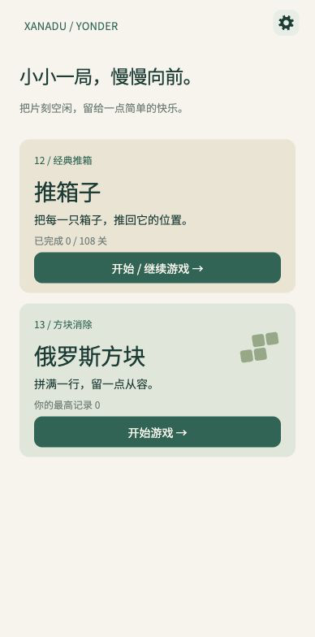
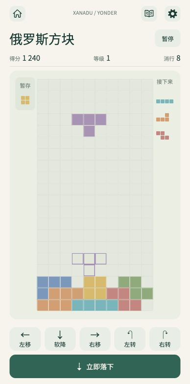
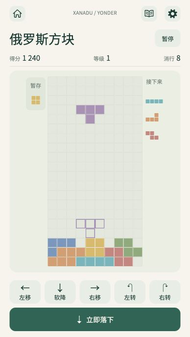
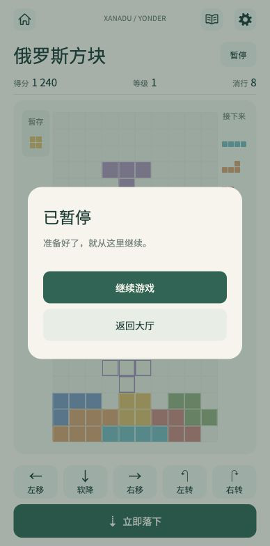

# 俄罗斯方块 UI 原型与生产截图入口

`index.html` 和 `screenshots/` 保留 **2026-10-28 开发授权前**的 UI 研究示例，未改写为当前游戏。可以切换大厅新卡、常规游戏页、短屏游戏页，以及暂停和恢复；棋盘不推进，没有计时、计分、随机出块、输入规则或存档实现。这些图片是原始浏览器原型，不是 Unity 游戏截图。

原始依据：主线 `0f6e4fd`、[小游戏 UI 参考规范](../../sokoban-development-guide.md)、[现有推箱子原型](../sokoban/README.md)。页面色、字体和 Home / Book / Settings 语义沿用合集。图标几何复用现有推箱子原型中对应 `UiIconGraphic.cs` 的坐标；字体引用仓库 `Assets/Resources/Fonts/NotoSansCJKsc-Regular.otf`，不复制字体或引入远程资源。HTML 的样式与行为均内置，离线打开仓库内的 `index.html` 即可预览。

用户已接受独立竖屏和单一温和无尽方案并授权开发。交付前再合入 master `898beea` 后，当前源码包含十五款游戏，俄罗斯方块为第 15 款，实际界面、输入、规则与存档已在 `Runtime/Tetris` / `Core/Tetris` 实现；现行契约见[玩法与实现说明](../../tetris-research.md)。正式 v0.6.0 发布仍包含十三款，本次没有升版或发布。

生产 UGUI 渲染使用独立的 [Unity 图集 `unity.html`](unity.html) 和 `unity-screenshots/`，页面仅只读展示图片，不模拟玩法、不写游戏存档。原始静态原型与截图保持历史内容，包括卡片研究编号和固定分数。合并前的自动检查、APK 与本次未重新编译的边界见[验证记录](../../verification-tetris.md)；图片不能替代真实输入、文件系统、后台恢复或设备触控验收。

## 原始原型尺寸与布局

| 项目 | 常规安全内容 | 短屏安全内容 |
| --- | --- | --- |
| 页面 | 388 × 784 CSS px | 388 × 688 CSS px |
| 棋盘 | 237 × 474 CSS px | 194 × 388 CSS px |
| 单格 | 23.7 × 23.7 CSS px | 19.4 × 19.4 CSS px |
| 左右内容边距 | 19.5 CSS px | 19.5 CSS px |
| 棋盘容器内边距 / 圆角 | 12 / 15 CSS px | 12 / 15 CSS px |
| 棋盘与操作区间距 | 16 CSS px | 16 CSS px |
| 操作区 | 48 px 两行，行间隔 8 px | 同左 |

尺寸只指宿主安全区内的可用内容，没有额外手机外壳、模拟系统栏或底部手势条。常规尺寸与现有规范中的 720 × 1455 Unity 可用画面对照；短屏对应按宽度缩放后的约 720 × 1277。Hold 预览盒宽 40 CSS px；48 px 只指底部六个操作按钮的高度，不代表所有触点均为 48 px。CSS px、Unity 设计单位和物理触控尺寸不能互相当作验收结果。

导航下是标题、暂停和单行得分 / 等级 / 消行。棋盘固定 10 列 × 20 行，以可用宽高的较小约束计算单格，保留严格 1:1 方格。左侧为可点击暂存预览盒的布局，右侧显示 Next 3。底部第一行左移、软降、右移、左转、右转；第二行独立“立即落下”。常驻说明放在研究页面外部，游戏 UI 没有新增专注模式、模式选择或底部提示占位。

原型大厅卡片分类为“13 / 方块消除”，使用浅鼠尾草色、标题“俄罗斯方块”和文案“拼满一行，留一点从容。”。大厅截图是列表尾部卡片节选，并同时保留品牌外壳以观察一致性，不是整页首页截图；已有前 11 款未在此图重复绘制，不表示删除或重新排列已有游戏。13 是当时十二款主线后的研究编号。当前生产卡片由动态计数得到“15 / 方块慢落”（Unity 图集保留合并前的第 14 张卡），文案为“落下一块，留一点从容。”；开始/继续取决于真实有效活动存档，不由本原型控制。

## 固定示例与交互范围

所有视图使用同一份静态绘制夹具：200 个单元、紫色活动块及其描边落点、底部彩色堆叠、暂存 O、接下来 I / L / Z。显示的得分 1,240、等级 1、消行 8 仅用于观察计数排布，不是规则计算结果或用户记录。大厅使用新玩家零记录示例，不制造存档。

研究工具栏可切换四种视图。大厅“开始游戏”只切换页面；Home 返回示例大厅；暂停覆盖层与继续只显示或隐藏覆盖层，恢复后保持原静态局面。Book、Settings、暂存与落子控件仅展示位置，明确禁用，不模拟规则。按键之外不保存浏览状态，也不写入任何游戏存档。

## 原始 UI 示例

| 大厅新卡 | 常规游戏页 |
| --- | --- |
|  |  |

| 短屏游戏页 | 暂停 |
| --- | --- |
|  |  |

## 重现与验证范围

在仓库根目录启动静态服务器，例如 `python3 -m http.server 8767 --bind 127.0.0.1`，打开 `/docs/prototypes/tetris/index.html`。用 `?view=game&capture=1`、`?view=short&capture=1`、`?view=lobby&capture=1` 或 `?view=paused&capture=1` 可隐藏研究工具栏并输出对应安全内容区域。截图按左上角 388 × 784 或 388 × 688 裁取，不作拉伸。

原调研阶段已在浏览器检查四种视图并保存对应 PNG；当时读取 DOM 确认常规 / 短屏均为 200 格，单格宽高相同，短屏操作区底边为 676 px，未超过 688 px。暂停再恢复后，200 格与计数不变。这些历史检查仅验证静态原型；当前实现的分层结果单独维护在[俄罗斯方块验证记录](../../verification-tetris.md)。
