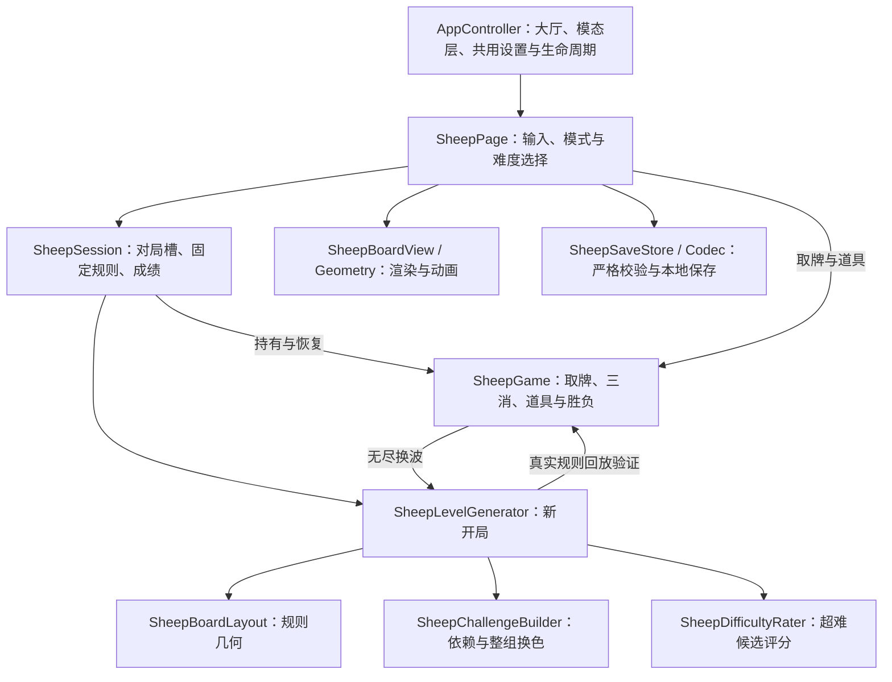

# 旸了个旸：算法与设计

本文是项目中「旸了个旸」的实现总览，面向后续开发、调参和排查问题。显示名为「旸了个旸」，稳定标识与代码目录仍使用 `sheep`。代码核对基线为 `925975d`，整理日期为 2026-10-27，对应 v0.4.0 开发代码。

阅读顺序：先看本文理解设计，再查[玩法与存档字段契约](sheep-game.md)、[难度校准证据](verification-sheep-difficulty.md)和[合并验证](verification-sheep-master-merge.md)。`docs/superpowers/` 中的早期方案，以及 v0.3.0 的验证记录，是历史决策与证据；其中一次道具、不限道具、schema 1 等描述不代表当前规则。本文描述本项目的原创离线实现，不声称还原了原版游戏未公开的生成算法。

## 1. 设计目标与固定规则

玩家从多层叠牌中挑选未被遮挡的牌，放入七格卡槽；三个同图案自动消除。主要决策是何时深入主堆、何时动用浅层牌与盲堆，以及如何为未完成的对子留槽位。

| 模式 / 难度 | 总牌数 | 图案数 × 每种张数 | 生成差异 | 完成后 |
| --- | ---: | --- | --- | --- |
| 第一关热身 | 18 | 3 × 6 | 小布局、较少交错 | 可进入或继续第二关，不计通关 |
| 第二关·简单 | 144 | 8 × 18 | 局部路线、连续三张 | 累计通关 +1 |
| 第二关·正常 | 144 | 12 × 12 | 随机合法路线、三组交错 | 累计通关 +1 |
| 第二关·困难 | 144 | 16 × 9 | 深入牌堆、多组依赖、整组换色 | 累计通关 +1 |
| 第二关·超难 | 144 | 16 × 9 | 困难构造 + 16 个候选模拟筛选 | 累计通关 +1 |
| 无尽 | 每波 144 | 12 × 12 | 固定正常难度 | 换波，累计实际消除张数 |

第二关各档均使用七格卡槽和相同牌数。难度来自图案组合、遮挡依赖和消除机会的分布。开局完成后，牌面只会因玩家主动使用洗牌而重排，不会根据玩家表现偷偷改牌。

默认移出 / 撤回 / 洗牌为 **2 / 3 / 1**，设置允许分别修改为 0..99；复活每局一次。新局复制设置形成固定规则，继续旧局不会被后来修改的设置覆盖。各模式保留一个对局，第二关的四档难度共用挑战槽，并非每档各存一局。

## 2. 责任划分与调用链



| 层 | 负责 | 边界 |
| --- | --- | --- |
| `Core/Sheep` | 状态、规则几何、确定性生成、评分 | 不依赖 Unity；不做 UI、磁盘 I/O 或联网 |
| `SheepSession` | 三个对局槽、切换、新局偏好、通关和最高分 | 不用页面文字推断状态；切换前保存当前快照 |
| `SheepPage` | 输入门禁、弹窗、设置、保存与反馈时序 | 先提交规则与保存，再表现动画 |
| `SheepBoardView`、`SheepBoardGeometry` | 牌底、图案、扇形盲堆、适配、动画 | 不判断三消、遮挡或胜负，不修改规则坐标 |
| `SheepSaveCodec`、`SheepSaveStore` | 协议校验、原子写入、备份恢复 | 只访问自己的 v2 存档 |
| `AppController` | 大厅入口、模态层、共用声音触感、离页和暂停 | 不把三消规则放入公共壳层；各游戏对局独立 |

## 3. 状态模型与一步操作

`SheepSnapshot` 用牌 ID 关联 `Kinds` 与 `Locations`，以 `Tray`、`Reserve` 数组保留两个区域的顺序。每张牌只属于棋盘、卡槽、移出区、已消除四种位置之一。几何不随存档传入，由 `Level + LayoutId` 派生。构造 `SheepGame` 和导出快照都深拷贝数组，外部不能通过快照引用修改游戏。

一次 `Pick(id)` 的顺序是：

1. 仅在 Playing 状态接受合法 ID；移出区的牌可直接选，棋盘牌必须不被更高层挡住。
2. 复制状态，记录最近一次取牌的来源；若来自移出区，保存原索引。
3. 把牌插在卡槽同类牌的最后一张后面；没有同类时追加到末尾。
4. 同类恰好三张时全部移到 Removed，分数 +3，并清除撤回记录。
5. 提交状态，再推导胜负：全部牌已消除为 Won，否则卡槽七张为 Lost，其余为 Playing。

因此第七张如果恰好凑成三消，会先消除再判断失败。胜利必须清空棋盘、卡槽、移出区；只清空棋盘不算完成。`Phase` 是状态的推导结果，不作为可独立修改的存档字段。

| 操作 | 改变什么 | 关键约束 |
| --- | --- | --- |
| 移出 | 卡槽前 `min(3, 槽内张数)` 张移到暂存末尾 | 暂存容量 6；失败后也可解困；不是消除，不加分 |
| 撤回 | 最近一张未消除牌回到准确来源 | 来源为暂存时还原索引；不恢复三消，也不是多步历史栈 |
| 洗牌 | 对仍在 Board 的图案做 Fisher–Yates 交换 | 至少两张棋盘牌且仍 Playing；槽、暂存和几何不变 |
| 复活 | 满槽失败后移出前三张 | 暂存至少三个空位；独立一次机会，不扣移出配额 |

成功使用任一道具后清除上一手撤回记录。无效操作不扣配额、不消耗随机状态。洗牌保留剩余图案数量，但没有重新求解，**不保证洗牌后的局面可解**；这是当前明确的能力边界。

## 4. 几何、遮挡与多堆布局

规则坐标采用半张牌为单位。一张牌 A 被 B 阻挡，当且仅当 B 仍在棋盘上、`B.Layer > A.Layer`，并且：

```text
abs(A.X - B.X) < 2 && abs(A.Y - B.Y) < 2
```

仅边缘接触不算遮挡。同层不会互相阻挡。因为边始终从高层指向低层，遮挡关系构成有向无环图，可按拓扑顺序取完全部牌。

教学生成布局 0..2，允许连续重复；新挑战和无尽只选 3..14，共 12 种。每次新开挑战或无尽、无尽换波，都会排除该模式上一局/波的布局。布局在候选循环之前选择，因此超难的 16 个候选使用同一套几何，仅生成路线、图案和随机状态不同。

| 布局 ID | 主堆家族 | 主堆牌数 |
| --- | --- | ---: |
| 3..5 | 两个横向错位岛，每岛 54 张 | 108 |
| 6..8 | 上方冠形堆 + 两条窄腿，每堆 36 张 | 108 |
| 9..11 | 四个轮换缺角的小岛，每岛 27 张 | 108 |
| 12..14 | 宽上层架 + 两只小脚，72 + 18 + 18 | 108 |

每种新布局再加 12 张浅层侧牌和左右各 12 张的盲堆，合计 144 张。层间错位、缺角与贯穿各层的空隙带来真实的分堆结构；不是只把同一整块牌在视觉上切开。

显示适配另由 `SheepBoardGeometry` 处理：按可用宽高统一缩放，只在完全空出的水平通道增加竖向间隔，单条额外间隔最多 72 个画布单位。卡面基准为 72 × 81，规则半格映射间距为 36；盲堆另留扇形牌背与数量文字空间。适配不改变规则几何、牌 ID 或已有重叠关系。旧布局 0..2 仍可被合法 v2 对局使用，不能直接重定义其坐标来“修 UI”。

## 5. 生成流水线：先构造可解路线，再检验真实规则

主入口为 `SheepLevelGenerator.Generate(mode, difficulty, seed, quotas, previousLayoutId)`：

```text
校验参数，非挑战模式固定为 Normal
→ 初始化确定性随机状态，选择布局并排除上一布局
→ 构造合法取牌路线 SolutionIds
→ 沿路线分配图案或完整三张组
→ Hard / Extreme 对完整三张组换色
→ 建立 Snapshot，按真实 SheepGame.Pick 回放整条路线
→ 非超难返回首个验证通过候选；超难模拟候选并选最低代价
```

这不是把若干三的倍数随机散到棋盘就宣称有解，也不依赖运行时搜索所有解。生成器随候选产生一条见证路线；`VerifyWitness` 必须逐步取牌成功、不能进入 Lost，最后必须 Won，且全程不使用道具。非超难最多尝试 8 次并返回首个有效候选，超难候选预算为 16 次；没有有效候选时明确抛错，不返回未经验证的棋盘。

`SolutionIds` 用于生成验收和测试回放，不写入玩家存档，候选评分器和独立测试玩家都不读取它。**有一条无道具解，不代表玩家任意顺序都能完成，也不代表玩家能看见解所需的所有信息。**

随机数采用 xorshift32（左移 13、右移 17、左移 5，再按范围取模）；seed 0 替换为 `0x6D2B79F5`，布局选择前先混合一次。相同代码和完整输入可复现相同输出。候选各自保存生成后的 `RandomState`；模拟使用副本，不能消费最终交给玩家的洗牌序列。继续存档直接恢复牌面，不重新执行生成器。

## 6. 四档难度如何构造

### 6.1 简单：局部连续消除

简单使用与困难相同的“优先深入相邻牌堆”路线，但只保留一个未完成三张组，目标占槽为 2，因此沿见证路线每组三张连续。八种图案、每种六组三张降低了寻找同类牌的成本。

路线的局部性使刚揭开的牌与最近的操作更有关联；简单的主要帮助来自三张的分布，不靠额外槽位或中途送道具。

### 6.2 正常：全局随机合法路线与三组交错

正常先在所有当前无遮挡的牌中随机选择下一张，得到合法拓扑路线，再用 `AssignKinds` 分配图案。维护每种图案的未开启组数、当前组进度、未完成组数与槽位占用。

正常最多同时开启三组，目标占槽为 4：达到目标且存在对子时优先补第三张，否则可开启新组或把单张变成对子；满六张时只允许完成已有对子。12 种图案每种四组三张。教学沿用此类算法，但最多两组交错、目标占槽为 3；无尽直接使用正常算法。

### 6.3 困难：跨层依赖与整组三张换色

困难和超难的共同构造由 `SheepChallengeBuilder` 完成，分为三步。

**第一步：构造倾向深入局部牌堆的路线。** 维护每张牌的阻挡数和它遮住的下层牌。只从阻挡数为零的未取牌中选下一张；除第一步外，候选分数为：

```text
seededNoise
+ 12 / (1 + 与上一张的曼哈顿距离)
+ 8 × 本步是否刚刚解锁
+ 0.15 × min(3, 该牌遮住的下层牌数量)
```

记录 `exposedAt[id]`（沿该路线首次可选的步数）与 `removedAt[id]`（实际取走步数）。这使后续可以衡量两张牌沿路线同时露出的时间。

**第二步：安排 48 个完整三张组。** 最多保留四个未完成组，倾向把不同组的单张、对子交错排列；占槽为六时必须选一个对子完成。选择时惩罚紧邻重复及在该牌已经露出期间出现过的同组类型，减少简单连续消除。这里的“组”是构造单位，不等于最终图案。

**第三步：保持可解性的换色。** 48 组分配为 16 种最终图案，每种恰好三组，即 9 张。对不同组的每对牌 a、b，计算共同可选区间长度：

```text
overlap = min(removedAt[a], removedAt[b])
        - max(exposedAt[a], exposedAt[b]) + 1

overlap > 0 时：weight = 1 + 0.1 × min(12, overlap)
两张都在开局露出时：weight 再加 20
```

将牌对权重累加到组对。目标是减少高权重组使用相同图案，尤其减少开局就露出的同类组合。先随机排列固定颜色库存，再做 **2,000 次组对换色尝试**：代价降低则接受，持平时以 10% 概率接受；不接受变差交换。这是有界局部搜索，不保证全局最优，也不是 2,000 次重新生成。

为什么整组换色仍有解：对见证路线任意前缀，令 `n_g` 为某组三张已取的数量。分开计算时，该组占槽为 `n_g mod 3`。若若干组共用同一图案，该图案实际占槽是 `(Σ n_g) mod 3`，不会大于 `Σ(n_g mod 3)`。因此重新合并同色组只可能提前消掉一些牌，不能增加原路线的总占槽；几何和取牌路线也没变。最终仍用真实规则回放把这条性质落实为验收。

### 6.4 超难：从可解候选中筛选

超难对 16 个候选逐一做无道具见证验证，再用三种模拟策略评估：

- `greedy / generous`：快速匹配。
- `visible3 / generous`：最多前瞻三次取牌，每层最多保留 8 个动作。
- `greedy / exposed`：只根据当前可选图案匹配。

每种模拟最多 800 个循环回合，固定使用标准移出 2、撤回 3、洗牌 1、复活 1。玩家自定义道具不会使生成器重新筛选出另一副牌；模拟也不会修改候选原快照。

设三种策略的实际消除张数为 `g / p / e`，当前评分公式为：

```text
cost = max(g, p, e) × 1,000,000
     + (g + p + e) × 1,000
     + openingCost

openingCost = 100 × 开局露出至少三张的图案种数
            + 开局露出至少两张的图案种数
```

选择 cost 最小者，平分保留先出现的候选。主要考虑能打得最远的策略，再考虑整体进展和开局直接匹配机会。不存在“某个分数以下才算超难”的逐局通过门槛：这里只选预算内相对更难的一局，不能保证每局都比任意困难局更难。

## 7. 评分玩家知道什么、怎样行动

信息约束必须和结果一起记录，否则完成率不可比较。

| 信息模型 | 可知道 | 不可知道 |
| --- | --- | --- |
| `generous` | 所有普通棋盘牌图案、盲堆顶牌、卡槽、暂存 | 盲堆内层牌图案 |
| `exposed` | 当前可选棋盘牌、卡槽、暂存 | 所有仍被盖住的图案 |

`generous` 甚至知道完全被普通牌盖住的图案，因此比真实视觉更宽松；`exposed` 不记住撤回后又被盖住的牌，属于保守近似。前瞻过程中未知图案保持未知，不会通过假想揭牌偷看内容，也不根据库存或未来随机状态推断盲堆。

贪心评分首先偏好立刻三消，其次是当前露出牌与槽内能凑成三张的组合、槽内已有同类、揭开已知匹配牌；避免没有匹配的第七张。同分按牌 ID 决定，保证复现。三步策略在此排序上做有界搜索，评价消除收益、槽位占用和后续选择数，不做完整通关求解。

到六张且没有直接三消时，道具启发式按条件尝试撤回换一张、移出、洗牌；已经失败时尝试撤回或复活。它不枚举所有道具时机或未来洗牌结果。生产评分器用于筛选候选，测试工程中的玩家独立实现同类策略；二者结果一致证明实现对齐，不自动证明策略能代表所有玩家。

## 8. 难度评估与已知局限

旧算法主要增加某一条生成路线的占槽压力，但玩家可能找到另一条很顺的路线，默认道具又进一步缩小差距。因此当前把“开局有解”和“对未知解玩家是否困难”分开验证。

固定回归使用种子 1001..1050、`greedy / generous`、标准道具：简单至少 90%，正常 50%..90%，困难至多 45%，超难至多 15%，相邻档至少相差 12 个百分点。当前记录为 **50 / 43 / 18 / 1 局完成**。这是一组固定策略回归标准，不是产品宣称的真人胜率。

参数冻结后的历史验证样本为 2001..2100，各档各 100 局，标准道具结果：

| 信息 / 策略 | 简单 | 正常 | 困难 | 超难 |
| --- | ---: | ---: | ---: | ---: |
| generous / greedy | 100% | 91% | 37% | 2% |
| generous / 三步宽 8 | 100% | 88% | 59% | 6% |
| exposed / greedy | 94% | 42% | 8% | 1% |
| generous / 三步宽 12 | 100% | 86% | 61% | 18% |

宽 12 没有参与生产筛选，但仍是同族启发式，不是完全独立的通用求解器。同种子宽 12 对照，旧版困难 / 超难为 73% / 73%，新版为 61% / 18%。详细样本口径、无道具结果及对照见[验证记录](verification-sheep-difficulty.md)，汇总见 [JSON](sheep-difficulty-results.json)。这些是已有验证结果，本次文档整理不会把它们冒充新做的真人实验。

需要保留的限制：

- 100 局样本不能推断精确总体胜率；不同种子、策略和道具会改变结果，不保证逐种子难度单调。
- 留出样本正常匹配完成率为 91%，略高于固定回归的上限；照实保留，没有因此改阈值。
- 16 候选筛选会偏向对已知策略困难的牌面。未来反复用同一批验证种子调参后，这批种子不能继续称作未见样本。
- 新算法只改变新局；继续旧档仍是旧牌面。同样难度标签不代表旧档已重新生成。
- 超难目前同步生成。历史 OPPO PKM110 开发包的六次样本约为 409..564 ms；这是当时特定设备和布局的观测，不是所有设备的性能上界。取牌时不再运行评分器。

## 9. 模式、无尽计分与设置

入口先显示模式选择。第二关可直接新开，无需通关热身；选择难度时可记住“下次直接使用”。`StartChallenge` 保存所选默认难度与 checkbox 状态；设置中可以修改。继续已有对局不询问难度，也不重新领取道具。

`SheepSession.Capture` 将当前游戏快照写回对应槽。挑战 Won 且尚未记录时，累计通关 +1 并设置 `WinRecorded`；达到 `long.MaxValue` 后饱和。切换模式、打开设置或恢复终局不会重复计数。

无尽按实际消除张数累加：

```text
Score = (Wave - 1) × 144 + 当前波 ClearedCount
```

三消 +3；移出、撤回、洗牌和复活本身 +0。整波清空后，`AdvanceWave` 使用当前随机状态和上一布局生成下一波：保留分数、开局上限、剩余次数与复活标记，重建棋盘并清空卡槽、移出区和撤回来源。自动换波不是新开一局，不能补道具；波次达到 `int.MaxValue` 后不再增加。

只有开局配额恰好 2 / 3 / 1 的无尽局可以更新标准最高记录。自定义局仍显示分数，但不覆盖最高；判断依据是局内上限，而不是当前设置或剩余次数。主动重开才按最新设置领取新局配额。

## 10. UI、快速输入与生命周期

页面顶栏从左至右为房子、环形双箭头重开、品牌、书本玩法、齿轮设置。牌面区随可用高度扩展；移出区、卡槽、道具区靠底部排列，参考布局相邻间距为 8 个画布单位。已移除卡槽上方“集齐三个，自动消除”和 `2 / 7` 文案，剩余牌数/消除数在顶部展示。

输入处理以真实模型为准，不把动画设为下一次合法取牌的必要等待：`CanPick` 通过后先 `Suspend` 结束上一段表现，再执行取牌、保存、播放动画。下一次快速点击同样可以结清旧表现，沿已提交状态继续。离页、打开模态层、暂停或失焦时也结束动画并重绘；不通过动画回调迟到地追加规则状态。

失败结果面板只覆盖牌面区，保留底部道具区域可用；有次数且满足条件的移出、撤回仍能救回满槽局。无尽在结算动画后换波，恢复已清空的一波时也检查换波，不能因退出/恢复漏掉结算。

## 11. 存档与恢复契约

路径为 `Application.persistentDataPath/sheep-v2.json`，带 `.bak` 和 `.tmp`，schema 为 2。当前不读取或迁移 v1。三个模式槽可为 null，代表未开始；已有对局必须完整合法。分数和记录以非负 64 位十进制字符串保存；胜负由位置推导。

读取顺序为“主档 → 合法备份 → 提示并进入无对局状态”。Codec 拒绝缺字段、额外字段、重复键、错误 token 类型、非法 null、未知 schema、坏牌 ID、库存/位置/分数/道具/撤回历史不一致；限制 128 KiB、JSON 深度 8。Store 严格解码 UTF-8 后才交给 Codec。具体字段以[完整契约](sheep-game.md#独立存档)为准。

写入先校验，再写临时文件并 flush，最后替换正式文件；只有合法旧主档可更新备份，防止坏主档覆盖好备份。`Capture` 更新计数与最高分后再保存，使成绩与对局同一事务落盘。写入失败保留原文件并提示用户，内存游戏允许继续；后续成功才清除保存错误，不能把“内存已提交”描述为“已持久化”。

## 12. 验证、复现与后续维护

| 检查入口 | 验证对象 |
| --- | --- |
| `scripts/test-sheep.sh` | 取牌、三消、七格结算、工具、换波与快照规则 |
| `scripts/test-sheep-layouts.sh` | 解法回放、库存、确定性、布局覆盖、旧几何指纹、配额不影响牌面 |
| `scripts/test-sheep-difficulty.sh` | 固定种子四档策略完成率及相邻差距、隐藏图案信息边界 |
| `scripts/test-sheep-difficulty.sh --check-rater` | 两种信息模型下生产评分器与独立实现对照、确定性、固定配额与输入不变 |
| `scripts/test-sheep-persistence.sh` | 严格协议、非法输入、文件写入和备份恢复 |
| `scripts/test-sheep-session.sh` | 三槽切换、固定规则、记住难度、记录与换波 |
| `scripts/test-sheep-presentation.sh` | 布局适配、卡片边界、空隙及遮挡显示关系 |
| `scripts/build-sheep-validation.sh` | Unity / IL2CPP 独立 Android 测试包 |

策略报告的复现示例：

```sh
scripts/test-sheep-difficulty.sh --benchmark --samples 100 --seed-start 2001 \
  --policy both --tools both --output artifacts/sheep-difficulty/generous.json
scripts/test-sheep-difficulty.sh --benchmark --samples 100 --seed-start 2001 \
  --policy greedy --tools default --observation exposed \
  --output artifacts/sheep-difficulty/exposed.json
scripts/test-sheep-difficulty.sh --benchmark --samples 100 --seed-start 2001 \
  --policy visible3wide --tools default --output artifacts/sheep-difficulty/wide.json
```

`both` 表示 greedy + visible3，不包含 visible3wide；`--benchmark` 输出报告，不套用默认回归阈值。每次比较同时记录代码版本、种子区间、布局、信息模型、道具、策略与搜索宽度。除完成率外，还看消除数分位数、槽位分布、操作次数和道具使用；撤回后重新取牌及暂存回槽会让取牌次数超过 144。

后续改动按责任选择验证：改生成器要保持见证和库存约束，使用同种子对照，再用新的未调参种子和更宽/不同策略复核；改布局需新增 ID 或版本，不能破坏旧档几何；改 UI 先做几何测试，再在长短屏检查真实渲染与点击；改状态或存档需覆盖坏数据、旧版本策略和后台恢复。不要为让生成器过关而同时放宽测试玩家或阈值。

尚未实现的可选方向包括把超难候选预生成/移出主线程、加入不同策略的更强评估、实测真人失败位置与道具使用分布。若开展这些工作，需要另行设计取消、种子复现、返回页面时的状态归属与新旧数据边界；不能将其当作当前能力。项目保持离线，不因评估需要自行接入数据上报服务。

本次文档整理已按源码交叉核对，并重跑默认难度回归（50 / 43 / 18 / 1）和 `--check-rater`（16 个棋盘、64 次独立对照）；均通过。仅修改文档与入口链接，没有重新构建 Android 或开展新一轮真机验收。

## 13. 源码与资料索引

| 主题 | 入口 |
| --- | --- |
| 模式、枚举、快照 | [SheepTypes.cs](../Assets/Scripts/Core/Sheep/SheepTypes.cs)、[SheepSnapshot.cs](../Assets/Scripts/Core/Sheep/SheepSnapshot.cs) |
| 核心规则与换波 | [SheepGame.cs](../Assets/Scripts/Core/Sheep/SheepGame.cs) |
| 布局和遮挡 | [SheepBoardLayout.cs](../Assets/Scripts/Core/Sheep/SheepBoardLayout.cs) |
| 生成与候选选择 | [SheepLevelGenerator.cs](../Assets/Scripts/Core/Sheep/SheepLevelGenerator.cs) |
| 依赖构造和整组换色 | [SheepChallengeBuilder.cs](../Assets/Scripts/Core/Sheep/SheepChallengeBuilder.cs) |
| 生产策略评分 | [SheepDifficultyRater.cs](../Assets/Scripts/Core/Sheep/SheepDifficultyRater.cs) |
| 对局与设置 | [SheepSession.cs](../Assets/Scripts/Runtime/Sheep/SheepSession.cs)、[SheepPreferences.cs](../Assets/Scripts/Runtime/Sheep/SheepPreferences.cs) |
| 页面交互 | [SheepPage.cs](../Assets/Scripts/Runtime/Sheep/SheepPage.cs)、[Layout](../Assets/Scripts/Runtime/Sheep/SheepPage.Layout.cs)、[Dialogs](../Assets/Scripts/Runtime/Sheep/SheepPage.Dialogs.cs) |
| 视觉适配 | [SheepBoardGeometry.cs](../Assets/Scripts/Runtime/Sheep/SheepBoardGeometry.cs)、[SheepBoardView.cs](../Assets/Scripts/Runtime/Sheep/SheepBoardView.cs) |
| 存档 | [SheepSaveData.cs](../Assets/Scripts/Runtime/Sheep/SheepSaveData.cs)、[Codec](../Assets/Scripts/Runtime/Sheep/SheepSaveCodec.cs)、[Store](../Assets/Scripts/Runtime/Sheep/SheepSaveStore.cs) |
| 大厅接入 | [AppController.cs](../Assets/Scripts/Runtime/AppController.cs) |
| 评估口径和命令 | [Tests/SheepDifficulty/README.md](../Tests/SheepDifficulty/README.md) |
| 素材来源与授权 | [THIRD_PARTY_NOTICES.md](../THIRD_PARTY_NOTICES.md#user-supplied-tile-assets-旸了个旸) |

维护本文时应先以代码和可复现证据核对当前行为，再更新设计说明；历史验证保留原日期和基线，不回写成新版测试结果。
