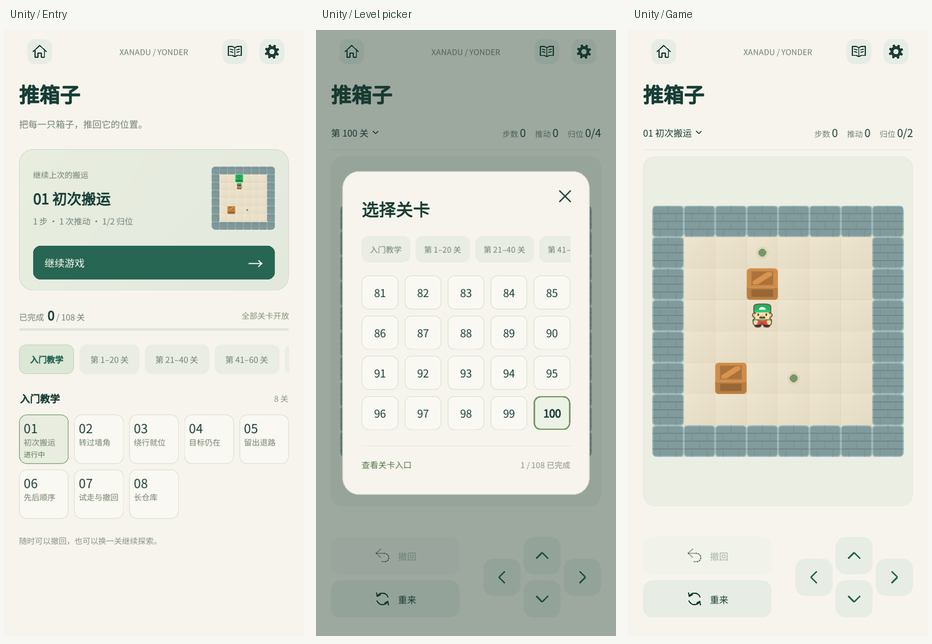

# 推箱子开发复盘与小游戏 UI 参考规范

更新：2026-10-28。适用于本仓库后续小游戏设计、Unity 接入与回归。案例基准为用户确认的浏览器原型 `597249b` 和 Unity 实现 `9c03c6d`；后续主线集成不改变这两个历史基准。

用户反馈认为推箱子是目前合集中 UI 最规范、最好看的一款。这是本次设计评审的主观反馈；本文从实际布局、代码与验证中提炼可复用方法，不把审美评价当成测量结果，也不要求其他玩法复制同一张页面。

本文区分三种内容：**现有工程约束**是代码和数据必须遵守的契约；**推荐默认做法**供新游戏优先参考；**推箱子特例**需按玩法重新判断。实际验证状态以[推箱子验证记录](verification-sokoban.md)为准。

## 1. 后续小游戏先读这十条

1. 先沿用合集的纸色、深绿、字体、导航语义，再设计玩法主体。不要每款游戏重做品牌、帮助和设置。
2. 先确认玩家最常做的动作，再分配空间。主体最大，计数可扫读，操作集中；少用常驻说明和重复工具栏。
3. 先测最大内容与最短屏幕，再决定是否需要缩放、专注、分页或额外入口。
4. 列表密度由信息量决定。有教学意义的名称值得保留；没有额外信息的普通关只需编号和状态。
5. 新入口必须提供明确价值。继续游戏应首屏可见、一键恢复，不让玩家反复选模式和关卡。
6. 同时设计新玩家、续局、完成、末关和保存失败状态。预览不等于活动对局，展示不能制造存档。
7. 确认的原型、尺寸、截图和状态说明进入 Git。实现后用同一可用尺寸、同一局面对照，而不是凭印象调整。
8. 输入只经一个提交通道；业务结果不依赖动画一定播完。弹窗、切后台、换布局后的动作不能补发。
9. 素材要有来源与许可，关卡要有生产规则验证，存档要能校验完整轨迹；下载成功和 JSON 可解析都不够。
10. 分别报告源码审查、自动测试、Unity 渲染、Android 构建、安装启动与真机交互。成功构建不代表全部验收。

## 2. 这次 UI 如何收敛

迭代中既有需求取舍，也有程序缺陷。用户要求调整尺寸、删控件不等于代码出错，应该记录它解决了什么体验问题。

| 阶段 | 调整与理由 | 留下的经验 |
| --- | --- | --- |
| 确认合集风格 | 返回大厅、玩法、设置和标题沿用已有游戏；关卡与三项计数放在同一行 | 先确定共同外壳和信息层级，避免玩法未定时先堆独立样式 |
| 扩大游戏主体 | 删除专注模式和底部常驻规则文案；操作合并在一个区域 | 每增加一个控件或说明，都要解释它为何值得占用玩法空间 |
| 验证最大地图后删缩放 | 最大已入包盘面仍可完整看清，移动又由方向盘承担；移除放大、缩小、适配和视口拖动 | 功能取舍要看真实内容和操作方式，不默认“多一种模式更完整” |
| 调整操作关系 | 撤回在第一行，重来在第二行；上/下键与两行对齐，左右键原位不动，中心点删除 | 对齐应表达功能关系，装饰不应占据操作结构中心 |
| 区分游戏区域 | 棋盘增加淡色圆角背景与内边距 | 轻背景就能表达边界，不必再增加重边框、标题或说明 |
| 增加关卡入口 | 108 关需要稳定的选择与进度位置；首屏突出继续当前局 | 多一步操作要换来可见价值，并缩短高频的续局路径 |
| 连续压缩选关 | 教学保留名称卡片，普通关改为小数字网格；弹窗收窄，删“进入” | 优先删除重复信息，再缩尺寸；两类信息不必使用同一种大卡片 |
| 修正无意义命名 | “仓库一至五”没有主题或难度依据，改为“第 1–20 关”等范围 | 分类名应帮助选择；没有依据的包装名称不如清楚编号 |

可操作原型及历史说明见[原型目录](prototypes/sokoban/README.md)，最终设计见[设计说明](superpowers/specs/2026-10-28-sokoban-design.md)。旧方案中曾有缩放不代表它仍是现行要求，变更后必须同步清理实现、帮助文案、测试与文档。

## 3. 可复用的 UI 做法

### 3.1 统一外壳，玩法保留自己的结构

共享颜色来自 [UiFactory](../Assets/Scripts/Runtime/UiFactory.cs)，不是推箱子另建的一套主题：

| 角色 | 当前值 | 用法 |
| --- | --- | --- |
| 页面底色 `Paper` | `#F6F4EC` | 页面与主要容器的纸色基调 |
| 正文与图标 `Ink` | `#173D35` | 标题、关键信息、导航图标 |
| 次级文字 `Muted` | `#718179` | 说明、单位、辅助状态 |
| 强调色 `Accent` | `#276653` | 主要行动、重点反馈 |
| 公共字体 | 项目已入库 Noto Sans CJK | 保持中文、数字及平台表现的一致来源 |

Home 表示合集大厅，Book 表示玩法说明，Settings 打开公共设置。保持这些入口的含义、顺序和视觉层级，比每个页面都出现同样数量的按钮更重要。游戏内返回、关闭弹窗和返回入口是不同动作，不能全部混用 Home。

推荐先复用颜色、字体、图标、按钮状态和导航语义。页面相似并不证明应继承同一个游戏基类；只有多个玩法具有同一职责和变化原因时，再在最窄范围抽取组件。当前 `SokobanPage`、`SokobanGraphic` 仍是推箱子的实现，本文没有把它们变成通用游戏框架。

### 3.2 好看的关键是信息有主次

推箱子游戏页只有五层：导航、标题、单行信息、棋盘、集中操作区。棋盘获得剩余高度；计数与按钮不抢主体。页边距、计数基线、棋盘边界和操作边界有一致的对齐关系，留白也有明确用途。

单行计数的前提是内容足够简单。这里的 `RefreshCounts` 先按真实文字宽度排列计数，再把剩余空间给关卡名，必要时省略名称；验证覆盖 50,000 步。其他游戏若还需要时间、错误次数、模式或九键输入，应重新分配层级，不能靠缩小所有文字硬塞一行。

常驻文案应帮助当前决策。“只能推”“走错了可撤回”在熟悉玩法后不再提供持续价值，因此放进玩法说明。保存失败则会影响当前进度可靠性，应持续可见，不能为了画面干净而隐藏。

### 3.3 用容器和对齐表达操作关系

棋盘淡色背景让玩家知道哪里是游戏区域；内边距让边缘墙体与容器边界分开。撤回/重来是一组局面操作，方向盘是一组移动操作，两组置于同一区域，上下行对齐。删除中心点后，空白仍保持方向关系，不需要填满每块空间。

推荐做法是先画清区域边界和对齐线，再决定是否需要分割线或装饰。已有圆角背景能够区分区域时，不再机械叠加粗线、阴影与说明标题。

### 3.4 用不同密度承载不同信息

| 内容 | 推箱子处理 | 适用判断 |
| --- | --- | --- |
| 教学关 | 64 CSS px 高卡片，编号、名称、状态；常规 5 列，窄屏 4 列 | 名称能告诉玩家正在练什么 |
| 普通关 | 44 px 高数字按钮；入口 6 列、窄屏 5 列，弹窗 5 列 | 名称没有额外价值，编号足以定位 |
| 当前关 | 边框、底色及有效状态 | 让玩家辨认当前进度，而不是给每项重复“进入” |
| 分组 | 入门教学，以及五个实际关卡范围 | 可直接推断内容，避免没有证据的难度和主题包装 |

缩小视觉控件时必须一起检查点击归属。本例紧凑网格不能用彼此覆盖的透明大热区扩大点击面积；`SokobanLayout.HitBounds` 让可见矩形和命中边界一致，再用响应式列数改善空间。CSS px、Unity 设计单位、屏幕像素和 Android dp 不是同一单位，44 CSS px 不构成所有设备物理触控尺寸合格的证明。

### 3.5 入口是一套状态设计

| 状态 | 应显示什么 | 不应发生什么 |
| --- | --- | --- |
| 新玩家 / 无活动局 | 教学第一关预览与开始动作 | 因浏览入口或后台保存生成假续局 |
| 进行中 | 当前局缩略图、真实计数和继续 | 点击继续重开，或丢失撤回历史 |
| 刚完成 | 真实完成结果及相邻下一关动作 | 重复保存重复累计完成数 |
| 最后一关完成 | 可执行的重玩动作 | 提供不存在的下一关 |
| 内容迁移后只剩旧选择 | 预览与实际开始的目标一致 | 卡片画一关，按钮却进入另一关 |
| 保存失败 | 可见的未保存提示，保留内存局面以便重试 | 静默显示成功，或把其他游戏的状态覆盖掉 |

入口适合大量关卡、多模式或长期进度管理；只有单一玩法、即开即玩的游戏，不必为统一形式强加入口。恢复后台中的正在进行游戏，也不应再次要求穿过入口。

### 3.6 可抄的是参数依据，不是所有坐标

以下是本例已确认的参考参数，完整坐标见[验证记录](verification-sokoban.md)。新游戏可以从这里起步，但需重新检查内容与真实宿主尺寸。

| 参考项 | 本例数值 |
| --- | --- |
| 原型安全内容 | 388×784 CSS px；不含模拟状态栏、手机边框和手势栏 |
| Unity 对照 | 720×1455 可用画面；比例 `rootWidth / 388` |
| 左右内容边距 / 宽度 | 19.5 / 349 CSS px |
| 棋盘背景 | `#EBEEE2`，圆角 15，内边距 12 |
| 棋盘到操作区间距 | 16 CSS px |
| 常用操作按钮 | 高 48；撤回、重来各宽 166 |
| 选关弹窗 | 宽 320；高度按教学列表或普通网格内容确定 |
| 网格间隙 | 教学 7；普通数字 8 CSS px |

自动适配的核心是 `cell = min((width - 2 × padding) / columns, (height - 2 × padding) / rows)`，再将完整地图居中。它只适用于需要完整显示且仍可读的内容。扫雷高级盘面为 30×16 且要直接点格，缩放和总览有不同必要性；数独的九键、笔记和计时也不能复制这套方向盘布局。

## 4. 从浏览器确认到 Unity 还原

1. **固定设计版本。** 同时保存原型、代表状态、尺寸和用户确认的改动；为下一次评审留下明确差异。
2. **比较同一可用区域。** 原型手机外壳和模拟系统栏不是游戏 UI；Unity 已由宿主处理安全区，不重复画入。
3. **先量区域，再量控件。** 导航、标题、信息、主体、操作区依次对齐，然后检查字体、图标、圆角、禁用态和边距。
4. **使用相同数据状态。** 比较同一关、相同步数、当前项和完成状态。若夹具状态不同，必须说明，避免把进度差异误判为样式差异。
5. **验证生产页面。** 通过真正的 UGUI、`Camera.Render` 和 `GraphicRaycaster` 检查画面与点击，不能只检查一套脱离宿主的 RectTransform 数字。
6. **覆盖边界。** 短屏、长屏、窄网格、最大地图、最长计数、末关、弹窗及后台恢复都要有明确预期。

本例原型使用浏览器系统字体，Unity 使用合集统一 Noto。几何尺寸可以对齐，但字形、字重合成、抗锯齿与纹理采样仍有差异。所谓“一比一还原”必须用可检查的布局和状态说明支撑，不能无证据宣称所有像素相同。

仓库已有[入口对照](screenshots/sokoban-comparison-entry.png)、[数字关入口对照](screenshots/sokoban-comparison-entry-numbers.png)、[游戏对照](screenshots/sokoban-comparison-compact.png)、[高图对照](screenshots/sokoban-comparison-tall.png)、[教学弹窗对照](screenshots/sokoban-comparison-picker-tutorial.png)和[数字弹窗对照](screenshots/sokoban-comparison-picker-numbers.png)。这些是实际渲染的裁切与等比缩放，不是重新绘制的效果图。

## 5. 实际问题与根因

下表仅收录开发中已定位并修复的问题；不把所有测试覆盖项描述为曾发生的事故。

| 问题 | 根因与处理 | 后续检查方式 |
| --- | --- | --- |
| 最后一步获胜，取消动画后未弹出结果 | 业务终局过度依赖动画回调。当前按模型终局检查，`CheckEndState` 幂等展示 | 最后一步期间布局刷新、打开弹窗或取消动画，结果仍可恢复展示 |
| 短屏右侧控件位置异常 | 构建时使用宿主最小高度框，进入时切换到按宽度适配，坐标基准不同 | `BuildSokoban` 构造时使用与进入相同的 `WidthOnly`，再恢复大厅策略；测试真实宿主初始化 |
| 紧凑按钮热区互相争抢 | 扩大的不可见命中区与相邻按钮重叠 | 可见边界和仲裁边界一致；检查相邻项与边缘真实射线命中 |
| 迁移存档的预览与开始关卡不一致 | 保留了旧 `SelectedLevelId`，但 `ActiveAttempt` 已清空 | 区分选择、预览和活动局；无活动局的预览与 CTA 使用相同目标 |
| 原型调整后内容验证失败 | 导入器依赖旧 `compact/tall` 源码结构 | 静态读取 `fallbackLevels`，按稳定教学 ID 对照，拒绝缺失和重复；不执行原型脚本 |
| Unity 导入后 `.meta` 改变，清单不可重现 | 手工生成的图片 metadata 不完整，被编辑器补写 | 固定 Unity 版本的完整导入模板，哈希包含 GUID、内部 ID 与平台字段；升级编辑器显式重新验证 |

此外，本次去掉方向控件 `onClick` 的第二条移动提交通道，由按下/松开仲裁唯一提交。旧实现已有同帧去重，因此准确结论是消除“补发已取消动作”的风险，不能夸大为已经证实线上持续双移动。

对应源码与回归入口见文末索引，初版与修订的历史证据见[验证记录](verification-sokoban.md)。

## 6. 工程规范与领域知识

### 6.1 素材和关卡必须形成完整来源链

内容交付包含：固定源版本与哈希、原许可证和作者引用、最小运行资源、目录校验、生产规则验证、可重复导入。原始素材全集与研究工具留在 `Assets/Resources` 外；当前入包 7 张 PNG、4 个短音效、8 关原创教学和 100 关 Boxoban。

108 关都有完整合法解法，生产 `SokobanGame` 重放并校验非终局前缀的撤回。**可解、最优、真人难度是三种不同结论**：当前解法见证不是最优步数证明，源池中搜索超预算的关卡也不能判为无解。章节不能根据机器搜索耗时直接标成简单或困难。

导入必须全部成功后再发布，失败保留旧目录。地图的空格、行列和原始来源有业务意义，不做改变坐标的随意 trim。许可证原文及已归档源字节不因文档整理而修改。复现入口见[关卡内容说明](../Data/Sokoban/campaign/README.md)与[第三方许可](../THIRD_PARTY_NOTICES.md)。

### 6.2 稳定身份与展示编号分开

`levelId`、内容版本和源 ID 属于存档与发布契约；教学 1–8、普通关 1–100、章节范围属于展示。修改名称或布局不应导致记录丢失。`warehouse-01` 等内部 chapter ID 可以保持稳定，但不需要原样暴露给玩家。

下一关按目录顺序定位，不把展示数字直接加一后拼接 ID。相同内容版本下不能静默把同一 ID 换成另一张地图；内容变化需要明确版本或新 ID，并定义旧存档迁移行为。

### 6.3 状态只有明确的所有者

| 层 | 本例责任 | 不应承担 |
| --- | --- | --- |
| `SokobanGame` | 地形、人箱位置、合法移动、归位与动作历史 | 页面导航、动画回调和磁盘保存 |
| `SokobanSession` | 当前尝试、身份和输入门禁 | 合集设置、所有游戏生命周期 |
| `SokobanProfile` | 唯一活动尝试、完成记录、真实成绩 | 视图尺寸、点击区域 |
| `SokobanSaveCodec/Store` | 边界校验、恢复、原子保存及备份 | 用 UI 默认值掩盖坏档 |
| `SokobanPage` | 入口/游戏/弹窗、布局与状态投影 | 另写一套移动或计分规则 |
| `AppController` | 大厅路由、公共设置、宿主生命周期 | 吞并推箱子的关卡策略 |

缩略棋盘是同一状态的另一个视图，不是第二个能独立推进的游戏。临时预览 session 与正式活动局通过 `hasStarted` 区分，宿主初始化、离页、后台和全局保存均不能把预览捕获成玩家进度。

### 6.4 存档可解析不等于可恢复

加载应检查必要字段、JSON 类型、ID、版本、有限数值和尺寸上限，再用生产规则重放历史，与最终人箱位置、计数和终局交叉校验。完整轨迹让“继续后仍能撤回”成为真实能力，而不是只恢复最后一张棋盘图片。

保存采用临时文件刷盘后原子替换；只有合法主档可以成为备份。主档若在加载后被外部改坏，保存前仍应重新验证，避免坏主档覆盖合法备份。写入失败保留内存游玩与明确提示，不宣称已经保存。坏档归档和其他游戏的独立存档范围必须保持。

最少步数与最少推动分别保留真实一局的 `(moves, pushes)` 元组，不能把两局各自的最小值拼成不存在的成绩。重复保存同一终局不能重复累计完成。

删除 UI 功能也要兼容旧数据：去掉缩放后，旧合法字段仍可加载；恢复完整轨迹后统一为 `Zoom=1`、中心 `.5/.5`，不为界面简化丢弃撤回历史。

### 6.5 输入、动画与生命周期分开

同一触点在同一方向控件正常按下、松开才提交一次。多指介入、触点取消、丢失松开、弹窗、后台和布局变化都取消待提交动作，恢复后不补发。普通按钮回调不能绕过仲裁兜底执行。

模型先提交，动画负责表现。刷新、撤回、离页可能随时终止动画，业务结果仍须可从模型恢复。推箱子目前忽略棋盘滑动属于玩法决定；上述取消与单一提交原则可复用，不能据此删除 2048 的滑动或扫雷的平移。

## 7. 验证与交付应分层记录

| 层次 | 本例入口 | 可以证明什么 | 不能替代什么 |
| --- | --- | --- | --- |
| 规则 | `scripts/test-sokoban.sh` | 合法移动、推动、计数与撤回 | 页面与设备输入 |
| 会话/存档 | `scripts/test-sokoban-persistence.sh` | 真实解析器、历史重放、迁移及文件事务 | Android 文件权限与真实后台行为 |
| 输入/布局 | `scripts/test-sokoban-input.sh` | 仲裁、取消、完整适配及命中几何 | 真机触点与物理点击体验 |
| 内容 | `scripts/test-sokoban-content.sh` | 108 关见证、拒绝非法内容、目录可复现 | 最优解、真人难度和声音听感 |
| 生产 UGUI | `scripts/test-sokoban-ui.sh` | 真页面渲染、射线点击、宿主与边界状态 | 真机安全区、系统触摸和性能 |
| 既有 UI | `scripts/test-minigame-ui.sh` | 已有覆盖范围内的大厅与游戏回归 | 所有其他玩法完整验收 |
| Android 构建 | `scripts/build-sokoban-validation.sh` | 编译、打包及本次产物 | 安装、启动及交互 |
| 设备 | 明确序列号安装、启动，再逐项操作 | 当前确实执行的设备场景 | 未执行的剩余场景 |

开发阶段已记录 8 组规则、18 组存档、593 项输入断言、20 项导入测试、108 关回放及 4,158 项 UGUI 断言。断言数量不是独立测试场景数量；这些是对应提交的历史执行结果，后续修改仍需重跑受影响检查，不能把本文当作永久绿灯。

已构建的 `0.4.0` 推箱子独立验证包在 OPPO PKM110 上安装并冷启动成功，包名 `com.duanyao.xanaduyonder.sokobantest`。这条记录只证明当时该包的安装和启动；完整真机交互、系统安全区、音频与性能尚未验收，也不证明后续主线合并包已经安装。

工作树要隔离 `Library/Temp`、Gradle 缓存及必要的 ADB 服务状态，同一工作树中的 Unity UI 检查和构建串行执行。推箱子的 [环境脚本](../scripts/sokoban-unity-environment.sh) 是本仓库现有做法；不把其他目录的缓存软链接过来，也不为某个玩法修改全局构建环境。

合并时重新拉取真实远端 `master`，保留已存在的游戏顺序及宿主改进。开发初期的大厅序号不能永久写死；应按最新主线接入结果确认序号、枚举、路由、构造、离页、保存与回归列表。最新源码游戏数、某个验证 APK 内容和正式 Release 游戏数是不同口径，报告时必须说清。

## 8. 后续小游戏可直接使用的检查表

### 设计评审

- [ ] 共享颜色、字体、图标和导航含义与合集一致。
- [ ] 明确玩家高频动作，主体、计数、操作区有清楚层级。
- [ ] 每个常驻按钮和文案都有实际用途；新增入口能解释收益。
- [ ] 用真实最大内容验证缩放、专注、分页等功能是否必要。
- [ ] 列表名称、编号和分组能够帮助选择，没有虚构主题或难度。
- [ ] 新玩家、续局、完成、末关及失败状态均有可执行行为。
- [ ] 确认原型、截图和尺寸已放入仓库，取消的方案已明确失效。

### Unity 实现

- [ ] 构造和进入使用一致设计框，安全区只由宿主处理一次。
- [ ] 控件图形与真实命中归属一致；窄屏、相邻项及边缘可操作。
- [ ] 预览不创建活动存档，继续保留同一局和历史。
- [ ] 展示编号与稳定 ID 分离，下一项按目录定位。
- [ ] 单一输入提交；取消、弹窗、换布局和后台不会补发动作。
- [ ] 终局与保存不依赖动画完成回调，重复调用保持幂等。
- [ ] 共享设置、状态提示和保存仅影响正确页面及存档范围。

### 交付

- [ ] 来源、许可、源版本、哈希与最小入包内容完整。
- [ ] 规则、真实解析器、内容和生产页面分别验证。
- [ ] 相同可用尺寸和局面的截图已对照，特殊字体差异有说明。
- [ ] 真实宿主路由、短屏、最大计数和末项场景有覆盖。
- [ ] Android 构建记录包名、版本、大小和 SHA-256，安装指定正确设备。
- [ ] 真机已执行与未执行场景分开记录；不拿旧包证据替代新包。
- [ ] 合并最新主线后重新核对游戏数、序号、生命周期及受影响回归。
- [ ] README、设计、开发说明和验证记录不再互相矛盾。

## 9. 源码与资料索引

| 要维护的内容 | 先读哪里 |
| --- | --- |
| 主题、字体、安全区设计框 | [UiFactory 与 SafeDesignFrame](../Assets/Scripts/Runtime/UiFactory.cs) |
| 大厅与共享生命周期 | [AppController](../Assets/Scripts/Runtime/AppController.cs) |
| 游戏布局、计数与操作 | [SokobanPage.Layout](../Assets/Scripts/Runtime/Sokoban/SokobanPage.Layout.cs)、[SokobanLayout](../Assets/Scripts/Runtime/Sokoban/SokobanLayout.cs) |
| 入口、展示编号与章节 | [SokobanPage.Entry](../Assets/Scripts/Runtime/Sokoban/SokobanPage.Entry.cs) |
| 选关、切换与终局 | [SokobanPage.Dialogs](../Assets/Scripts/Runtime/Sokoban/SokobanPage.Dialogs.cs) |
| 会话、输入与适配 | [SokobanSession](../Assets/Scripts/Runtime/Sokoban/SokobanSession.cs)、[SokobanInput](../Assets/Scripts/Runtime/Sokoban/SokobanInput.cs)、[SokobanPointer](../Assets/Scripts/Runtime/Sokoban/SokobanPointer.cs)、[SokobanViewport](../Assets/Scripts/Runtime/Sokoban/SokobanViewport.cs) |
| 规则与关卡 | [SokobanGame](../Assets/Scripts/Core/Sokoban/SokobanGame.cs)、[SokobanCatalog](../Assets/Scripts/Core/Sokoban/SokobanCatalog.cs) |
| 存档校验与文件事务 | [SokobanSaveCodec](../Assets/Scripts/Runtime/Sokoban/SokobanSaveCodec.cs)、[SokobanSaveStore](../Assets/Scripts/Runtime/Sokoban/SokobanSaveStore.cs) |
| 内容导入与模板 | [导入器](../scripts/import-sokoban-content.py)、[内容说明](../Data/Sokoban/campaign/README.md)、[Unity 导入模板](../Data/Sokoban/campaign/unity-importer/manifest.json) |
| 生产 UI 回归 | [SokobanUiChecks](../Assets/Editor/SokobanUiChecks.cs)、[输入测试](../Tests/SokobanInput/Program.cs)、[导入测试](../Tests/SokobanContent/test_importer.py) |
| 设计和交付证据 | [原型](prototypes/sokoban/README.md)、[设计](superpowers/specs/2026-10-28-sokoban-design.md)、[实现计划](superpowers/plans/2026-10-28-sokoban-approved-ui-unity.md)、[验证记录](verification-sokoban.md) |

本文、示例图、原型、源码和规范入口均保存在仓库。运行生成的日志、临时文件及 APK 仍按仓库现有规则放在被 Git 忽略的 `artifacts/`，不把设备私有数据、签名或个人凭据加入文档与版本控制。
