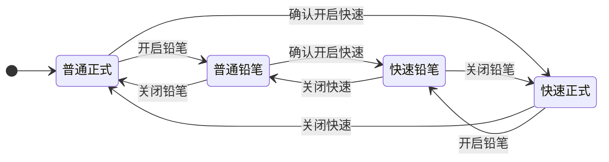
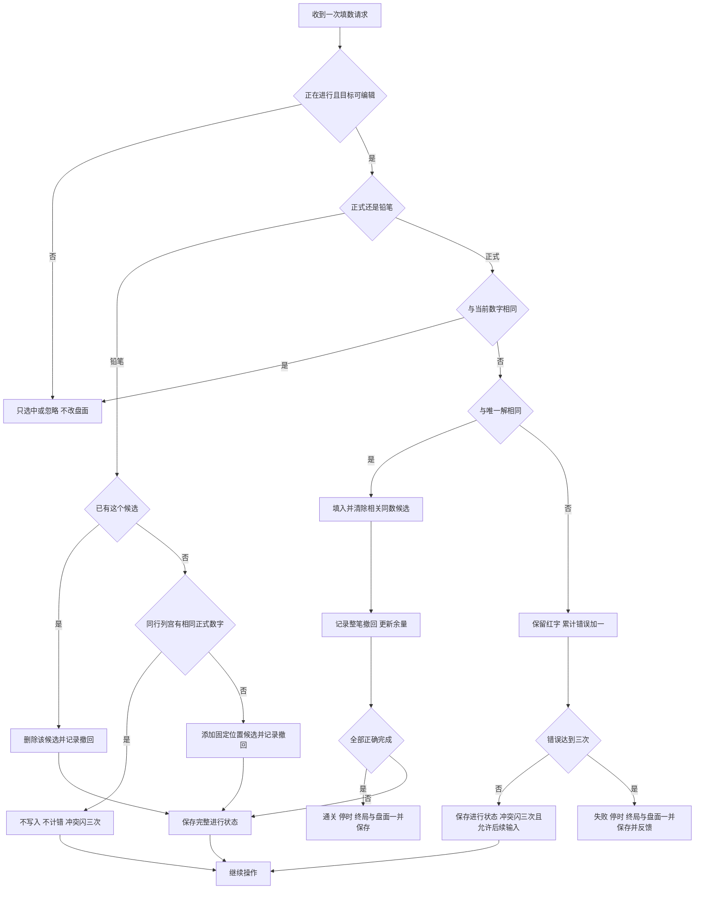
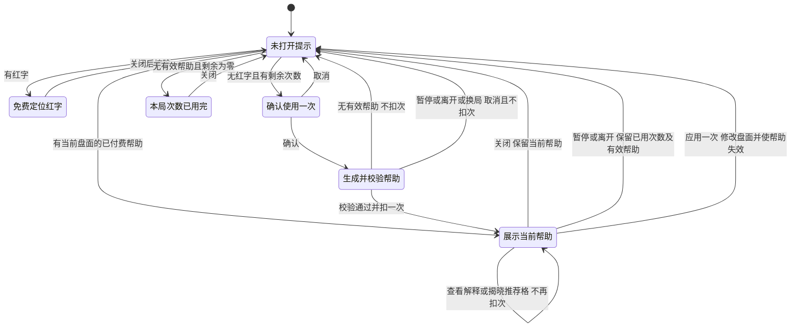
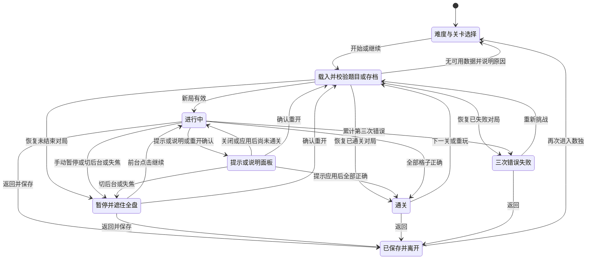

# 基础数独设计与对局状态图

状态：已获用户批准，2026-10-27 按最新计算边界实施。基于用户的 9 张 `sodu1.jpeg` 至 `sodu9.jpeg` 参考图及逐条说明。用户已明确确认：**每局 3 次提示，累计第 3 次正式填数错误后结束本局，不做分数制度。** 普通与快速模式的正式填数都计错，铅笔冲突不计错。本文把已要求的交互补成可执行的完整规则；未指定的边界采用下文明确标注的建议。

## 1. 范围与关卡

仅做标准 9×9 数独，数字 1～9 在每行、每列、每个 3×3 宫各出现一次。每道题有唯一解，不包含对角线、杀手数独等变体。

沿用前一版方案：入门、简单、中等、困难四档，首批建议每档 500 关，共 2,000 关，按难度分别编号。难度可自由选择，各档推荐按关卡顺序推进；已完成关卡可以重玩。不设分数、广告、付费提示或网络依赖。

题库候选为 [Sudoku Exchange Puzzle Bank](https://github.com/grantm/sudoku-exchange-puzzle-bank)，数据使用 [Unlicense](https://github.com/grantm/sudoku-exchange-puzzle-bank/blob/master/LICENSE.txt)。开发阶段筛选并随安装包内置，首次运行不下载。导入时检查格式、题面合法性、唯一解、重复题及难度；使用自己的逻辑解题器重新分档，不能只按空格数量划分。候选技巧为单值、唯一候选、区块排除、数对、数组及基础 X-Wing；只收录提示引擎能正确解释的题。题量固定为四档各 500；题库筛选、答案、唯一性和技巧分档在开发电脑一次完成。客户端不重新求解验证唯一性，仅做数据完整性与结构检查。

大厅增加第四张卡片，保留当前卡片高度和滚动布局，不通过压缩卡片容纳新游戏。局内所有功能离线可用。

## 2. 页面、数字与选中效果

| 位置或元素 | 规则 |
| --- | --- |
| 左上角 | 显示“待填 N 格”和“错误 M/3”。待填包括空格和仍然错误的格子；候选数字不算完成 |
| 中间 | 显示难度和关卡号，不显示分数 |
| 右上角 | 显示本局用时和暂停按钮 |
| 棋盘 | 始终完整显示 9×9，3×3 宫边界加粗；适配手机安全区域，数字区不被手势栏遮挡 |
| 工具栏 | 撤回、橡皮、铅笔、提示；提示显示剩余次数，铅笔开启时显示 ON |
| 快速按钮 | 棋盘右下附近的闪电开关；开启前显示使用说明并确认，关闭直接生效 |
| 底部数字 | 1～9，每个数字下显示尚未正确填完的个数；公式为 9 减题面及正确填写中该数字的数量 |

选中空格时，对所在行、列、宫取并集使用浅色背景，重合位置不反复叠加变深；选中格使用更深背景和清晰边框。点击给定数字或正确填写的数字，全盘高亮相同的正式数字，以及候选区内对应的小数字，候选区不整格涂成“已填”。

配色沿用本 APP：题面数字用深色，玩家正确数字用绿色，错误数字用红色。选中边框、同数背景与红色错误标记分层显示，不能因为选中效果把红字变成正确颜色。提示填入的数字按玩家正确数字显示，不变成题面数字。

候选数字固定排成以下 3×3，不因只剩两个候选而重新居中排布：

```text
1 2 3
4 5 6
7 8 9
```

**建议边界：**数字剩余为 0 时仍可点选查看同数高亮，但不能继续写入；快速输入把该数字最后一个位置填完后，清除当前快捷数字，提示选择下一个数字。

## 3. 两组独立的输入开关

“普通／快速”决定先选格还是先选数字；“正式／铅笔”决定写大数字还是写候选。两组开关可以组合，切换模式不自动填数、不消耗提示、不计错，也不进入撤回历史。

| 模式 | 数字按钮 | 点击空格或仅有候选的格子 | 点击已有正式数字 |
| --- | --- | --- | --- |
| 普通正式 | 向当前可编辑格填入或替换正式数字 | 只选中 | 只选中并高亮；题面只读，玩家数字可编辑 |
| 普通铅笔 | 为当前无正式数字的格子添加或取消一个候选 | 只选中 | 只选中，不覆盖正式数字 |
| 快速正式 | 选择当前快捷数字，不改盘面 | 已选数字则填入，未选数字则只选中并引导先选数字 | 给定／正确数字作为快捷数字来源；错误格只选中，不覆盖、不更换快捷数字 |
| 快速铅笔 | 选择当前快捷数字，不改盘面 | 已选数字则添加或取消该候选，未选数字则只选中 | 同上；不覆盖正式数字 |

点击盘面正确数字选择快捷数字，对应参考图 8 的说明。快速输入每一次有效点击是一笔独立操作，连续点多个格子可以逐步撤回；不把一串点击合成一笔。一个触点的一次点击只能提交一次，拖动经过多个格子不会连续写入。

**用户已确认：**普通模式允许修改玩家填写的正确数字及错误数字；快速模式只写无正式数字的格子，避免连续点击意外覆盖。要修改快速模式中的错误格，可先用橡皮擦除，或关闭快速模式后直接替换。铅笔模式永远不直接覆盖大数字。快速开启说明以及点击已有数字时，用轻提示说明只能填写空格及如何修改已有数字。



新局默认普通正式、无选中格、无快捷数字。续局恢复模式和选择；模式图只在对局允许操作时生效。快速模式选了数字之后持续保留，直到换数字、该数字全部完成或退出快速模式。选中格与当前快捷数字分别存储，不能用一个变量互相覆盖。

## 4. 正确、错误和候选的处理

### 正式输入

正式数字与本题唯一解相同才算正确。正确输入一次性完成：替换目标格内容、清空目标格全部候选、从同行／同列／同宫的其他格子中仅移除相同数字的候选、更新待填和数字余量、刷新同数高亮、检查通关。

错误输入保留在目标格，以红色显示，本局累计错误加 1；目标格原有候选被正式数字替换，但不自动删除其他格的候选。同一行、列或宫内与错误数字相同的正式数字闪红 3 次，重复命中的同一格只闪一组。原本正确的题面／玩家数字在闪动后恢复自己的颜色，不被标为错误。

**即使没有可见的重复数字，只要与唯一解不符，也属于普通填数错误。** 此时目标格仍标红并计错，只是没有其他冲突格可闪。累计第 3 次错误立即结束本局，不能通过擦除、撤回、退出再进入降低错误数。

重复点击目标格内原有的同一个数字，不构成新输入，不新增错误或撤回记录；把红字换成另一个错误数字属于新输入，会再计一次错误。

### 铅笔输入

候选不与最终答案比较。添加候选前，只检查同行／同列／同宫是否已有该正式数字，检查包含红色正式数字；有冲突则不写入，冲突正式数字闪红 3 次，不增加错误、不进入撤回历史。

再次输入已存在的候选是删除该候选，先执行删除，不因为目前有冲突而阻止删除。没有冲突的候选，即使不是该格最终答案也允许记录。候选与正式数字互斥。

例如某格原有候选 `{2, 5, 8}`，在它的同行正确填入 5 后，该格变为 `{2, 8}`；不影响其他候选，也不影响不同行、不列、不宫的格子。擦除刚填的 5 不自动补回其他格的草稿；撤回这次填 5 才能恢复这一整笔操作前的状态。

### 反馈与连续操作

建议每次闪红由 3 个短周期组成，总时长约 0.9 秒，最终在真机调节。前两次错误或铅笔冲突的闪动不锁输入；新操作立即使用最新规则状态，已被修正的冲突不再继续闪动。切换选中格、撤回、暂停或换局时，旧反馈不得覆盖新状态。

第三次错误先冻结游戏操作和计时，再显示失败结果及最后一次冲突反馈。失败结果按钮立即可用，不等待闪动结束；返回、重开、切后台取消旧反馈，新局不会收到旧动画回调。



图中的输入请求由上一节的模式先解析；快速模式点击已有正式数字不会走到写入分支。一次事务先确定盘面、累计计数、胜负和停止时间，再保存完整状态，不保存“错误已达 3 次但仍进行中”或“全部正确但尚未通关”的中间快照。无变化操作不触发写盘。

## 5. 橡皮与撤回

橡皮只作用于选中格：有玩家正式数字则擦除；有候选则一次清空该格全部候选。题面数字和已经空的格子不变，工具不可用时不产生操作。橡皮在快速／铅笔模式下含义不变，不变成“连续擦除模式”。用户已确认允许擦除、替换和撤回玩家正确数字。

撤回恢复最近一笔实际改变盘面的操作，包括正式填数、候选增删、橡皮和提示应用。必须恢复目标格的旧数字、旧候选，以及本笔正确填数自动清掉的所有关联候选；不能只清空当前格。撤回后根据恢复的棋盘重新计算余量和高亮。

错误次数、已经使用的提示次数、用时属于本局累计记录，**撤回不退还**。撤回恢复一个此前的红字时也不重新计错。选择格子、切换模式、无效点击、被拒绝的候选、提示阅读不进入盘面撤回历史。暂停和终局期间禁用撤回，失败后不能靠撤回继续本局。

## 6. 三次提示的完整流程

每局从 3 次开始，提示与错误次数是两个独立计数。重开是新的一局，回到原始题面并重新给予 3 次；继续存档不重置。建议不提供整盘答案按钮，以保持三次提示的明确含义。

每条提示围绕一个尚未正确填写的目标格，讲清解题思路，并提供“填入这一格”。选择了空格时优先尝试解释该格；如果该格暂时没有可解释的直接步骤，明确指出本次推荐的其他格子，不假装每个选中格都能直接推导。

1. 有红字时，先免费定位错误并提示“先擦除红色数字，再查看解题提示”；用户只需擦掉，不必自己知道正确答案。此时不泄露答案，也不消耗次数。
2. 没有红字且还有次数时，先展示“查看一步解题帮助将使用 1 次”的确认框，取消不扣次。
3. 先生成并校验有效帮助，首次展示这条帮助时扣 1 次并保存。定位、解释、应用属于同一条帮助，合计只用 1 次；不能看完答案后通过取消应用退还次数。
4. 解题计算根据题面和已正确填写的数字重建候选，不把玩家没写全的草稿当作完整候选集合。推导中的候选排除只作解释，不单独收费、不自动修改草稿；继续推导到一个确定的可填格，避免连续提示反复收取同一个排除步骤的次数。
5. 用户实在不会推导时，同一条帮助可继续选择“直接揭晓推荐格”，先提示即将显示答案，再揭晓该格的正确数字，不再额外扣次；可一键填入。若无可解释技巧，明确提供该选项，不编造推理过程。一次帮助最多填入一个格子，执行与普通正确填数相同的自动清候选、撤回和通关流程。
6. 盘面未改变时，可以重看当前这条已付费帮助，即使剩余次数为 0 也不重复扣次。任何盘面实际修改后，旧帮助失效；下一条新帮助重新扣次。一次提示应用后同样失效，不可重复应用。次数为 0 且无可重看的帮助时，显示“本局提示已用完”。
7. 生成失败或确认前取消不扣次。确认的重复点击只能扣一次，已揭晓但未应用的帮助和已用次数随存档恢复。生成中发生暂停、离开或换局，取消尚未展示的请求，不扣次；迟到结果不能打开面板或扣次。展示和应用前都检查本局、盘面版本、请求及前台状态仍有效。逻辑提示按需在客户端后台线程计算，初始预算 200 ms；循环内响应取消，超时明确提供直接揭晓，不阻塞主线程。

提示解释面板可展示棋盘定位，面板打开时锁住盘面输入，但仍计时；快速模式说明、重开确认也采用相同规则。只有真正暂停、切后台、离开或结束才停止计时。切后台时关闭操作弹窗并遮住盘面与解释，返回后先进入暂停态；已经消耗的提示仍然保留，可再次免费查看当前有效帮助。



## 7. 对局生命周期状态图

对局主状态只有准备、进行、暂停、通关、失败、离开。输入模式是“进行”状态中的独立子状态；提示／说明是模态层；闪红是表现层。不能把这些全部塞进一个互斥枚举，否则容易出现“提示关了却无法输入”等状态遗漏。



### 暂停与恢复

暂停立刻停止计时，使用完全遮蔽内容的雾层盖住整个盘面，包括题面、玩家数字、候选及提示高亮，不能只是仍可辨认数字的半透明蒙层。禁用盘面、数字、撤回、橡皮、铅笔、提示和快速切换，只提供继续、重开、返回。

切后台、锁屏或失去焦点自动暂停，取消尚未提交的触摸；回到前台仍保持遮蔽，必须点继续才计时和接收输入。已经暂停时再次收到后台事件不能把它恢复。提示、快速说明等弹窗被后台打断后不自动确认。

终局切后台也遮蔽盘面，但恢复时仍然是原通关／失败状态，不进入可操作的进行态。用时只累计前台的进行中及可见棋盘的说明／提示时间，不累计后台、暂停、关卡选择和终局时间。

### 通关与失败

通关要求全部 81 格都等于答案；候选、错误数字或“没有空白格”均不能代替正确性检查。终局先更新模型、冻结输入和计时，记录本局结果，再呈现结果卡。重复回调、返回进入和读档不能重复记录一次通关。

通关显示难度、关卡、用时、错误次数和已用提示次数，提供下一关、重玩、返回关卡；所在难度最后一关显示“返回关卡”，不跳到不存在的关卡。由于允许自由选关，完成第 500 关不代表前 499 关全部完成；实际完成数量按记录显示。关卡列表标记已完成、进行中及是否使用提示，不引入分数评价。

失败显示“已累计 3 次错误”、用时、重新挑战和返回关卡。允许查看失败盘面，但不能继续填写、擦除、撤回或使用提示。重玩／重新挑战回到同题原始给定数字，创建新一局，重置用时、错误、提示、候选、撤回记录和输入模式；进行中或暂停时的重开必须先确认。已获得的历史通关标记保留。

## 8. 状态所有权与存档

| 所有者 | 持有的状态与职责 |
| --- | --- |
| 纯 C# 数独核心 | 题面、唯一解、玩家数字、候选掩码、错误数、提示消耗、撤回事务、胜负；对外只暴露受控操作和快照 |
| 输入与页面 | 选中格、普通／快速、正式／铅笔、快捷数字、同数高亮、说明／提示面板、雾层与闪动；按核心结果绘制 |
| 提示引擎 | 从已验证状态计算逻辑步骤和解释证据；每条帮助绑定本局和盘面版本，应用时重新检查有效性 |
| 对局与存档 | 稳定题目 ID、题库版本、本局 ID、用时、当前对局、关卡完成记录、已付费帮助与应用状态；独立文件 `sudoku-v1.json` |
| 公共 shell | 大厅路由、共用声音触感、生命周期通知及统一保存时机；不承载数独判错和候选规则 |

状态权威来源各只有一份。剩余格、数字余量、红字集合、候选高亮和按钮是否可用由当前状态推导，不能分别保存成相互漂移的多份数据。错误数和提示次数是累计记录，不能从当前红字数或撤回历史长度反推。

建议首版保留一个当前未完成对局；切换其他关卡前告知当前局会被替换。关卡完成记录独立保留。每次有效操作、提示扣次、暂停、离开保存，进行中定期保存已用时间；恢复未结束对局一律先暂停。保存模式、选择及可撤回记录，使续局行为一致，不保存尚未提交的手势、闪动计时和弹窗临时确认。

沿用仓库原子临时写入和备份恢复方式。读档严格检查版本、题目 ID、81 格长度、取值范围、题面不可改、正式数字与候选互斥、错误范围 0～3、提示范围 0～3、终局一致性、撤回记录及帮助对应关系。读入一个用户错误数字是合法对局数据，不能将它误判成损坏存档。主档损坏尝试备份，均不可用时明确告知；写入失败保留内存对局、显示未保存状态，不能宣称已成功保存。

## 9. 后续实现验收清单

以下是实现验收要求，当前文档不代表已经通过这些测试。

| 场景 | 必须得到的结果 |
| --- | --- |
| 普通／快速与正式／铅笔四种组合 | 行为逐项符合模式表；模式切换不产生填数 |
| 给定数字与玩家数字 | 给定不可改；玩家数可选、改、擦、撤回，颜色不同 |
| 普通错误但无重复同行列宫数字 | 红字、计错；不虚构冲突位置 |
| 第 1、2、3 次错误与快速连续点击 | 前两次可继续，第三次立即冻结；后续已排队点击不能写进终局 |
| 第三错之后返回、读档、撤回 | 仍然失败；不能恢复成进行中 |
| 候选不是最终答案但局部无冲突 | 可以添加，不计错 |
| 候选与正式数字冲突 | 拒绝写入，冲突闪三次，不计错，不记录撤回 |
| 候选重复点击 | 删除该候选，其他候选保留 |
| 正确填数自动清候选 | 同行列宫去重，只删相同数字；不影响非关联格 |
| 撤回自动清候选的填数 | 目标格及所有受影响候选完整恢复，累计统计不回退 |
| 橡皮与错误替换 | 清除目标数或整格草稿；不误删其他格；同值重复点击不重复计错 |
| 三次提示与确认重复点击 | 每条只扣一次；取消不扣、重看不扣、应用不再扣、撤回不返还 |
| 提示过期与不完整草稿 | 盘面变化后旧提示不能应用；推理不依赖玩家是否写全草稿，不对相同候选排除重复收费 |
| 提示生成时暂停或换局 | 未展示不扣次，迟到结果不能弹回；已展示的扣次和有效帮助保留 |
| 提示最后一格与重复结果回调 | 正确通关，只记一次结果 |
| 暂停、锁屏、失焦、重启 | 全盘和提示被遮蔽，时间不增加；回来需明确继续，终局不复活 |
| 故障存档和保存失败 | 合法备份可恢复，错误输入可正常读回，写失败不清空旧档或其他游戏 |
| 真机快速点击、连续纠错与闪动 | 无输入丢失、双提交、旧闪动染色、弹窗穿透；失败和新局边界清楚 |
| 大厅与旧游戏回归 | 第四张卡保持固定高度、滚动可达，旧三款游戏存档与行为正常 |

本轮实现完整功能，在独立工作区构建和验证，不改其他工作分支或共享测试设备。
