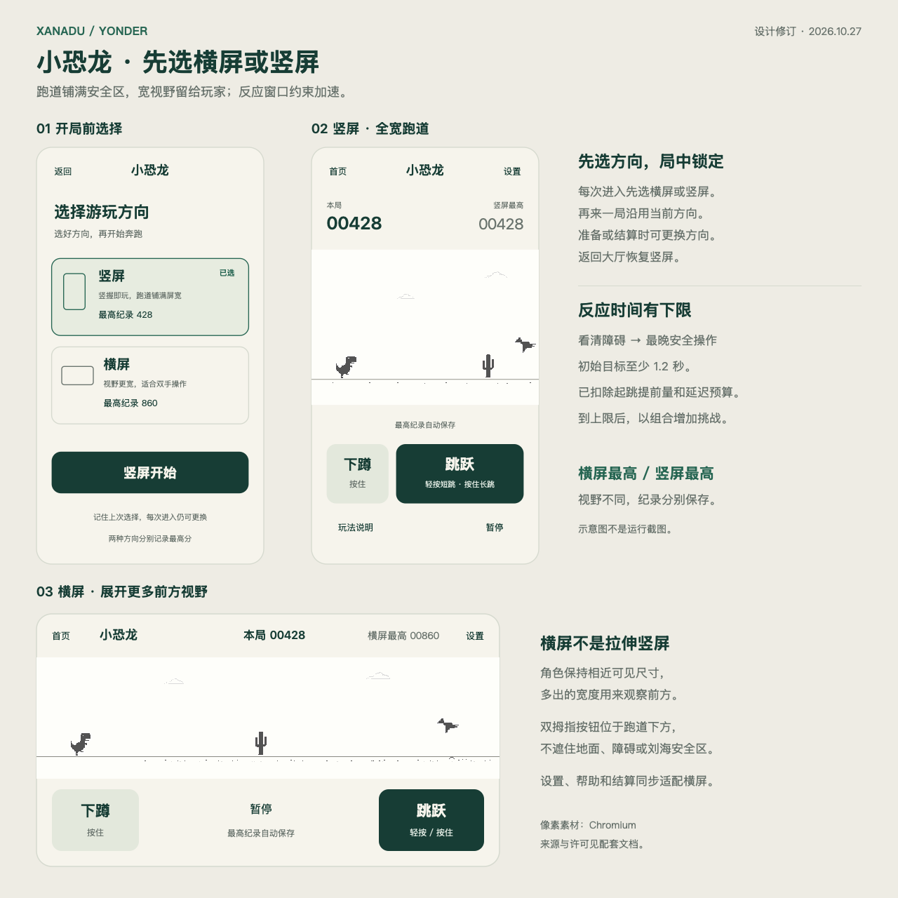

# 小恐龙游戏设计与素材调研

日期：2026-10-27。状态：设计评审稿。已确定经典像素风格，并在开局前提供横屏／竖屏选择；两种方向都采用安全区内全宽跑道。

建议在 XanaduYonder 中新增「小恐龙」：玩家先选择横屏或竖屏，再进入横向卷轴、单局无尽跑酷。保留黑白像素恐龙、仙人掌、翼龙和昼夜交替，用两个大触控按钮解决手机上的跳跃与下蹲。核心目标是好上手、看得清、来得及操作，失败后能立即再来一局。

本文交付玩法、界面、素材、接入边界与验收要求。当前只创建工作树和设计资料，尚未实现游戏；示意图也不是运行截图。

## 1. 首版形态

| 项目 | 首版决定 |
| --- | --- |
| 大厅名称 | 小恐龙；说明「经典像素跑酷 · 挑战最高纪录」 |
| 平台与入口 | Android 离线合集；大厅保持竖屏，小恐龙开局前选择横屏或竖屏 |
| 核心循环 | 选择方向 → 准备／开始 → 自动奔跑 → 跳过仙人掌／躲避翼龙 → 受反应窗口约束地加速 → 碰撞结束 → 再来一局 |
| 玩法模式 | 一个经典无尽模式，不设关卡、体力、道具或复活 |
| 手机操作 | 右侧跳跃，左侧按住下蹲；跑道空白处也可按下跳跃 |
| 成绩 | 本局距离分；横屏、竖屏分别保存最高纪录，暂停不计分 |
| 存档 | 保存两种方向的最高纪录和上次所选方向；同进程切后台可暂停续玩，主动离开或进程重启后开新局 |
| 声音与触感 | 跟随合集共用开关；无背景音乐，短促动作音与失败反馈 |
| 不在首版内 | 联网榜单、每日挑战、皮肤商店、广告、登录、多人与分享服务 |

比较过的三个方向：经典像素版辨识度最高且素材齐全；像素增强版可以丰富背景，但会增加视觉噪声和美术工作；原创恐龙版更自由，但须补全角色动作与环境资源。本稿采用已选定的经典像素版，合集的米白、墨绿只用于外围界面。

Google 官方访谈将原作定位为无尽跑酷，核心动作是跑、跳、蹲，后续加入翼龙和夜间模式。本项目在这一玩法基础上设计原生 Unity 页面与触屏交互。[原作设计访谈](https://blog.google/products-and-platforms/products/chrome/chrome-dino/)

## 2. 界面与视觉

[查看可缩放示意图](assets/chrome-dino/layout-preview.svg)。图中的角色、障碍与云来自本目录的 Chromium 图集；界面排布为本项目设计。

### 开局前选择方向

每次从大厅点击「小恐龙」，先在竖屏展示一页轻量选择页，两张选项卡直接说明差别：

| 选项 | 玩家看到的说明 | 同时展示 |
| --- | --- | --- |
| 竖屏 | 竖握即玩，跑道铺满屏宽 | 竖屏布局缩略图、竖屏最高纪录 |
| 横屏 | 视野更宽，适合双手操作 | 横屏布局缩略图、横屏最高纪录 |

首次预选竖屏，此后预选上次成功进入的方向，但仍展示选择页，不替玩家直接开跑。选项只改变预览；点击「竖屏开始」或「横屏开始」后才请求对应方向并进入准备页。切换选项不修改纪录，也不切换整台手机的系统旋转设置。

完成方向切换、实际安全区及控件布局稳定后，才显示可操作的准备页；这次点击不会穿透成游戏内跳跃。切换失败或设备窗口不能满足所选方向时，保留选择页并提示重试或选择另一方向，不静默按错误方向开始。

「再来一局」沿用本局方向，直接回准备页；准备页和结算页提供「更换方向」，返回选择页。奔跑或暂停中的方向保持锁定；如要更换，先确认结束本局再返回选择页。晃动、横握或竖握手机都不在局中自动改布局。

### 两种方向的全宽布局

| 区域 | 竖屏 | 横屏 |
| --- | --- | --- |
| 导航与分数 | 顶部导航，下一行本局／竖屏最高 | 压缩为顶部一行，显示本局／横屏最高；暂停置于底部按键带中间 |
| 跑道 | 占满实际安全区可用宽度，取消左右卡片留白和内嵌边框 | 占满实际安全区可用宽度，向前展示更多路程 |
| 操作 | 跑道下方左侧下蹲、右侧更大的跳跃按钮 | 左下下蹲、右下跳跃；按键带位于跑道下方，不遮住地面和障碍 |
| 帮助与设置 | 独立工具行或顶栏 | 收纳到暂停菜单和顶栏，弹窗按横屏尺寸排布 |
| 安全区域 | 适配刘海、底部手势区及短屏 | 适配横向刘海、侧边系统手势区及矮屏 |

竖屏布局以 **720 × 1320** 为参考，横屏以 **1320 × 720** 为参考；这两个尺寸用于排版，不把整张竖屏画面压缩或拉伸到横屏。跑道依实际安全区铺满宽度，文字和按钮另保留必要内边距。角色、障碍、碰撞盒统一等比映射，横屏维持与竖屏相近的角色可见尺寸，把多出的宽度用于前方视野。

两种方向的实际触控区域都不小于 48 dp，左右按钮互不重叠；舞台点击仍支持跳跃。按键带不覆盖赛道，新障碍不得藏在按钮或刘海后。分数至少五位，不限制到 99999，也不溢出归零。

竖屏长屏多出的高度用于天空与上下间隔；横屏矮屏优先保证跑道净空和按钮高度。首页与 Android 返回执行同一离开流程；返回合集前恢复竖屏，再开放大厅操作。

大厅增加同规格卡片，保留现有 608 × 350 卡片、374 纵向步长和滚动位置。稳定标识为 `dino`；展示序号在最终集成时随大厅排序分配，避免与其他正在开发的小游戏争用编号。大厅卡片分别显示「竖屏最高／横屏最高」，不合并成一个易误解的排名。

### 视觉与反馈

场外使用现有纸色 `#F6F4EC`、墨绿 `#173D35`；舞台白天使用浅背景和深灰像素，夜晚使用深背景和浅灰像素。图集使用 Point 采样、关闭 mipmap，检查实际设备上的像素边缘与地面接缝。

恐龙保留待机眨眼、两帧跑步、跳跃、两帧下蹲跑步和碰撞姿态。云低速移动；夜晚增加月亮、星星。昼夜只影响显示，不改变障碍、速度和碰撞。

起跳发一次短音；每 100 分发一次里程碑提示；碰撞时立即冻结模型，短音与一次轻触感后显示结算。不开全屏闪白、不持续震动；结算遮罩不遮住本局分数。

### 页面状态

| 状态 | 显示与可操作行为 |
| --- | --- |
| 方向选择 | 竖屏展示横／竖两张选项卡，预选上次方向；确认后才切换方向 |
| 方向切换 | 暂停所有模拟和输入，等待方向与安全区稳定；可取消返回选择页，过期回调不得再次打开游戏 |
| 准备 | 恐龙待机、「按下跳跃开始」；第一次跳跃同时开始计时并起跳 |
| 奔跑 | 计分与舞台运动；允许跳跃、下蹲、暂停 |
| 暂停 | 冻结完整画面；可继续、查看玩法、打开设置、结束本局返回 |
| 恢复倒数 | 显示 3、2、1；模拟、分数和出怪均冻结；倒数可以再次暂停 |
| 结束 | 显示本局、当前方向最高纪录和新纪录标记；「再来一局」保留方向回准备页，「更换方向」回选择页，「返回大厅」恢复竖屏离开 |

## 3. 操作与判定

### 手机与编辑器

| 输入 | 规则 |
| --- | --- |
| 跳跃按钮／舞台按下 | 落地且未下蹲时立即起跳；起跳发生在按下，不等松手 |
| 跳跃松开 | 达到最小跳高后截断上升，形成短跳；持续按住形成完整跳跃，落地后不会自动连跳 |
| 下蹲按住／松开 | 地面上按住保持蹲跑，松开起身；空中按住加快下落，落地后若仍按住则下蹲 |
| 同时操作 | Jump 与 Duck 各自只有一个 owner；跳跃按钮、舞台、空格和 ↑ 共享 Jump 的所有权。首次有效按下取得所有权，其他入口不接管、不排队，只有 owner 的松开／滑出／取消可以释放 |
| 动作优先级 | 真实按住下蹲时不接受起跳；空中下蹲优先于继续升高；跳跃松开不会释放另一个手指的下蹲 |
| 取消、滑出、切后台 | 前台滑出所属按钮或 `Canceled` 释放该输入，不触发新跳；生命周期中断先暂停并保留动作意图，再清理真实输入所有权 |
| 编辑器 | 空格／↑ 跳跃，↓ 下蹲，Esc 暂停或进入离开确认；操作提示只在相应平台显示 |

首版不做双击二段跳，也不缓存空中点击到落地触发。按住与松开的状态必须对应同一手指；导航、设置、弹窗和恢复按钮不会穿透到跑道。

暂停时同时冻结模型与当前动作意图，然后清空真实 pointerId、键盘所有权；生命周期取消不等于玩家主动松手。上升中的长跳恢复后继续原轨迹到顶点，已松手的短跳仍按原轨迹，不额外增加跳跃能量，也不会在落地后连跳。

暂停时若处于蹲跑，恢复后继承蹲姿，直到新的跳跃按下将其解除并起跳，或玩家重新按住再松开下蹲将其解除；继承姿态与“当前手指真实按住下蹲”分开记录，后者仍按动作优先级处理。这样不会在翼龙下方恢复时自动站起。

倒数阶段不接受跳跃；允许重新操作下蹲，用新的动作覆盖继承姿态。恢复按钮本次触摸必须完全释放，才重新开放舞台跳跃。暂停意图只服务于当前动作，落地或新动作接管后清除，不重新注册旧手指。

### 碰撞与公平性

- 采用与像素实体贴合的多矩形碰撞盒，避开透明边缘；下蹲使用对应碰撞盒。UI 的按钮或整张 Sprite 外接矩形不作为碰撞边界。
- 模型以固定 60 Hz 推进。高速位移采用扫掠碰撞或足够的子步，防止薄障碍穿透；渲染帧率不改变同一输入序列的判定。
- 同一步中先施加输入，再推进运动，再碰撞，再计分；碰撞后不再发出里程碑或重复结算事件。
- 障碍从视野右侧进入，禁止突然出现在角色近处。生成器检查当前速度、实际障碍宽度、跳跃落地时间与最小操作间隔，拒绝无解组合。
- 通过固定种子和自动操作轨迹验证组合可通过；“理论可通过”不替代真机手感测试。

## 4. 节奏与分数

以下是本项目的**初始调参方案**，不是宣称复刻 Chromium 的全部参数。所有数值归 `DinoRules` 统一管理，真机试玩后可整体校准。

| 阶段 | 内容与节奏 |
| --- | --- |
| 开始后 0–3 秒 | 无危险障碍，供玩家理解起跳与落地；正常计分 |
| 3–20 秒 | 单株小仙人掌，大间距；速度平缓上升 |
| 20–45 秒 | 加入大、小仙人掌组合，最多三株，仍保证完整落地与下一次操作窗口 |
| 45 秒以后 | 加入翼龙；首版采用低空和中空两档，低空需跳过，中空可下蹲通过；首次出现前给一次非阻断提示 |
| 90 秒以后 | 已达到本局安全速度上限；主要通过障碍组合和跳蹲切换增加挑战，不继续挤压反应窗口 |

### 用可操作时间限制速度

反应窗口定义为：**障碍完整露出且可以辨认，到玩家最晚仍能安全发出跳跃或下蹲指令之间的时间**。它不是“出现到碰撞”的时间；必须扣除跳跃升高所需的提前量，并覆盖翼龙相对速度、组合障碍和输入／显示延迟。

首版设计约束取 **至少 1.2 秒的有效反应窗口**，作为待真机校准的初始目标。由实际模型求最晚安全操作点，再预留 100 ms 的输入／显示预算；扣除该预算后仍应达到 1.2 秒。对需要多步操作的组合，分别检查下一动作窗口，不能只证明有一条极限可解轨迹。

竖屏逻辑视野以宽 600 单位为起点；角色位于左侧约 10%–15%，源图等比放大约 1.35 倍。横屏保持相近的角色屏幕尺寸，按实际安全区宽度展开更多逻辑路程，不强制压回同一个 600 单位视野。

名义速度先取 180 单位/秒，在 90 秒内平缓增加至 360；实际曲线为名义速度与本局安全速度上限的较小值。开局时根据所选方向、视野及本局允许的全部障碍类别推导安全上限，确保加速后的最坏组合仍满足反应约束；不在危险障碍逼近时临时刹车。若初速也不满足，先降速或调整布局，不缩小到看不清的角色尺寸。

障碍之间另保证落地或完成下蹲后至少 **0.25 秒**的下一动作准备时间，且不能抵消前面的 1.2 秒提前识别约束。生成器应拒绝不合格组合，而不是让玩家承担布局和随机生成造成的额外难度。

横屏更宽的视野是玩家选择它的实际收益，不额外用更激进的专属加速抵消这项收益。由于视野、实际速度上限与操作姿势不同，两种方向的最高纪录分开保存；两者共享距离计分公式和障碍规则，不宣称成绩严格等价。

距离分取累计逻辑行程除以 30 后向下取整，名义初速约每秒 6 分，若安全约束降低初速则按实际行程计分。暂停、旋转切换与恢复倒数不累计；分数使用非负 64 位整数并饱和保护。每 100 分提示一次；每 700 分切换一次昼夜，过渡约 0.8 秒，保持角色与障碍的对比度。

**翼龙差异要明确：** Chromium 的移动端配置只有两档高度，桌面配置三档。本项目由于提供显式下蹲按钮，自行设定“低空跳过／中空蹲过”两档，并以本项目碰撞测试验收，不宣称与 Chrome 手机版本逐帧一致。[原版障碍配置](https://chromium.googlesource.com/chromium/src/+/64574fa0f2daa1b48f2703a072687272000178ce/components/neterror/resources/dino_game/offline_sprite_definitions.ts)

## 5. 网上素材与选用方案

首版推荐使用已核验的 Chromium 官方精灵图。固定源版本为 `64574fa0f2daa1b48f2703a072687272000178ce`，取材日期为 2026-10-27。原始文件及校验记录已保存在本文配套目录，仅作设计资料，尚未进入 `Assets/Resources`。

| 素材 | 核验结果 | 用途 |
| --- | --- | --- |
| [1× 原始图集](assets/chrome-dino/100-offline-sprite.png) | 1233 × 100，3002 字节 | 观察像素与切片参考 |
| [2× 原始图集](assets/chrome-dino/200-offline-sprite.png) | 2446 × 194，4758 字节 | 推荐开发时作为运行时源图 |
| 恐龙 | 站立 44 × 47 逻辑像素；含待机、跑、跳、撞击、蹲跑 | 主角与大厅预览 |
| 仙人掌与翼龙 | 小仙人掌 17 × 35；大仙人掌 25 × 50；翼龙 46 × 40、两帧 | 危险障碍 |
| 云、地面、月亮、星星 | 同一图集齐全；夜晚不需要额外整套角色图 | 背景与昼夜 |
| [起跳音](assets/chrome-dino/button-press.mp3)、[碰撞音](assets/chrome-dino/hit.mp3)、[得分音](assets/chrome-dino/score-reached.mp3) | 已获取；源名为 `.mp3`，实际容器为 Ogg/Vorbis、44.1 kHz 双声道；未试听 | 开发时按真实格式导入、试听并校验音量 |
| 中文文字与菜单控件 | 复用项目已有 Noto Sans CJK SC 与 UI 图标 | 标题、说明、暂停、结算 |

原版动画参数：跑步 12 fps、蹲跑 8 fps、翼龙 6 fps。1× 和 2× 的整图排布不完全同比，不能把所有裁切坐标简单乘二；应使用各自的 `ldpi` / `hdpi` 定义。尤其蹲跑的可见高度与源矩形高度不同。[精灵定义](https://chromium.googlesource.com/chromium/src/+/64574fa0f2daa1b48f2703a072687272000178ce/components/neterror/resources/dino_game/offline_sprite_definitions.ts) · [恐龙动画定义](https://chromium.googlesource.com/chromium/src/+/64574fa0f2daa1b48f2703a072687272000178ce/components/neterror/resources/dino_game/trex.ts)

完整获取地址、固定提交、尺寸、字节数、SHA-256 见 [source-manifest.json](assets/chrome-dino/source-manifest.json)。Gitiles 的 `?format=TEXT` 返回 Base64，配套文件是解码后的原始内容。

音效参考文件保留上游原名与字节；Unity 导入时应使用对应 `.ogg` 扩展名并验证解码，若需转码则另记输出参数和哈希，不覆盖原始来源记录。

### 许可保留

图集及音效采用 Chromium 仓库根目录的 BSD-style 三条款许可作为来源依据，相关资源目录未见另附许可证。配套目录已原样保留 [LICENSE.chromium](assets/chrome-dino/LICENSE.chromium)，并在仓库第三方说明中标注这批文档参考素材。

实际打包时也要随应用保留版权声明、许可条件及免责声明，提供可访问的第三方许可入口；不得将 Google 或贡献者名称用作产品背书。大厅使用「小恐龙」，不使用 Chrome Logo 或「Google 官方」宣传语。项目的 MIT 许可不替代素材自身许可。[Chromium 原始许可](https://chromium.googlesource.com/chromium/src/+/64574fa0f2daa1b48f2703a072687272000178ce/LICENSE)

### 可替代素材

| 来源 | 已确认的作者页信息 | 适用边界 |
| --- | --- | --- |
| [Voidcord Pixel Dino](https://voidcordtech.itch.io/dino-spritesheet-animation) | 128 × 128，Idle / Run / Die，标注 CC0 | 原创风格备选；缺少已确认的 Jump / Duck 动作，不作为完整替代 |
| [Kenney 1-Bit Platformer](https://kenney.nl/assets/1-bit-platformer-pack) | 16 × 16，400 个文件，CC0 | 后续黑白环境主题；未逐文件核对恐龙和仙人掌 |
| [Kenney Digital Audio](https://kenney.nl/assets/digital-audio) | 60 个音效，CC0 | 复古提示音备选，未下载或试听 |

这三组不混入首版，以保持角色与场景统一；作者网页信息不等于已经完成包内逐文件核验。

## 6. 暂停、离开与记录

**首版跨进程保存两种方向的最高纪录与上次成功进入的方向。** 跑酷局面中的角色速度、障碍位置和随机生成状态不写盘。这样重启后明确开始新局；同一进程内切后台则保留完整内存局面和本局方向。

| 场景 | 行为 |
| --- | --- |
| 暂停／打开帮助或设置 | 立即冻结，清理输入和音效；关闭弹窗后仍停在暂停态 |
| 锁屏、失焦、应用后台 | 立即暂停并保存纪录；回前台显示继续按钮，不自动开始 |
| 点击继续 | 先显示 3 秒倒数，再恢复模拟；后台时间不补算 |
| 局中转动手机 | 保持本局横／竖方向和布局，不以陀螺仪姿态触发模式切换 |
| 窗口／安全区发生变化 | 先暂停并重排；重新校验视野与已有障碍的安全操作窗口，不满足时提示恢复原窗口或结束重开，不直接续跑 |
| 更换方向 | 准备／结算页直接回选择页；有未结束对局时先确认结束，再保存纪录并回到竖屏选择页 |
| 首页按钮／Android 返回 | 运行或暂停中的局面显示「结束本局并返回？最高纪录会保留」；可继续游戏或结束返回 |
| 碰撞后返回 | 已结算，恢复竖屏后返回大厅 |
| 进程被杀或应用重启 | 应用以竖屏大厅启动；进入小恐龙仍先显示方向选择页，预选上次方向，不提示“继续上次对局” |

窗口变化后的校验保留已有障碍首次完整可见的模拟时刻及已执行动作，不把恢复时刻当作重新识别的起点，也不凭空再要求临近障碍多给 1.2 秒；检查的是重排是否遮挡原本可见的危险、改变既定轨迹或破坏后续操作可行性。后续新障碍按更新后的视野重新满足完整窗口约束。

独立文件为 `dino-v1.json`，字段包括 `schemaVersion: 1`、`gameId: "dino"`、十进制字符串 `bestPortraitScore` 和 `bestLandscapeScore`，以及只允许 `"portrait"`／`"landscape"` 的 `preferredOrientation`。当前尚未发布小恐龙存档，因此直接按此首版协议实现，无需迁移先前草案里的单纪录字段。

缺字段、显式 null、错误 token 类型、负值、溢出、非法方向、重复键或未知版本均拒绝；主档损坏读合法备份，均不可用则以两个纪录均为 0、偏好为竖屏初始化并提示。方向偏好仅在成功进入准备页后提交，取消或旋转失败不覆盖上次偏好。沿用临时文件、flush、原子替换和合法备份策略，不改其他游戏的 JSON 协议。

产生新纪录时最多每秒写一次，碰撞、暂停、离开与退出时立即补写。正常退出保留当前纪录；未收到生命周期回调的强杀最多可能丢失约一秒的新纪录，历史已落盘纪录仍保留。写入失败继续允许游玩，清晰提示「最高纪录暂未保存」，后续成功后消除提示。

接入时同步修订大厅与 README 的概括文案，避免继续笼统承诺所有游戏“进度自动保存”；小恐龙显示「最高纪录自动保存，本局退出后重新开始」。

## 7. 与现有工程的接入

实际基线为 `master` / `origin/master` 的 `ca50db0f381b96c7a024586792bdc60eb3f0fd3c`，Unity **6000.3.27f1**。现有项目通过 `AppController` 直接持有各游戏页面，没有统一的 `IGameModule` 注册接口。

| 层级 | 拟新增职责与文件 |
| --- | --- |
| `Assets/Scripts/Core/Dino/` | `DinoGame.cs` 拥有运动、障碍、碰撞、分数及终局；`DinoState.cs` 提供只读快照与事件；`DinoRules.cs` 保存参数与规则。均不引用 Unity |
| `Assets/Scripts/Runtime/Dino/` | `DinoPage.cs` 负责状态、时钟和 shell 回调；`DinoOrientationPage.cs` 展示开局选择；`DinoViewport.cs` 负责安全区、横竖排版并报告布局稳定；`DinoTrackView.cs` 渲染图集、地面与昼夜；`DinoInput.cs` 管理触摸／键盘所有权 |
| 同目录存储与反馈 | `DinoSaveData.cs`、`DinoSaveCodec.cs`、`DinoSaveStore.cs` 保存纪录；`DinoAudio.cs` 独立拥有音源、读取公共开关并释放资源 |
| `Assets/Resources/Dino/` | 经导入核验的图集、音效与许可清单；本文参考资料不会自动进入运行时 |
| `AppController.cs` | Dino 页面枚举、选择页与游戏页路由、懒创建、两项纪录刷新、离开、保存、错误提示及系统返回接入；独占应用方向的请求与恢复，离开恢复竖屏 |
| `Tests/Dino/` 与 `Tests/DinoPersistence/` | 编译生产 Core／存档源码，验证规则、输入、时序与真实临时文件行为 |

运行关系为：输入适配 → 固定时间步 Core → 状态与事件 → 视图／反馈；Core 是对局唯一真相。无需引入 Unity Physics2D、WebView 或运行时联网。

公共 shell 只管理导航、公共设置与应用生命周期，小恐龙的跳跃、出怪、难度和结算留在 Dino 模块。不为本次接入重构整个合集；所有现有 `Enter*` 和 `ShowLobby` 路径都要纳入 `dinoPage?.Leave()`，防止后台继续跑或残留声音。

**横屏不能只修改屏幕方向。** 当前 `SafeDesignFrame`、`UiFactory.Band` 与公共弹窗都按 720 × 1320 排版，直接旋转会得到横屏中央的窄竖屏。Dino 游戏页使用独立安全区根节点，选择页可复用原竖屏框架；公共设置、确认弹窗增加显式的布局上下文，默认仍采用现有竖屏布局。Dino 的横屏设置／帮助／暂停／结算均在横屏可用矩形内排布，不添加按具体游戏类型分支判断的通用基类。

进入横屏前记录当前应用方向策略；本项目其他页面保持竖屏，离开、取消进入或销毁时成对恢复。方向切换用会话标识拒绝过期完成回调；切换中清空输入、冻结模拟与成绩。实际方向和安全区连续稳定两帧后开放准备页；三秒仍未就绪则回选择页并显示可重试错误，不永久停在遮罩。横屏可在入场阶段依据握持方向选择左／右横向，准备页就绪后锁定；返回前台恢复本局方向，再允许继续。

源码核对入口：

- [UiFactory 与安全区](../../../Assets/Scripts/Runtime/UiFactory.cs)：设计尺寸、颜色、`SafeDesignFrame`、`Band`。
- [AppController](../../../Assets/Scripts/Runtime/AppController.cs)：大厅、`Page` 枚举、`EnterWatermelon` 懒创建、`Save`、`StopAnimation`、Android 返回与应用生命周期。
- [JumpPage](../../../Assets/Scripts/Runtime/Jump/JumpPage.cs)：注入输入门禁、手指取消处理。
- [WatermelonPage](../../../Assets/Scripts/Runtime/Watermelon/WatermelonPage.cs)：固定步长、独立页面与音源生命周期。
- [架构与存档契约](../../architecture.md)：纯 C# 所有权、真实 JSON 校验、原子文件写入。

## 8. 开发顺序与验收

这是设计范围内的阶段划分，不是已执行的实现记录。

| 阶段 | 可评审结果 | 必须通过的检查 |
| --- | --- | --- |
| 1. 规则与手感 | 可在编辑器重复跑固定种子局，调通短跳、长跳、下蹲、碰撞 | 多帧率同轨迹、边界碰撞、最大速度无穿透、障碍组合存在有效解 |
| 2. 手机界面 | 方向选择、全宽横／竖布局、双按钮、昼夜、音效、暂停和重开 | 横竖与左右横握、安全区、输入取消、弹窗不穿透、连续重开与切换无残留输入 |
| 3. 合集与存储 | 大厅入口、两项最高纪录、方向偏好、公共设置、返回与后台流程 | 存档坏档／备份／写失败、方向失败不提交偏好、强杀语义、回大厅恢复竖屏且其他六款不受影响 |
| 4. Android 验收 | 可安装的独立测试包与真机记录 | ARM64 构建、真机操作／音频／生命周期／性能、第三方许可可见 |

验收重点：

1. 同种子、同固定步输入在 30／60／120 Hz 渲染驱动下给出同样分数与碰撞；卡顿超过 100 ms 自动暂停，不突然追赶并撞死。
2. 短跳与长跳有可见区别；长按不连跳，空中点击不在落地后意外起跳。地面下蹲、空中快速落地、双入口交叠按压以及空格与 ↑ 同时输入各有测试；非 owner 松开不截断 owner 的长跳。
3. 横屏和竖屏分别验证最坏视野、最高实际速度、翼龙相对速度与组合障碍；扣除动作提前量及延迟预算后有效反应窗口至少 1.2 秒，下一动作准备窗口至少 0.25 秒。两方向分别进行真人试玩，不用同一个设备方向的结果替代另一种。
4. 返回、设置、锁屏、通知遮挡后都先暂停；继续倒数期间无位移、无得分，恢复按钮不带出额外跳跃。上升中长跳、已松手的短跳、下降中、翼龙下方蹲跑的暂停恢复都不因清理旧指针改变既定动作；分别检查继承蹲姿的两种解除方式。
5. 失败只结算一次，里程碑只响一次；关闭声音后无残余播放，关闭触感后碰撞不振动。
6. 至少覆盖一台实际 Android ARM64 设备的竖屏、左右横握，以及短屏、长屏布局；检查刘海与侧边手势区、横屏弹窗、开局选择、方向锁定、旋转取消／失败、后台返回、回大厅恢复竖屏。记录型号、系统、刷新率和方向，观察连续 10 分钟运行、页面往返后的内存及帧耗时。
7. 整局目标为流畅 60 fps；用设备 Profiler 验证游戏循环不产生持续的逐帧 GC。未完成这些检查时不声称“已达到原版手感”或“真机验收通过”。

## 9. 本次交付记录

- 新工作树：`/Users/bytedance/.codex/worktrees/chrome-dino/XanaduYonder`。
- 新分支：`p/duanyao.0516/feature/chrome-dino`，从已与远端核对的 `master ca50db0` 创建。
- 资料：本文、界面示意图、官方两档图集、三个音效、完整 Chromium 许可及来源校验清单。
- 设计修订：加入开局横竖屏选择、全宽跑道、分别计纪录和方向恢复；以“最晚安全操作”定义反应窗口，替代初稿按碰撞时刻衡量的标准。
- 工作树基础检查：既有 `scripts/test-core.sh` 为 43/43 通过，`scripts/test-input.sh` 为 10/10 通过。这是原有基线的抽样检查，不代表小恐龙测试或全部游戏回归。
- 当前验证到设计、素材来源与基础工作树状态；未运行 Unity 编译、APK 构建或真机测试。
