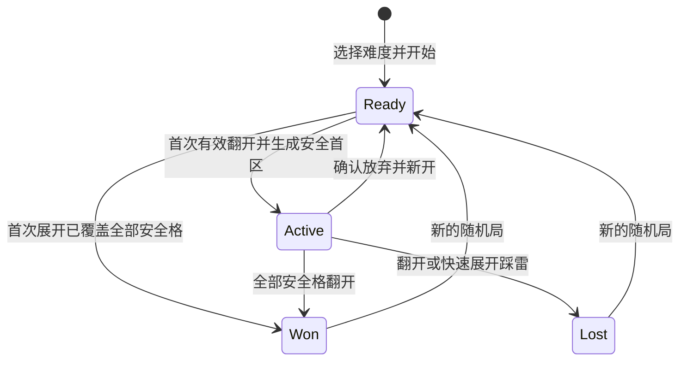

# 扫雷：完整玩法与接入设计

日期：2026-10-27。状态：已确认「经典规则 + Xanadu 简洁界面」方向，本文为实现前审阅稿；功能与后文验收项尚未实现或通过验证。

开发基线：`master` / `origin/master` 同为 `ca50db0f381b96c7a024586792bdc60eb3f0fd3c`。独立工作树：`/Users/bytedance/.codex/worktrees/minesweeper/XanaduYonder`；分支：`p/duanyao.0516/feature/minesweeper`。本方案基于该版本的六款游戏和 Unity 6000.3.27f1，不使用其他工作分支中的未合入功能。

## 1. 产品目标与方案选择

扫雷是一款可随时开始、暂停和继续的离线逻辑小游戏。玩家根据数字判断周围雷的位置，翻开全部安全格获胜。稳定标识为 `minesweeper`，大厅显示名「扫雷」，入口文案「数字之间，步步为营。」。

| 方案 | 取舍 | 决定 |
| --- | --- | --- |
| 经典规则 + Xanadu 简洁界面 | 规则熟悉，沿用纸色、深绿、中文字体与导航；为手机处理大棋盘和手势 | 用户已选定 |
| 复古灰色立体格 | 怀旧辨识强，需要单独视觉规范，手机仍需重新设计操作 | 本期不采用 |
| 休闲提示与悔棋模式 | 更易入门，但改变失败代价、纪录口径与存档状态 | 后续可独立讨论 |

首版包含三档随机棋盘、首击安全区、插旗、空区展开、数字快速展开、两种点击模式、大棋盘平移与分档放大、完整玩法说明、暂停续局、每档独立存档与最佳用时、胜负反馈。

不包含问号标记、自定义棋盘、提示、撤销、复活、原盘重试、每日挑战、无猜生成器、排行榜、登录、广告或联网服务。不为了扫雷重构全应用路由或存档框架。首版仍是单人竖屏 Android 游戏，编辑器支持鼠标验证。

## 2. 难度、目标与数字

| 难度 ID / 名称 | 宽 × 高 | 雷数 | 安全格 | 雷密度 |
| --- | --- | --- | --- | --- |
| `beginner` / 初级 | 9 × 9 | 10 | 71 | 12.35% |
| `intermediate` / 中级 | 16 × 16 | 40 | 216 | 15.63% |
| `expert` / 高级 | 30 × 16 | 99 | 381 | 20.63% |

宽表示列数，高表示行数，高级保持 30 列 × 16 行，不为竖屏改变规则棋盘。三档规格参考 [KDE KMines 官方难度手册](https://docs.kde.org/trunk_kf6/en/kmines/kmines/command.html)。

数字 1～8 表示该格四周八个方向中的地雷总数；边缘与角落只数棋盘内的邻格。数字不随玩家插旗变化。没有邻雷的已开格显示为空白。棋盘左上角为 `(0,0)`，内部索引 `row * width + column`，禁止左右边界串行相邻。

胜利条件只有「全部非雷格均已翻开」。插齐旗、剩余旗计数为 0、未开格数量看起来接近雷数，都不能单独触发胜利。踩中一个雷立即失败；旗只是玩家判断，不替玩家验证正误。这些规则及快速展开依据 [KMines 官方玩法](https://apps.kde.org/kmines/)。

### 首次翻开与随机布雷

1. 新局先创建全覆盖棋盘，尚不放雷；选择难度、移动视口和插旗均不触发布雷或计时。
2. 第一次有效翻开无旗覆盖格时，排除该格及其实际存在的八邻格，在其余格子中随机选择指定数量的雷。首格必为 0，并立即展开一片安全区域。
3. 通过对候选格进行无偏部分洗牌取得不重复的雷位。先插的旗不影响雷位选择；安全区内的错旗保留且阻止展开，必须自行拔掉。
4. 开始计时、生成雷区、翻开首区、判定结果构成一次模型操作。无效点击、点击旗、取消手势不消耗随机数。
5. 布雷后完整保存雷位与首击位置；读档使用原雷位，不重新抽样。新局重新随机，允许极小概率重复，不通过拒绝某些棋盘暗改分布。

「首格及周围一圈安全」是本项目的体验选择，不是对所有扫雷实现的描述。随机局可能出现必须猜测的情况，产品明确写「首击安全，不保证全盘无猜」。[Simon Tatham 的 Mines 说明](https://www.chiark.greenend.org.uk/~sgtatham/puzzles/java/mines.html)分别描述了首击安全和其版本的无猜保证，本项目只采用前者的安全思路，不采用其生成器或代码。

## 3. 格子状态与规则操作

每格玩家状态为「覆盖」「插旗」「已开」之一；地雷属性独立于玩家状态。失败后的地雷、错旗标识，以及胜利后的装饰旗均为终局表现，不反写成普通玩家操作。

| 操作 | 前提 | 结果 |
| --- | --- | --- |
| 翻开覆盖格 | 未暂停，准备或进行中，格上无旗 | 首击先布雷；数字显示数字；零格执行连通展开；雷则失败 |
| 翻开有旗格 | 翻开模式 | 无变化，并提示「先移除旗帜」 |
| 插旗 / 拔旗 | 覆盖格或有旗格 | 两态切换；不检查是否真雷，不翻开，不自动推理 |
| 操作已开零格 | 任意点击模式 | 无变化 |
| 快速展开数字 | 翻开模式点击已开 1～8，邻旗数等于数字 | 一次尝试翻开其全部无旗覆盖邻格，再展开其中的零格 |
| 邻旗数不等于数字 | 点击已开数字 | 仅短暂标示该数字邻域，提示「周围旗数还不匹配」；不翻开 |
| 终局后格子操作 | 胜利或失败 | 只允许查看与平移，不改变盘面 |

插旗总数不限制为雷数，状态栏显示「剩余标记 = 总雷数 − 已插旗数」，允许负数；这不是系统已验证的剩余地雷数。负数显示警示色，并解释「标记数超过总雷数」。不使用「已找出地雷」等误导文案。

零格展开使用队列遍历：揭开相连的所有无旗零格及其外围无旗数字格，遇旗停止该格的处理；不揭雷、不穿过边界、不重复访问。每次操作只提交一份完整结果和一组变化格，避免将动画逐格回调当作规则执行。

快速展开只检查旗的数量，不检查旗是否插对。若目标邻格中存在雷，整个操作直接判负，选择索引最小的未插旗目标雷作为引爆标识；不先提交可能触发胜利的安全格变化。若均安全，则完整展开后统一判胜。重复点击、终局同帧排队点击都不得继续改盘。

## 4. 手机与鼠标操作

底部常驻「翻开 / 插旗」双段开关，有图形和文字，当前段明确高亮。新局默认翻开模式，续局恢复上次模式；不把模式存在其他游戏的公共设置中。

| 目标与手势 | 翻开模式 | 插旗模式 |
| --- | --- | --- |
| 短按无旗覆盖格 | 翻开 | 插旗 |
| 短按有旗格 | 不翻开，提示先拔旗 | 拔旗 |
| 短按已开数字 | 尝试快速展开 | 仅显示邻域，不快速展开 |
| 长按覆盖格 / 旗格并松手 | 插旗 / 拔旗 | 插旗 / 拔旗 |
| 拖动棋盘 | 平移视口 | 平移视口 |

长按阈值固定 400 ms。达到阈值只显示待插旗/拔旗预览，正常松手才提交；说明文案为「长按后松手标记」。阈值前正常松手为短按；同一手势只产生一次规则操作。手指离开原格、超过移动阈值、离开视口或被系统取消，都不能提交长按或短按。

一次手势从按下记录原始 pointerId、原格、位置、模式及局 ID。移动超过 12 个设计单位后转入平移，清除点击/长按资格；之后即使拖回原点也不得翻格。细小移动但进入其他格同样取消格子操作。手势期间不接受第二个指针；检测到多指则取消当前操作，所有手指抬起后才能重新开始。

点击其他控件、切换模式、调整缩放、打开弹窗、换局、暂停、失焦、离开页面和组件禁用都取消待提交手势。正常松手还必须确认原触点不是 `TouchPhase.Canceled`，触点丢失同样按取消处理。棋盘由一个输入组件仲裁，不能让每格 Button 与 ScrollRect 分别提交点击和拖动。

编辑器鼠标左键遵循当前点击模式，也支持长按；右键松开直接插旗/拔旗，不改变全局模式；左键点已开数字执行与手机相同的条件展开。拖动仍按同一阈值判定。不要求双击、左右键合击或滚轮作为唯一可用操作。

## 5. 大棋盘与屏幕布局

沿用现有 720 × 1320 设计坐标、`SafeDesignFrame` 和 `UiFactory.Band`。页面从上到下为：

```text
返回  重开          XANADU / YONDER        玩法  设置
扫雷                              数字之间，步步为营。
剩余标记 10          初级 9×9          00:00  暂停
┌─────────────────────────────────────────────────┐
│                                                 │
│           可裁剪、可平移的扫雷棋盘                │
│                                                 │
└─────────────────────────────────────────────────┘
[ 翻开 | 插旗 ]                         [−] 100% [+]
点击翻开 · 长按后松手标记 · 拖动查看
当前存档状态 / 错误提示
```

这是结构示意，不是已完成的画面。参考布局：导航 y=0..92；标题 y=108..178；状态 y=194..268；棋盘视口 y=286..1046、宽 648；工具 y=1068..1140；提示 y=1156..1200；底部状态复用宿主区域。长屏把额外空间优先分给视口；短屏保持工具不重叠，通过棋盘滚动承接空间不足。

每格初始边长 72 设计单位，三档放大为 72 / 90 / 108（100% / 125% / 150%）。初级基准下九列正好占 648；中级和高级不压缩成微小格子，均可横纵拖动。视口使用矩形裁剪、边界夹紧、无惯性，边缘细条提示尚有内容；没有可滚动空间的轴居中显示。初始视口在左上角，缩放保持视口中心对应的棋盘点，再夹紧边界。

手机可见单格边长目标至少 32 dp；如安全区和等比缩放导致不足，在扫雷视口内提高基础格尺寸并允许初级滚动，不修改全应用缩放策略。该尺寸必须用设备实际密度和截图验证，不能把 72 设计单位直接当成 72 dp。主要模式、暂停、缩放按钮目标点击区域至少 44 dp；小屏可扩大透明命中区域，但相邻区域不得重叠。

不提供双指缩放或可点击的全盘缩略图，以保持多指取消和点击语义一致。视口保存缩放档及两个 0..1 的归一化滚动位置；恢复后按当前安全区重新计算并夹紧。平移或放大期间仍计时；暂停时整块棋盘被不透明层遮住，不能平移查看。

## 6. 大厅、难度选择和完整流程

大厅追加「07 / 经典扫雷」，原六款顺序不变，沿用卡高 350、间距 24 和纵向列表。卡片展示原创小棋盘预览、三档难度、本地累计胜局；未玩过显示「首击安全 · 三档挑战」。按钮「选择难度 / 继续」进入扫雷选择页，不在启动应用时自动创建一局。

选择页列出三档的尺寸、雷数、胜局、败局和最佳时间。没有最佳时间显示「—」。每档最多保留一个最新对局，三档互不覆盖：

- 没有存档或只有已结束对局：主按钮「开始新局」；已结束对局另有「查看上局」。
- 存在准备局或进行局：主按钮「继续」，另有「新开一局」。
- 切换选择的难度只改选择，不生成、不放弃、不清空其他难度。
- 新开同档会替换该档上局。替换进行局或有旗的准备局先确认「放弃当前局，开始新的随机棋盘？」；取消保留原局。完全未操作的准备局及终局直接新建。

新局是新的局 ID、空白覆盖棋盘、零用时、零旗、默认翻开模式与初始视口；从首次有效翻开开始计时。顶部重开与结果页「再来一局」都生成新的随机局，不回放旧雷区。退出或主动重开不记败局；首版不展示胜率，避免把未结束的放弃局计入口径不明的分母。

游戏返回到扫雷难度页，保存并暂停当前局；难度页返回大厅。Android 返回优先关闭弹窗，其次按同一页面层次返回。`Active` 局从难度页继续或冷启动恢复时，先显示遮盘的「继续游戏」，明确点击后才开始计时；`Ready` 局回到准备盘面，用时仍为 0；`Won/Lost` 只进入终局查看，不显示继续按钮。

首次进入扫雷选择页显示简短操作引导，可跳过，不消耗对局；每页右上书本按钮随时查看完整规则。示例使用单独静态示意盘，不创建可计入纪录的教程局。

## 7. 生命周期、弹窗和计时

规则模型状态只有 `Ready`、`Active`、`Won`、`Lost`。暂停、前后台、所在页面和弹窗归 Session/页面管理，不把 `Paused` 当成丢失原胜负信息的规则状态。



Session 的可操作条件为：本页可见、应用前台、未暂停、无阻断弹窗、局状态允许操作、请求局 ID 仍匹配。规则核心也拒绝终局修改，不能只依赖按钮变灰。

| 场景 | 棋盘 | 计时与恢复 |
| --- | --- | --- |
| 准备局 | 可见，可插旗和翻开 | 计时为 0；第一次有效翻开开始 |
| 进行中 / 平移 / 缩放 / 标记 | 可见 | 累计前台有效用时 |
| 手动暂停 | 不透明遮住盘面 | 停时，必须点继续 |
| 玩法、设置、重开确认 | 先暂停并遮盘，再打开弹窗 | 停时；取消/关闭后仍显示继续层，不自动恢复 |
| 切后台、锁屏、失焦 | 取消输入并遮盘；关闭临时弹窗 | 停时、保存；前台恢复仍需继续 |
| 返回难度页 / 大厅 | 不显示盘面 | 停时、保存；再次进入先暂停 |
| 胜利 / 失败 / 查看终局 | 可见终局，弹窗期间仍阻断输入 | 固定终局用时；继续按钮不能使终局复活 |

准备局打开设置等也遮盘，但关闭后可回到准备局，不开始计时。终局后台返回仍保留原终局，不出现可继续游玩的按钮。共用设置弹窗不能留下一个可透视数字的半透明暂停盘面；遮盘由扫雷页面自身负责。

时间采用单调时钟的前台累计毫秒，不用系统日期差，不累计后台跨度。每个有效动作和暂停事件先结算当前片段再捕获快照；恢复重设时钟锚点，不复用退出前的时钟值。界面按秒显示 `mm:ss`，一小时以上显示 `hh:mm:ss`，不在 999 秒封顶；结果和最佳记录显示毫秒，比较原始毫秒，完全相同不重复显示破纪录。

每次规则变化、模式变化、离开、暂停、终局立即保存；拖动视口和缩放在操作结束后保存；运行中每 10 秒补存用时。异常杀进程最多丢失上次保存后的时间和未提交手势，不能把已保存的雷区重新随机。首次翻开即获胜是合法极端情形，用时可以为 0。

## 8. 胜负、记录与反馈

胜利：冻结规则和计时，安全格全部可见，剩余雷位可展示装饰旗；显示「排雷成功」、难度、雷数、用时、是否刷新本档最佳，提供「再来一局」「选择难度」和「查看棋盘」。胜利不要求玩家最后逐个插齐旗。终局状态栏改为结果说明，不把装饰旗误当成玩家新增标记。

失败：触雷格用红底与地雷图形明确标识，展示全部雷；插错在安全格的旗带叉，正确旗保持。未打开的其他安全格仍覆盖，点击不能揭开；可以拖动查看。结果显示「触雷了」、本局用时、难度，提供「再来一局」「选择难度」「查看棋盘」。不提供复活或撤销。

每档只记录已获胜次数、已触雷失败次数、最短获胜用时。放弃、关闭、未首次翻开的准备局均不增加胜负计数。记录存本机，不宣称公平竞速或跨设备排名。

终局操作由 Profile 将「最终棋盘 + 冻结时间 + 本局结果已记录标记 + 本档统计」作为一个事务捕获并写入同一文件。结果弹窗、进入/离开、重复保存和恢复终局都不累加统计。写盘失败保留已经结算的内存结果并提示，后续重试只重写，不重新结算；备份恢复可能回退到上一份完整快照，不拼接来自不同版本的棋盘和统计。

翻开/插旗用轻短反馈；零区连开只播一次，不能每格同时播放；胜利一段短上行音，失败一段低音，避免强烈闪屏或长震动。棋盘变化即时完成，表现淡入约 80～120 ms、批量展开总长不超过 200 ms；表现不阻塞下一次合法操作，换局或终局取消旧动画。声音和触感分别遵从应用现有开关，进入后台立即停止。

## 9. 视觉与素材方案

沿用宿主 `UiFactory` 的纸色 `#F6F4EC`、深色文字 `#173D35`、主题绿 `#276653`、次要文字 `#718179` 和已授权 Noto CJK 字体。未开格采用浅绿灰实底与细边，已开格用平纸色；旗采用朱红旗面加深色杆；地雷用深色圆心与短辐射线，触雷格额外加红底。数字 1～8 使用不同色彩，但识别始终以数字字形为依据，不能只靠红绿区分。

首版实际采用方案：原创 UGUI 棋盘、原创网格预览及程序绘制的旗/雷/错旗图标；复用现有通用导航图标与字体；由现有合成反馈能力提供短音。扫雷图标放模块内，不为它扩张全应用基础控件的业务职责。没有外部资源时完整功能仍可交付。

已在线核查以下候选，查询日期为 2026-10-27。当前只完成来源调研，尚未下载、试听或纳入游戏：

| 素材 / 作者 | 页面核实的内容与许可 | 本期决定 |
| --- | --- | --- |
| [UI Pack / Kenney](https://kenney.nl/assets/ui-pack) | 官方页列出 430 个界面文件，CC0；适用按钮、面板、滑块，不声称包含扫雷雷/旗 | 作为参考候选；宿主已有界面组件，不引入 |
| [Input Prompts / Kenney](https://kenney.nl/assets/input-prompts) | 官方页列出 1500 个输入图示，包含触摸与键鼠，CC0 | 操作教程图示候选；首版用原创图示和中文说明 |
| [UI Audio / Kenney](https://kenney.nl/assets/ui-audio) | 官方页列出 50 个点击/按钮/开关音效，CC0；具体音色未试听 | 后续音色替换候选；首版采用项目合成音 |

[Kenney 官方支持页](https://kenney.nl/support)说明其资源可用于商业项目且无需强制署名；[CC0 官方说明](https://creativecommons.org/publicdomain/zero/1.0/)提供对应使用条款。日后实际选用时，只引入必要文件，保存包内许可、来源、版本/下载日期、修改说明和 SHA-256，更新 `THIRD_PARTY_NOTICES.md`，将资源放 `Assets/Resources/Minesweeper/` 并提交 `.meta`。不批量拷贝整个素材包，不使用作者 Logo，不截取 Windows 或其他扫雷游戏美术，不复制参考项目实现代码。

## 10. 代码责任与实际接入点

当前仓库没有统一小游戏接口或共享 Header 组件。`AppController` 直接持有各 Page；各游戏用 `UiFactory.Band/IconButton/Label` 组成相似导航。扫雷保持现有接入方式，规则和状态在模块内独立负责。

| 建议组件 | 责任与依赖 |
| --- | --- |
| `Core/Minesweeper/MinesweeperGame` | 纯 C#，棋盘、三档规格、邻域、布雷、翻格、插旗、快速展开、胜负；注入随机源，对外返回防御复制快照和变化格 |
| `Core/Minesweeper/MinesweeperSnapshot` | 状态快照及不变量校验；从雷位重算邻雷数，不信任冗余保存数字 |
| `Runtime/Minesweeper/MinesweeperSession` | 可独立测试的普通 C#；局 ID、模式、计时、暂停和前台状态；拒绝旧局操作，捕获完整局数据 |
| `Runtime/Minesweeper/MinesweeperProfile` | 三档槽、选择偏好、胜负和最佳纪录；唯一的结算写入者，保证同一局仅记录一次 |
| `MinesweeperSaveCodec / Store` | 严格 Newtonsoft JSON 解析、边界校验、原子写盘与备份，不参与 Unity 输入和胜负推断 |
| `MinesweeperGesture / Pointer` | 前者为可测试手势状态机，后者适配 Unity 触摸/鼠标和取消事件；统一决定点击、长按、拖动 |
| `MinesweeperBoardView / IconGraphic` | 绘制快照、裁剪、视口、反馈动画；不根据视觉状态重算胜负 |
| `MinesweeperPage` | 选择页、导航、状态栏、工具、说明和结果展示；调用 Session/Profile；允许按 Layout/Dialogs 分文件 |
| `AppController` | 第七张卡、路由、公共设置注入、前后台、统一保存和退出通知；不保存雷区或判定扫雷胜负 |

必须核对的宿主接线：构建 Page、刷新大厅记录、进入扫雷时其他 Page 离开、进入任意旧游戏时扫雷离开、返回大厅、`StopAnimation` 中扫雷 Suspend、公共弹窗、`Save`、`SetStatus` 的保存错误、`CheckEndState`、硬件返回和 `OnApplicationPause/Focus`。`Leave/Suspend/Save` 可重复调用，但不能重复结算或恢复计时。

设计依据的实际文件：

- [AppController](../../../Assets/Scripts/Runtime/AppController.cs)：六张大厅卡与宿主生命周期。
- [UiFactory](../../../Assets/Scripts/Runtime/UiFactory.cs)、[UiIconGraphic](../../../Assets/Scripts/Runtime/UiIconGraphic.cs)：设计坐标、基础组件和现有通用图标。
- [SudokuPage](../../../Assets/Scripts/Runtime/Sudoku/SudokuPage.cs)、[SudokuSession](../../../Assets/Scripts/Runtime/Sudoku/SudokuSession.cs)：独立选择页/对局页、计时与遮盘参考；不直接照搬其各类弹窗的自动恢复行为。
- [WatermelonPointer](../../../Assets/Scripts/Runtime/Watermelon/WatermelonPointer.cs)：Android 取消触摸与丢失触点必须单独核查。
- [WatermelonSaveCodec](../../../Assets/Scripts/Runtime/Watermelon/WatermelonSaveCodec.cs)、[WatermelonSaveStore](../../../Assets/Scripts/Runtime/Watermelon/WatermelonSaveStore.cs)：严格解析和原子文件读写参考。
- [MiniGameUiChecks](../../../Assets/Editor/MiniGameUiChecks.cs)：大厅六款顺序断言需要随第七款调整，旧控件断言保留。

核心程序集维持 `noEngineReferences=true`；独立测试沿用 .NET 10、C# 7.3，并直接编译生产源代码，不另写一套仅供测试的扫雷实现。无新增网络 SDK、物理引擎依赖或大资源题库。

## 11. 独立存档与校验契约

文件为 `Application.persistentDataPath/minesweeper-v1.json`，根版本 `schemaVersion: 1`，`gameId: "minesweeper"`。仅访问自身 `.json/.bak/.tmp`，不改 2048/公共设置或其他游戏协议。文件大小上限 256 KiB、JSON 深度上限 12，UTF-8 严格解码。

| 数据 | 精确定义 |
| --- | --- |
| `selectedDifficulty` / `tutorialSeen` | 三个固定难度 ID 之一；是否看过/跳过首次引导的布尔值 |
| `slots` | 长度为 3 的数组，依次为 beginner/intermediate/expert；各为 null 或对应难度最新局，同档终局保留到新开局 |
| `records` | 同顺序长度为 3 的数组；每项为 `wins`、`losses`、可空 `bestMilliseconds`，未获胜必须无最佳记录 |
| 局身份 | 非空规范 GUID `sessionId`、固定 `rulesVersion: 1`、`difficulty`、`width/height/mineCount`；槽内难度及规格必须相符 |
| 棋盘 | `generated`、可空 `firstRevealIndex`、按行平铺的 `mines/revealed/flags` 布尔数组，长度严格为宽×高 |
| 终局 | `state` 为字符串 Ready/Active/Won/Lost；可空 `detonatedIndex`；`resultRecorded` 布尔值，终局必须已记录，非终局必须未记录 |
| 时间与操作 | 非负累计 `elapsedMilliseconds`、字符串 `inputMode`（reveal/flag）、整数 `zoomIndex` 0..2、有限数值 `scrollX/scrollY` 0..1 |

毫秒与累计胜负次数使用无符号十进制字符串解析到非负 `Int64`；拒绝负号、小数、空串、溢出和 JSON 数值替代类型。计时和计数到达 `Int64.MaxValue` 后饱和，不回绕。最佳值允许 0，只由有效胜局更新。其他整数/布尔字段必须为对应 JSON token，不能靠默认字段补齐缺失数据。

字段清单固定，拒绝重复键、未知字段、尾随内容、缺失字段、错误 token、非法枚举和数组 null/长度异常；不暴露部分成功解码的 Profile。整个文件失败后尝试备份，不跨版本拼接槽位和记录。

快照必须满足以下不变量：

1. 准备局未布雷，雷位和已开数组全 false，首击/引爆位置为空，用时 0，可有旗；`Ready` 不能带已生成雷区。
2. `generated` 当且仅当状态不是 `Ready`；所有非准备局必须已有合法雷区和首击位置。已生成局雷数准确，首击在棋盘内且已翻开，首击及其八邻格无雷；邻雷数字只从雷位派生。
3. 旗和已开互斥；任何普通已开雷只允许是失败局的引爆格。未开始或进行中不能带 `resultRecorded`。
4. `Active` 至少翻开一格、没有引爆格，安全格尚未全开；`Won` 全部安全格已开且无引爆格；`Lost` 引爆索引确为已开雷，其余雷不作为模型已开格，且仍有未开的安全格，不接受已满足胜利条件却声称失败的快照。
5. 三个槽的局 ID 不重复；结束槽必须 `resultRecorded=true`，并有相应非零胜/败记录。胜局的本档最佳不得大于该局用时；胜局数为 0 时最佳必须为空，非零时必须存在。
6. 存档不保存当前手指、长按预览、动画、临时确认或绝对时钟锚点；进行局恢复总是暂停，不能信任持久化的「当前可输入」标记。

写入先完整校验和编码，再写临时文件、flush，原子替换主档；只有合法旧主档才可更新备份。主档损坏时尝试备份并显示恢复提示，二者不可用时明确告知扫雷进度不可恢复，原有其他游戏不受影响。新文件不存在是首次使用，不显示损坏警告。写入失败继续允许内存游玩但持续显示「扫雷进度暂未保存」，成功重试后才清除；不显示虚假的保存成功。

没有旧扫雷协议需要迁移。未来修改首击安全或计分规则时必须改变规则版本并明确处理旧局与纪录；不能静默重生成已保存的雷区。

## 12. 验收矩阵

下列为实现验收要求，不代表本次文档工作已完成这些测试。

| 层次 | 场景 | 必须结果 |
| --- | --- | --- |
| 核心 | 三档宽高、雷数及角/边/中央邻域 | 固定规格，八邻域无越界或行间串连 |
| 核心 | 多种子 × 首击位置，含四角和边缘 | 雷无重复；首格和有效八邻格安全；生成确定性可重放 |
| 核心 | 首击前插旗、点旗、取消、恢复准备局 | 不提前布雷/计时；旗不影响抽样，不自动移除 |
| 核心 | 大空区、边界数字、区内错旗 | 全部合法区域展开，旗保留，拔旗后可再次翻开 |
| 核心 | 多插旗、拔旗、已开格、无变化操作 | 负计数语义明确；不改变雷数；无变化不随机/写盘 |
| 核心 | 正确旗快速展开 / 数量不符 / 等量错旗 | 分别展开 / 无变化 / 判负；错旗不被系统自动纠正 |
| 核心 | 最后一格、首击全开、无需插旗获胜 | 胜利完整、用时冻结；后续点击无效 |
| 核心 | 快速展开同时含雷与最后安全格 | 结果只能失败，不先记胜，不受遍历顺序影响 |
| 输入 | 399/400 ms、拖动阈值两侧、离格再返回 | 短按/长按定义准确；一旦取消或拖动永不回落点击 |
| 输入 | 第二手指、系统 CANCEL、触点丢失、重复 UP | 无误揭、无双提交、无遗留长按状态 |
| Session | 按住时弹窗/换局/返回/失焦 | 旧手势失效，旧局 ID 不可改新局 |
| Session | 暂停、说明、设置、重开取消、锁屏 | 完全遮盘、停时；前台或弹窗关闭后需明确继续 |
| Session | 长时间后台、改变系统日期、重复前台事件 | 不累计后台时间，不发生时间倒退/重复片段 |
| 统计 | 胜负、重开、读终局、重复弹窗/Save | 只计一次；放弃不计负；三档纪录独立 |
| 存档 | 正常往返、三个槽、准备局、终局 | 同雷区、旗/展开/时间/模式/视口保持，进行局先暂停 |
| 存档 | 字段缺失/null/错类型/重复键/未知版本/过深/超大 | 严格拒绝；不依赖构造函数默认值掩盖异常 |
| 存档 | 非法首击区、雷数、状态、结算与统计关系 | 拒绝不一致快照，不修正成另一盘合法游戏 |
| 文件 | 坏主档好备份、两份坏、写满/权限失败、重试 | 完整备份恢复；不混状态；旧文件不被损坏内容覆盖 |
| UI | 大厅第七卡、底部文案、返回滚动位置 | 卡片固定尺寸，最后一张可达，其他六款顺序不变 |
| UI | 720×1320、720×1582、短屏安全区 | 标题/数字/工具无重叠，棋盘裁剪正确，暂停不漏数字 |
| UI/设备 | 高级 30×16 四角、三档缩放和横纵平移 | 每格均可到达；滚动/缩放不误揭；触控尺寸满足设计 |
| UI/设备 | 连续点击、长按与拖动交替、终局查看 | 动画不漏输入、结果不重复、无弹窗穿透 |
| 设备 | Home/锁屏/任务切换/重启/声音触感开关 | 生命周期、文件读写、输入分发与反馈符合约定 |
| 回归 | 六款已有游戏和共享设置 | 原存档正常读取，导航/返回/暂停及原测试保持通过 |

建议新增测试入口（待实现）：`scripts/test-minesweeper.sh`、`scripts/test-minesweeper-session.sh`、`scripts/test-minesweeper-input.sh`、`scripts/test-minesweeper-persistence.sh`；Unity 增加扫雷实际 UI 检查并更新既有 `test-minigame-ui.sh`。文件测试使用真实 Newtonsoft.Json 13.0.2 和临时目录，不能只测试手写假 JSON 对象。

Android 验证按已有各游戏方式增加独立包 `com.duanyao.xanaduyonder.minesweepertest`，避免覆盖正式应用的安装和进度；实现时确定实际输出命令与产物后再记录。自动化通过、Unity 编译、Play Mode、Android 构建和真机回归分别出证据，不相互替代。当前不修改版本号，不发布安装包或 Release。

## 13. 本次准备工作与交付边界

已完成：核对远端 master；从该基线创建独立工作树和开发分支；阅读真实宿主接入/输入/存档代码；查询经典规则与素材官方来源；确认视觉方向；编写本设计。

本工作树基线检查实际执行：`scripts/test-core.sh` 43/43、`scripts/test-input.sh` 10/10、`scripts/test-persistence.sh` 13/13，均退出 0。这 66 项只证明已有核心/手势/公共存档的基线检查通过，不是扫雷测试，也不代表六款游戏的完整回归。未执行 Unity 导入、编译、APK 构建或设备验证。

本设计审阅后，下一阶段按「规则及测试 → 手势/Session/存档 → 页面和宿主接入 → UI/设备验证」形成实施计划，再编写游戏代码。所有新功能和素材实际采用情况需在实现完成后更新玩法与验证文档，不能把本设计中的建议组件或测试入口表述为已经存在。
