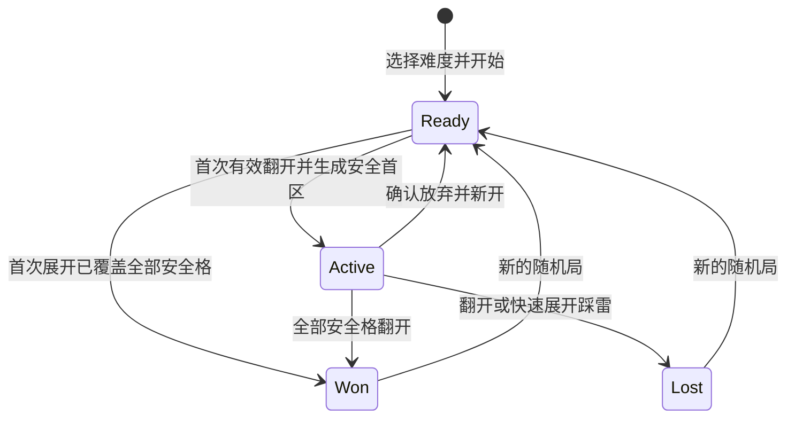

# 扫雷：完整玩法与接入设计

日期：2026-10-27。状态：本设计已落实为当前开发分支中的扫雷规则、会话/存档、手势/视口、Unity 页面及宿主接线，并提供独立测试、UI 检查和隔离构建入口。下文保留规范与验收要求；源码已实现不等于所有验收项已通过，实际结果统一见[扫雷验证记录](../../verification-minesweeper.md)。最新正式发布仍为包含六款游戏的 v0.4.0，扫雷未作为新版本发布。

建树时核对的开发基线：`master` / `origin/master` 同为 `ca50db0f381b96c7a024586792bdc60eb3f0fd3c`。独立工作树：`/Users/bytedance/.codex/worktrees/minesweeper/XanaduYonder`；分支：`p/duanyao.0516/feature/minesweeper`。本方案基于该版本的六款游戏和 Unity 6000.3.27f1，不使用其他工作分支中的未合入功能；该基线记录不表示后续 master 永远未变化。

## 1. 产品目标与方案选择

扫雷是一款可随时开始、暂停和继续的离线逻辑小游戏。玩家根据数字判断周围雷的位置，翻开全部安全格获胜。稳定标识为 `minesweeper`，大厅显示名「扫雷」，入口文案「数字之间，步步为营。」。

| 方案 | 取舍 | 决定 |
| --- | --- | --- |
| 经典规则 + Xanadu 简洁界面 | 规则熟悉，沿用纸色、深绿、中文字体与导航；为手机处理大棋盘和手势 | 用户已选定 |
| 复古灰色立体格 | 怀旧辨识强，需要单独视觉规范，手机仍需重新设计操作 | 本期不采用 |
| 休闲提示与悔棋模式 | 更易入门，但改变失败代价、纪录口径与存档状态 | 后续可独立讨论 |

首版包含三档随机棋盘、首击安全区、插旗、空区展开、数字快速展开、两种点击模式、单指平移、双指同时缩放与平移、50%～200% 连续缩放、点击倍率回到 100%、应用内全屏专注布局、临时只读总览、完整玩法说明、暂停续局、每档独立存档与最佳用时、胜负反馈。

不包含问号标记、自定义棋盘、提示、撤销、复活、原盘重试、每日挑战、无猜生成器、排行榜、登录、广告或联网服务。不为了扫雷重构全应用路由或存档框架。首版仍是单人竖屏 Android 游戏，编辑器支持鼠标验证。

## 2. 难度、目标与数字

| 难度 ID / 名称 | 宽 × 高 | 雷数 | 安全格 | 雷密度 |
| --- | --- | --- | --- | --- |
| `beginner` / 初级 | 9 × 9 | 10 | 71 | 12.35% |
| `intermediate` / 中级 | 16 × 16 | 40 | 216 | 15.63% |
| `expert` / 高级 | 30 × 16 | 99 | 381 | 20.63% |

宽表示列数，高表示行数，高级保持 30 列 × 16 行，不为竖屏改变规则棋盘。三档规格参考 [KDE KMines 官方难度手册](https://docs.kde.org/trunk_kf6/en/kmines/kmines/command.html)。

数字 1～8 表示该格四周八个方向中的地雷总数；边缘与角落只数棋盘内的邻格。数字不随玩家插旗变化。没有邻雷的已开格显示为空白。棋盘左上角为 `(0,0)`，内部索引 `row * width + column`，禁止左右边界串行相邻。

胜利条件只有「全部非雷格均已翻开」。插齐旗、剩余旗计数为 0、未开格数量看起来接近雷数，都不能单独触发胜利。踩中一个雷立即失败；旗只是玩家判断，不替玩家验证正误。这些规则及快速展开依据 [KMines 官方玩法](https://apps.kde.org/kmines/)。

### 首次翻开与随机布雷

1. 新局先创建全覆盖棋盘，尚不放雷；选择难度、移动视口和插旗均不触发布雷或计时。
2. 第一次有效翻开无旗覆盖格时，排除该格及其实际存在的八邻格，在其余格子中随机选择指定数量的雷。首格必为 0，并立即展开一片安全区域。
3. 通过对候选格进行无偏部分洗牌取得不重复的雷位。先插的旗不影响雷位选择；安全区内的错旗保留且阻止展开，必须自行拔掉。
4. 开始计时、生成雷区、翻开首区、判定结果构成一次模型操作。无效点击、点击旗、取消手势不消耗随机数。
5. 布雷后完整保存雷位与首击位置；读档使用原雷位，不重新抽样。新局重新随机，允许极小概率重复，不通过拒绝某些棋盘暗改分布。

「首格及周围一圈安全」是本项目的体验选择，不是对所有扫雷实现的描述。随机局可能出现必须猜测的情况，产品明确写「首击安全，不保证全盘无猜」。[Simon Tatham 的 Mines 说明](https://www.chiark.greenend.org.uk/~sgtatham/puzzles/java/mines.html)分别描述了首击安全和其版本的无猜保证，本项目只采用前者的安全思路，不采用其生成器或代码。

## 3. 格子状态与规则操作

每格玩家状态为「覆盖」「插旗」「已开」之一；地雷属性独立于玩家状态。失败后的地雷、错旗标识，以及胜利后的装饰旗均为终局表现，不反写成普通玩家操作。

| 操作 | 前提 | 结果 |
| --- | --- | --- |
| 翻开覆盖格 | 未暂停，准备或进行中，格上无旗 | 首击先布雷；数字显示数字；零格执行连通展开；雷则失败 |
| 翻开有旗格 | 翻开模式 | 无变化，并提示「先移除旗帜」 |
| 插旗 / 拔旗 | 覆盖格或有旗格 | 两态切换；不检查是否真雷，不翻开，不自动推理 |
| 操作已开零格 | 任意点击模式 | 无变化 |
| 快速展开数字 | 翻开模式点击已开 1～8，邻旗数等于数字 | 一次尝试翻开其全部无旗覆盖邻格，再展开其中的零格 |
| 邻旗数不等于数字 | 点击已开数字 | 仅短暂标示该数字邻域，提示「周围旗数还不匹配」；不翻开 |
| 终局后格子操作 | 胜利或失败 | 只允许查看、平移、缩放和总览定位，不改变盘面 |

插旗总数不限制为雷数，状态栏显示「剩余标记 = 总雷数 − 已插旗数」，允许负数；这不是系统已验证的剩余地雷数。负数显示警示色，并解释「标记数超过总雷数」。不使用「已找出地雷」等误导文案。

零格展开使用队列遍历：揭开相连的所有无旗零格及其外围无旗数字格，遇旗停止该格的处理；不揭雷、不穿过边界、不重复访问。每次操作只提交一份完整结果和一组变化格，避免将动画逐格回调当作规则执行。

快速展开只检查旗的数量，不检查旗是否插对。若目标邻格中存在雷，整个操作直接判负，选择索引最小的未插旗目标雷作为引爆标识；不先提交可能触发胜利的安全格变化。若均安全，则完整展开后统一判胜。重复点击、终局同帧排队点击都不得继续改盘。

## 4. 手机与鼠标操作

底部常驻「翻开 / 插旗」双段开关，有图形和文字，当前段明确高亮。新局默认翻开模式，续局恢复上次模式；不把模式存在其他游戏的公共设置中。

| 目标与手势 | 翻开模式 | 插旗模式 |
| --- | --- | --- |
| 短按无旗覆盖格 | 翻开 | 插旗 |
| 短按有旗格 | 不翻开，提示先拔旗 | 拔旗 |
| 短按已开数字 | 尝试快速展开 | 仅显示邻域，不快速展开 |
| 长按覆盖格 / 旗格达到 400 ms | 立即插旗 / 拔旗 | 立即插旗 / 拔旗 |
| 单指拖动棋盘 | 平移视口 | 平移视口 |
| 第二指在棋盘内按下 | 取消待翻开/插旗，转双指变换 | 取消待插旗/拔旗，转双指变换 |
| 双指移动与开合 | 中点平移与距离比缩放同时生效 | 中点平移与距离比缩放同时生效 |

2026-10-28 根据用户真机反馈修订：长按阈值固定 400 ms，首个达到阈值的合法单指帧立即插旗/拔旗，并在触感开启时反馈一次，同时立即保存。不需要松手；说明文案为「长按 0.4 秒即插旗」。持续按住及之后松手都不能重复标记或退化成翻开。同一手势最多一次规则操作；如果阈值后的第一个可观测帧已经是正常 UP，仍只提交一次长按。阈值前正常松手为短按；阈值前离开原格、超过移动阈值、离开视口或被系统取消，均不能提交。已完成的标记不会被之后的取消、移动或第二指撤销，之后只允许视图操作。

长按已开数字或零格不执行规则操作，松手不得退化为短按或快速展开；鼠标右键操作已开格同样无变化。触发帧及松手帧都要用实际位置核对移动距离、原格及视口边界，不能只在收到 MOVE 时检查；已经触发的长按不会在 UP 再执行任何格子命令。

一次单指手势从按下记录原始 pointerId、原格、位置、模式及局 ID。移动超过 12 个设计单位后转入平移，清除点击/长按资格；之后即使拖回原点也不得翻格。细小移动但进入其他格同样取消格子操作。

第二指按下时立即撤销尚未提交的单指点击/长按资格；第二指与 400 ms 阈值同帧时，多指仲裁优先，不插旗。若前一帧已完成标记，则保留该结果并转入只允许视图变换的阶段。只有两根手指都从本棋盘视口开始、仍属于当前局，才转入双指变换；从工具栏或视口外开始后滑入的触点不能加入。以两指中点为锚点，距离比改变缩放，中点位移同时改变视口，两者在一次更新中计算并夹紧边界。两指距离小于 12 个未缩放的视口设计单位时只平移；首次达到 12 时建立有效距离基线，该帧不追补此前缩放，随后用相邻有效帧的距离比计算。距离再次小于 12 则重新等待基线，避免除零或跳变。到达倍率边界仍更新距离和中点基线，保证反向立即生效。12 单位阈值与单指阈值使用同一坐标系，不随棋盘倍率或设备基础格尺寸变化。

双指中一指正常抬起后，剩余指进入「仅平移」状态；重新记录该指的平移起点，避免跳动，抬手不得转成翻开/插旗。其间若另一指再次从棋盘按下，可重新建立双指基线，但本轮始终没有格子操作资格；只有全部手指抬起后，下一次新手势才允许点击或长按。

第三指、触点起始位置不合法、系统取消、触点丢失、指针离开棋盘视口、失焦等中断会终止本轮后续变换并取消格子操作，保留最后合法的倍率和中心，锁定到所有触点抬起。失焦或禁用后重新启用也必须先确认没有存量触点，不能把仍按住的手指当作新按下。正常松手必须核对原触点不是 `TouchPhase.Canceled`；不能仅凭 UGUI 的 `PointerUp` 提交。

Unity 适配器每帧先收集完整触点快照及阶段，再统一仲裁：先处理多指加入、非法触点、取消与生命周期失效，最后才允许提交格子操作。同帧出现第一指 UP 与第二指 DOWN 时，不得因遍历顺序先翻格；每帧中点/距离变换及边界夹紧只执行一次。真实触摸期间不再消费 Unity 合成鼠标输入，避免同次触摸双提交。

点击其他控件、切换模式、点击缩放按钮、进入/退出全屏或总览、打开弹窗、换局、暂停、离开页面和组件禁用都取消待提交手势，并让仍按住的触点完成上述释放门禁；双指自身引起的连续缩放不触发这项按钮取消逻辑。棋盘由一个输入组件仲裁，不能让每格 Button 与 ScrollRect 分别提交点击和拖动。总览中的单击只用于定位，详见第 5 节；任何视图切换后的同一次抬手都不能穿透为格子操作。

编辑器鼠标左键遵循当前点击模式，也支持长按；右键松开直接插旗/拔旗，不改变全局模式；左键点已开数字执行与手机相同的条件展开。拖动仍按同一阈值判定。不要求双击、左右键合击或滚轮作为唯一可用操作。

## 5. 大棋盘与屏幕布局

2026-10-28 设备反馈修订：9×9 的「总览」「全屏」保持原位置，但按钮、图标和文字显示禁用态，不响应点击；该限制不随正常缩放倍率改变。16×16、30×16 保留总览与全屏能力，仍遵守暂停、弹窗等输入限制。旧 9×9 存档即使保存了 `fullscreen: true`，恢复时也统一使用普通布局，不重开棋盘、不重置记录或倍率，中心按普通视口边界正常夹紧；后续保存写回 `fullscreen: false`。本节后续全屏/总览能力描述均以这项难度约束为前提。

沿用现有 720 × 1320 设计坐标、`SafeDesignFrame` 和 `UiFactory.Band`。普通布局保留应用导航，示例如下：

```text
返回  重开          XANADU / YONDER        玩法  设置
扫雷                              数字之间，步步为营。
剩余标记 10          初级 9×9          00:00  暂停
                                       [进入全屏]
┌─────────────────────────────────────────────────┐
│                                                 │
│         可裁剪、可平移、可双指缩放的棋盘          │
│                                                 │
└─────────────────────────────────────────────────┘
[ 翻开 | 插旗 ]              [−] 100% [+] [总览]
点击翻开 · 长按即标记 · 双指缩放和平移
当前存档状态 / 错误提示
```

这是结构与布局意图示意；实际控件由页面和按钮布局组件按可用区域、点击目标尺寸排布。参考布局：导航 y=0..92；标题 y=108..178；状态 y=194..268；棋盘视口 y=286..1046、宽 648；工具 y=1068..1140；提示 y=1156..1200；底部状态复用宿主区域。长屏把额外空间优先分给视口；短屏保持工具不重叠，通过棋盘滚动承接空间不足。

正常视图的基础格边长为 72 设计单位，连续倍率 `zoomScale` 为 0.5～2（50%～200%），对应基准边长 36～144。新局默认 100%，初级基准下九列正好占 648；中级和高级保持这个可点尺寸，用户可主动缩小以增加观察范围。双指缩放保持两指中点对应的棋盘坐标；「− / +」每次减/加 25 个百分点，以视口中心为锚点，边界钳制为 50% 和 200%，例如 138% 点「+」变为 163%，61% 点「−」到 50%。点击中间倍率数值回到 100%，仍以视口中心为锚点。显示百分比可四舍五入，但内部倍率保留连续精度；到达 50%/200% 时分别禁用减/加按钮。

50%（含）到 100%（不含）是正常可操作的小格视图：短按、长按、快速展开和翻开/插旗模式含义不变，不自动改成只读、不在首次点击时擅自放大。底部显示「小格视图 · 点击倍率恢复 100%」及当前模式。点击命中仍以实际格边界为准，不扩展单格热区覆盖邻格；用户缩小换取更大的观察范围，同时承担更高的点选精度要求。需要完整棋盘且不操作时使用独立的只读总览。

视口使用矩形裁剪、边界夹紧、无惯性，边缘细条提示尚有内容；没有可滚动空间的轴居中显示。新局视口在左上角，能完整容纳的轴居中。缩放与平移先联合计算，再按最终倍率和布局夹紧；到达缩放上下限时仍允许中点平移，反向开合立即响应，不能因累计越界距离而产生一段无效行程。边界附近以棋盘不露出多余空白为优先，锚点不能完全保留时允许最小必要位移。

点击命中、双指锚点和总览定位的逆变换使用当前实际渲染且已夹紧的变换，不使用尚未映射为实际渲染位置的期望中心。棋盘缩小居中后，周边空白的点击和长按均无操作，不能把越界索引夹到边缘格；从视口空白开始的合法双指仍可平移/缩放。总览中点击棋盘之外的空白不定位、不退出。

100% 基准下手机可见单格边长目标至少 32 dp；如安全区和等比缩放导致不足，在扫雷视口内提高基础格尺寸并允许初级滚动，不修改全应用缩放策略。100% 始终相对该设备调整后的基础格尺寸；用户主动缩至 50% 时允许约 16 dp 的格子，不再承诺所有倍率均达到 32 dp。该尺寸必须用设备实际密度和截图验证，不能把 72 设计单位直接当成 72 dp。模式、暂停、缩放、倍率复位、总览和退出全屏等主要按钮目标点击区域至少 44 dp；小屏优先调整排列，必要时扩大透明命中区域，相邻区域不得重叠。实现中 `MinesweeperControlLayout` 按设备密度与每设计单位像素数换算目标尺寸，单行放不下时将模式与缩放/总览分成两行；它只服务扫雷工具，不改变全应用导航。只读总览允许更小的格子，因为它不执行格子操作。单指移动阈值在屏幕对应的设计坐标中计算，不随棋盘倍率缩放；命中格坐标再经视口逆变换计算，避免 50% 时把滑动误当点击。

### 应用内全屏 / 专注布局

普通布局提供「进入全屏」，三档均可使用，主要解决中高级棋盘观察区域不足。全屏仅改变扫雷页面的竖屏布局：隐藏品牌导航、大标题和大块提示，不改变 Android 系统栏、全局沉浸策略或屏幕方向。安全区内固定保留顶部「退出全屏、剩余标记、计时、暂停」和底部「翻开/插旗、缩放−/+、总览」；两条工具栏占独立布局空间，不覆盖棋盘、不自动隐藏。保存错误在底部保留紧凑可见提示，不能随品牌区一起消失。

```text
[退出全屏]       标记 99       04:28       [暂停]
┌─────────────────────────────────────────────────┐
│                                                 │
│                                                 │
│               扩大的棋盘可视区域                │
│           单指拖动 · 双指缩放并平移              │
│                                                 │
│                                                 │
└─────────────────────────────────────────────────┘
[ 翻开 | 插旗 ]              [−] 138% [+] [总览]
保存异常时在这里显示紧凑提示，不遮挡棋盘
```

这仍是设计示例，不是已实现截图。进入或退出全屏只改变 `fullscreen`：同局、规则状态、累计时间、输入模式和缩放保持，视口尽量保持中心棋盘坐标，按新可视区域重新夹紧。切换取消当前输入，不重开、不弹重开确认、不自动暂停或恢复；原本进行中的计时连续，原本暂停的遮罩保持。普通布局复用宿主底部状态区，全屏由扫雷本地紧凑状态区承接同一保存状态，退出时恢复宿主区域。玩法、设置和重开仍可在退出全屏后的普通导航中访问。

推荐固定紧凑工具栏：控制位置稳定，能够同时保留双指手势空间与明确的模式提示。浮动遮盘工具栏会遮住关键数字并与双指手势竞争，本期不采用；横屏需要重新验收安全区、布局和手势，留待后续，不作为本期的大棋盘方案。

### 临时只读总览

普通布局与全屏都提供「总览」。进入前取消当前输入，并保存进入前的正常视图 `{fullscreen, zoomScale, centerColumn, centerRow}`；将整盘按比例适应当前棋盘视口，明确显示「总览 · 仅观察和定位，计时继续」。用细框标出进入前的可视范围，帮助辨认当前位置。总览是观察视图，不是暂停，也不是另一个规则局。它不揭示额外信息，只缩小当前已知盘面；终局按原终局规则显示地雷/错旗。

用户最终确认：总览图标为四个小箭头从四角向中心指向，保留「总览」文字。标题、导航、字号、字体和图标线宽/颜色严格沿用 Xanadu 既有 `UiFactory` / `UiIconGraphic` 规则；已有图标直接复用。交互示例中的布局用于扫雷区域，宿主的明确视觉规则优先，不另外引入暗色主题。所有编码、测试缓存和构建必须位于本扫雷工作树，验证包与存档独立隔离。

总览内禁用翻格、插旗、长按、快速展开和双指变换，模式/缩放按钮不执行操作，「总览」入口改为「返回局部」。暂停按钮仅在 `Ready/Active` 可用，`Won/Lost` 禁用。单指正常短按棋盘某处，只退出总览，恢复进入前的全屏状态与可操作倍率，并尽量把所点的连续棋盘坐标置于视口中心；边缘按正常规则夹紧。这次抬手被消耗，不再翻开落点格。拖动、长按、多指、取消触摸均不定位，也不操作格子。点击「返回局部」或 Android 返回则恢复进入前的原视口，不改变观察中心。

总览中的 `Active` 局继续计时；`Ready` 仍为 0，`Won/Lost` 固定终局时间。总览中手动暂停、进入后台或失焦时关闭总览、恢复进入前的正常视图并遮盘；`Active` 前台恢复仍需明确继续，`Won/Lost` 前台恢复直接回正常倍率的终局查看，均不自动重新打开总览。正常视图的保存字段不被总览的适应整盘倍率覆盖；总览本身及返回视图快照仅驻内存。总览不提供切换全屏的入口，先返回局部再切换，避免两层视图切换互相覆盖。

持久化以棋盘连续坐标保存用户希望保持的视口中心：列坐标 `centerColumn` 在 0..width、行坐标 `centerRow` 在 0..height；原点位于棋盘左上外边界，格 `(column,row)` 的中心为 `(column+0.5,row+0.5)`。恢复和布局转换时使用已保存的倍率与中心，再按当前安全区及基础格尺寸夹紧；小于视口的轴居中。纯布局变化的临时夹紧不覆盖期望中心，避免普通→全屏→普通却无用户平移时丢失原观察位置；主动平移、缩放或总览定位才更新期望中心。暂停时正常盘面和总览都必须被不透明层遮住，不能通过平移、缩放、全屏切换或总览查看。

## 6. 大厅、难度选择和完整流程

大厅追加「07 / 经典扫雷」，原六款顺序不变，沿用卡高 350、间距 24 和纵向列表。卡片展示原创小棋盘预览、三档难度、本地累计胜局；未玩过显示「首击安全 · 三档挑战」。按钮「选择难度 / 继续」进入扫雷选择页，不在启动应用时自动创建一局。

选择页列出三档的尺寸、雷数、胜局、败局和最佳时间。没有最佳时间显示「—」。每档最多保留一个最新对局，三档互不覆盖：

- 没有存档或只有已结束对局：主按钮「开始新局」；已结束对局另有「查看上局」。
- 存在准备局或进行局：主按钮「继续」，另有「新开一局」。
- 切换选择的难度只改选择，不生成、不放弃、不清空其他难度。
- 新开同档会替换该档上局。替换进行局或有旗的准备局先确认「放弃当前局，开始新的随机棋盘？」；取消保留原局。完全未操作的准备局及终局直接新建。

新局是新的局 ID、空白覆盖棋盘、零用时、零旗、默认翻开模式、普通布局、100% 缩放与初始视口；从首次有效翻开开始计时。顶部重开与结果页「再来一局」都生成新的随机局，不回放旧雷区。退出或主动重开不记败局；首版不展示胜率，避免把未结束的放弃局计入口径不明的分母。

游戏返回到扫雷难度页，保存并暂停当前局；难度页返回大厅。Android 返回顺序固定为「先处理弹窗 → 返回总览前的局部视图 → 退出全屏 → 对局返回难度页 → 难度页返回大厅」。关闭玩法/设置/重开确认仍执行第 7 节的暂停规则；暂停继续层不会因返回而直接露出可观察盘面，可先退出全屏但保持遮罩，再返回难度页。退出全屏不弹重开确认、不改变局 ID。`Active` 局从难度页继续或冷启动恢复时，先恢复该局保存的布局和正常视图，再显示遮盘的「继续游戏」，明确点击后才开始计时；`Ready` 局回到准备盘面，用时仍为 0；`Won/Lost` 只进入终局查看，不显示继续按钮。所有恢复均不自动进入临时总览。

首次进入扫雷选择页显示简短操作引导，可跳过，不消耗对局；选择页和普通对局页右上书本按钮可查看完整规则，全屏先退出到普通布局再查看。引导包含「单指拖动、双指缩放并平移、总览仅观察且继续计时」。示例使用单独静态示意盘，不创建可计入纪录的教程局。

## 7. 生命周期、弹窗和计时

规则模型状态只有 `Ready`、`Active`、`Won`、`Lost`。暂停、前后台、所在页面、弹窗、全屏布局和临时总览归 Session/页面管理，不把 `Paused`、全屏或总览当成丢失原胜负信息的规则状态。



Session 的格子操作条件为：本页可见、应用前台、未暂停、无阻断弹窗、未处于总览、局状态为 `Ready/Active`、请求局 ID 仍匹配。规则核心也拒绝终局修改，不能只依赖按钮变灰。平移、缩放、全屏和总览属于视图操作，不能经由格子命令修改规则；终局查看可使用这些视图能力。计时条件独立于格子输入许可：当前局为 `Active` 且前台可见、未暂停时持续计时，总览虽禁用格子输入也必须计时。

| 场景 | 棋盘 | 计时与恢复 |
| --- | --- | --- |
| 准备局 | 可见，可插旗和翻开 | 计时为 0；第一次有效翻开开始 |
| 进行中 / 单双指平移与缩放 / 标记 | 可见 | 累计前台有效用时 |
| 进入 / 退出全屏 | 布局变化，正常中心尽量不变；原遮罩不变 | 保留原计时状态，不自动暂停或恢复 |
| 临时只读总览 / 总览定位 | 整盘适应视口，只显示已有信息 | `Active` 继续计时；总览不能充当免费暂停 |
| `Ready/Active` 手动暂停 | 不透明遮住盘面 | 停时，必须点继续；`Ready` 继续后仍为 0 |
| 玩法、设置、重开确认 | 先阻断输入并遮盘，再打开弹窗 | 停时；关闭/取消按下表恢复，进行局不自动继续 |
| 切后台、锁屏、失焦 | 取消输入并遮盘；关闭临时弹窗和总览，恢复正常视图 | 停时、保存；前台按下表恢复，不重开弹窗/总览 |
| 返回难度页 / 大厅 | 不显示盘面 | 停时、保存；再次进入按第 6 节恢复 |
| 胜利 / 失败 / 查看终局 | 可见终局，可平移/缩放/全屏/总览；弹窗期间阻断视图输入 | 固定终局用时；继续按钮和总览定位都不能使终局复活 |

关闭/取消临时弹窗或从后台回到同一页时，按原规则状态及原暂停状态恢复，不对所有状态套用「继续游戏」：

| 原状态 | 恢复结果 |
| --- | --- |
| `Active`，原本运行或已暂停 | 保持遮盘，明确点击继续才重新计时 |
| `Ready`，原本未手动暂停 | 回到准备盘面，计时仍为 0 |
| `Ready`，原本已手动暂停 | 保持遮盘，点击继续后仍为准备局 |
| `Won/Lost` | 回终局查看，时间冻结，不显示继续游戏，不重新打开结果/临时弹窗 |

所有布局中的终局暂停按钮均禁用。共用设置弹窗不能留下一个可透视数字的半透明暂停盘面；遮盘由扫雷页面自身负责，覆盖普通、全屏和总览的整个棋盘区域。暂停期间禁用总览、平移和缩放；退出全屏只能重排仍被遮住的区域。

公共设置弹窗属于 `AppController`。当前宿主的失焦/后台回调不会关闭它，因此接入扫雷时由宿主在当前页为扫雷且失焦/进入后台时直接调用 `CloseModal()`，不调用用户主动关闭时的恢复回调；扫雷页面关闭自己拥有的临时弹窗。先保存原规则/暂停信息，再进入后台遮盘，重复 Pause/Focus 通知须幂等。不能只让扫雷页面清理自身弹窗而遗漏共享设置。

时间采用单调时钟的前台累计毫秒，不用系统日期差，不累计后台跨度。每个有效动作和暂停事件先结算当前片段再捕获快照；恢复重设时钟锚点，不复用退出前的时钟值。界面按秒显示 `mm:ss`，一小时以上显示 `hh:mm:ss`，不在 999 秒封顶；结果和最佳记录显示毫秒，比较原始毫秒，完全相同不重复显示破纪录。

每次规则变化、模式变化、全屏切换、离开、暂停、终局立即保存；单双指视图操作在本轮全部触点释放或取消时捕获最后合法倍率和中心并保存，缩放按钮在动作结束后保存。进入总览前先保存正常视图，定位退出后保存新中心；总览中周期补存或后台保存仍使用正常视图，不能写入临时适应整盘的视图。运行中每 10 秒补存用时。异常杀进程可能丢失上次保存后的累计时间与未保存视图变化，未提交手势直接丢弃，不能把已保存的雷区重新随机。首次翻开即获胜是合法极端情形，用时可以为 0。

## 8. 胜负、记录与反馈

胜利：冻结规则和计时，安全格全部可见，剩余雷位可展示装饰旗；显示「排雷成功」、难度、雷数、用时、是否刷新本档最佳，提供「再来一局」「选择难度」和「查看棋盘」。胜利不要求玩家最后逐个插齐旗。终局状态栏改为结果说明，不把装饰旗误当成玩家新增标记。

失败：触雷格用红底与地雷图形明确标识，展示全部雷；插错在安全格的旗带叉，正确旗保持。未打开的其他安全格仍覆盖，点击不能揭开；可以平移、缩放、切全屏或通过总览定位查看。结果显示「触雷了」、本局用时、难度，提供「再来一局」「选择难度」「查看棋盘」。不提供复活或撤销。胜负后的总览定位不修改盘面、不恢复计时、不重复显示或结算结果。

每档只记录已获胜次数、已触雷失败次数、最短获胜用时。放弃、关闭、未首次翻开的准备局均不增加胜负计数。记录存本机，不宣称公平竞速或跨设备排名。

终局操作由 Profile 将「最终棋盘 + 冻结时间 + 本局结果已记录标记 + 本档统计」作为一个事务捕获并写入同一文件。结果弹窗、进入/离开、重复保存和恢复终局都不累加统计。写盘失败保留已经结算的内存结果并提示，后续重试只重写，不重新结算；备份恢复可能回退到上一份完整快照，不拼接来自不同版本的棋盘和统计。

翻开/插旗用轻短反馈；零区连开只播一次，不能每格同时播放；胜利一段短上行音，失败一段低音，避免强烈闪屏或长震动。棋盘变化即时完成，表现淡入约 80～120 ms、批量展开总长不超过 200 ms；表现不阻塞下一次合法操作，换局或终局取消旧动画。声音和触感分别遵从应用现有开关，进入后台立即停止。

扫雷模块的 `MinesweeperFeedback` 自行合成并缓存短音：翻开 440 Hz / 45 ms，标记 660 Hz / 45 ms，胜利依次 523、659、784 Hz 各 70 ms，失败 130 Hz / 180 ms，均带短淡入淡出包络。一次有效操作只反馈一次；胜负音取代该次普通翻开音；无变化和视图移动不播放。现有 `GameFeedback.Miss/Land` 会读取 Jump 游戏资源，不能将其当成通用扫雷音。声音源与生成的 AudioClip 由扫雷模块持有、复用并在销毁时释放，暂停/离开/关闭声音时立即停止。触感复用宿主 Android 桥，给 `GameFeedback` 增加通用 `Pulse(bool enabled)` 薄入口包装现有 Haptic；标记或胜负各一次，普通翻开不震动，声音和触感开关互不耦合。

## 9. 视觉与素材方案

沿用宿主 `UiFactory` 的纸色 `#F6F4EC`、深色文字 `#173D35`、主题绿 `#276653`、次要文字 `#718179` 和已授权 Noto CJK 字体。未开格采用浅绿灰实底与细边，已开格用平纸色；旗采用朱红旗面加深色杆；地雷用深色圆心与短辐射线，触雷格额外加红底。数字 1～8 使用不同色彩，但识别始终以数字字形为依据，不能只靠红绿区分。

标题、导航图标的字号、布局与笔画沿用已有 Xanadu 页面，不以交互原型覆盖现有浅色系。总览图标固定为四个向内箭头；这是已锁定的用户选择。2026-10-28 配色修订：可用的总览图标与文字、棋盘横向/纵向范围条使用现有主题绿 `#276653`；棋盘视口背景由 `#E7EDE4` 调浅为 `#F0F3EC`，未开格和已开格颜色保持。禁用的总览/全屏图标与文字沿用次要文字色 `#718179`，按钮背景继续使用公共禁用效果。

首版采用方案：原创 UGUI 棋盘、原创网格预览及程序绘制的旗/雷/错旗图标；复用现有通用导航图标与字体；由扫雷模块按第 8 节生成短音。扫雷图标放模块内，不为它扩张全应用基础控件的业务职责。没有外部资源时完整功能仍可交付。

已在线核查以下候选，查询日期为 2026-10-27。当前只完成来源调研，尚未下载、试听或纳入游戏：

| 素材 / 作者 | 页面核实的内容与许可 | 本期决定 |
| --- | --- | --- |
| [UI Pack / Kenney](https://kenney.nl/assets/ui-pack) | 官方页列出 430 个界面文件，CC0；适用按钮、面板、滑块，不声称包含扫雷雷/旗 | 作为参考候选；宿主已有界面组件，不引入 |
| [Input Prompts / Kenney](https://kenney.nl/assets/input-prompts) | 官方页列出 1500 个输入图示，包含触摸与键鼠，CC0 | 操作教程图示候选；首版用原创图示和中文说明 |
| [UI Audio / Kenney](https://kenney.nl/assets/ui-audio) | 官方页列出 50 个点击/按钮/开关音效，CC0；具体音色未试听 | 后续音色替换候选；首版采用项目合成音 |

[Kenney 官方支持页](https://kenney.nl/support)说明其资源可用于商业项目且无需强制署名；[CC0 官方说明](https://creativecommons.org/publicdomain/zero/1.0/)提供对应使用条款。日后实际选用时，只引入必要文件，保存包内许可、来源、版本/下载日期、修改说明和 SHA-256，更新 `THIRD_PARTY_NOTICES.md`，将资源放 `Assets/Resources/Minesweeper/` 并提交 `.meta`。不批量拷贝整个素材包，不使用作者 Logo，不截取 Windows 或其他扫雷游戏美术，不复制参考项目实现代码。

## 10. 代码责任与实际接入点

当前仓库没有统一小游戏接口或共享 Header 组件。`AppController` 直接持有各 Page；各游戏用 `UiFactory.Band/IconButton/Label` 组成相似导航。扫雷保持现有接入方式，规则和状态在模块内独立负责。

| 已实现组件 | 责任与依赖 |
| --- | --- |
| `Core/Minesweeper/MinesweeperGame` | 纯 C#，棋盘、三档规格、邻域、布雷、翻格、插旗、快速展开、胜负；注入随机源，对外返回防御复制快照和变化格 |
| `Core/Minesweeper/MinesweeperSnapshot` | 状态快照及不变量校验；从雷位重算邻雷数，不信任冗余保存数字 |
| `Runtime/Minesweeper/MinesweeperSession` | 可独立测试的普通 C#；局 ID、模式、计时、暂停和前台状态，保存本局正常视图；拒绝旧局操作，区分总览的输入禁用与持续计时 |
| `Runtime/Minesweeper/MinesweeperProfile` | 三档槽、选择偏好、胜负和最佳纪录；唯一的结算写入者，保证同一局仅记录一次 |
| `MinesweeperSaveCodec / Store` | 严格 Newtonsoft JSON 解析、边界校验、原子写盘与备份，不参与 Unity 输入和胜负推断 |
| `MinesweeperGesture / Pointer` | 前者为可测试手势状态机，后者适配 Unity 触摸/鼠标和取消事件；统一仲裁点击、长按、单指平移、双指变换、剩余指仅平移和全抬释放门禁 |
| `MinesweeperViewport` | 可独立测试的普通 C#；连续倍率、棋盘中心、双指锚点、边界钳制、全屏布局切换和总览前后视图转换；不改规则或计时 |
| `MinesweeperControlLayout` | 可独立测试的普通 C#；主要工具按钮的 44 dp 尺寸换算、单行优先与双行排布，返回不重叠的设计坐标矩形 |
| `MinesweeperBoardView / IconGraphic` | 绘制快照、裁剪、正常视图/总览和反馈动画；不根据视觉状态重算胜负 |
| `MinesweeperFeedback` | 本模块合成音及 AudioSource/AudioClip 生命周期；通过通用触感入口响应宿主设置 |
| `MinesweeperPage` | 选择页、普通/全屏布局、工具、说明、结果及临时总览；按优先级处理返回，调用 Session/Profile；允许按 Layout/Dialogs 分文件 |
| `AppController` | 第七张卡、路由、公共设置注入、前后台、统一保存和退出通知；不保存雷区或判定扫雷胜负 |

必须核对的宿主接线：构建 Page、刷新大厅记录、进入扫雷时其他 Page 离开、进入任意旧游戏时扫雷离开、返回大厅、`StopAnimation` 中扫雷 Suspend、公共弹窗、`Save`、`SetStatus` 的保存错误、`CheckEndState`、硬件返回和 `OnApplicationPause/Focus`。公共弹窗优先处理后，硬件返回交由扫雷页面按总览/全屏/原路由消耗；全屏布局切换不能调用会暂停整局的宿主 `StopAnimation`，只取消扫雷当前输入并重排视图。`Leave/Suspend/Save` 可重复调用，但不能重复结算或恢复计时。

设计依据的实际文件：

- [AppController](../../../Assets/Scripts/Runtime/AppController.cs)：六张大厅卡与宿主生命周期。
- [UiFactory](../../../Assets/Scripts/Runtime/UiFactory.cs)、[UiIconGraphic](../../../Assets/Scripts/Runtime/UiIconGraphic.cs)：设计坐标、基础组件和现有通用图标。
- [SudokuPage](../../../Assets/Scripts/Runtime/Sudoku/SudokuPage.cs)、[SudokuSession](../../../Assets/Scripts/Runtime/Sudoku/SudokuSession.cs)：独立选择页/对局页、计时与遮盘参考；不直接照搬其各类弹窗的自动恢复行为。
- [WatermelonPointer](../../../Assets/Scripts/Runtime/Watermelon/WatermelonPointer.cs)：Android 取消触摸与丢失触点必须单独核查。
- [WatermelonSaveCodec](../../../Assets/Scripts/Runtime/Watermelon/WatermelonSaveCodec.cs)、[WatermelonSaveStore](../../../Assets/Scripts/Runtime/Watermelon/WatermelonSaveStore.cs)：严格解析和原子文件读写参考。
- [MiniGameUiChecks](../../../Assets/Editor/MiniGameUiChecks.cs)：大厅顺序断言已扩展至第七款扫雷，旧控件断言保留。扫雷独立生产页面检查位于 [MinesweeperUiChecks](../../../Assets/Editor/MinesweeperUiChecks.cs)。

核心程序集维持 `noEngineReferences=true`；独立测试沿用 .NET 10、C# 7.3，并直接编译生产源代码，不另写一套仅供测试的扫雷实现。无新增网络 SDK、物理引擎依赖或大资源题库。

沿用现有 Bootstrap 场景与 Core/Runtime/Editor 程序集，不新增场景或 asmdef。新增 `Assets` 目录/脚本/资源均提交对应 `.meta`，既有资源 GUID 保持不变。构建环境与开发验收入口详见[开发准备核查](../../minesweeper-development-readiness.md)。

## 11. 独立存档与校验契约

文件为 `Application.persistentDataPath/minesweeper-v1.json`，根版本 `schemaVersion: 1`，`gameId: "minesweeper"`。仅访问自身 `.json/.bak/.tmp`，不改 2048/公共设置或其他游戏协议。文件大小上限 256 KiB、JSON 深度上限 12，UTF-8 严格解码。

| 数据 | 精确定义 |
| --- | --- |
| `selectedDifficulty` / `tutorialSeen` | 三个固定难度 ID 之一；是否看过/跳过首次引导的布尔值 |
| `slots` | 长度为 3 的数组，依次为 beginner/intermediate/expert；各为 null 或对应难度最新局，同档终局保留到新开局 |
| `records` | 同顺序长度为 3 的数组；每项为 `wins`、`losses`、可空 `bestMilliseconds`，未获胜必须无最佳记录 |
| 局身份 | 非空规范 GUID `sessionId`、固定 `rulesVersion: 1`、`difficulty`、`width/height/mineCount`；槽内难度及规格必须相符 |
| 棋盘 | `generated`、可空 `firstRevealIndex`、按行平铺的 `mines/revealed/flags` 布尔数组，长度严格为宽×高 |
| 终局 | `state` 为字符串 Ready/Active/Won/Lost；可空 `detonatedIndex`；`resultRecorded` 布尔值，终局必须已记录，非终局必须未记录 |
| 时间与操作 | 非负累计 `elapsedMilliseconds`、字符串 `inputMode`（reveal/flag） |
| 本局正常视图 | 布尔 `fullscreen`；有限数值 `zoomScale` 0.5..2；有限数值 `centerColumn` 0..width、`centerRow` 0..height，采用第 5 节的连续棋盘坐标；不保存临时总览 |

毫秒与累计胜负次数使用无符号十进制字符串解析到非负 `Int64`；拒绝负号、小数、空串、溢出和 JSON 数值替代类型。计时和计数到达 `Int64.MaxValue` 后饱和，不回绕。最佳值允许 0，只由有效胜局更新。整数/布尔字段必须为对应 JSON token；`zoomScale/centerColumn/centerRow` 接受有限整数或小数 token，拒绝字符串、NaN、Infinity 和越界值，不能靠默认字段补齐缺失数据。合法中心在具体设备显示时按视口再夹紧，这不等于修复非法盘面。

字段清单固定，拒绝重复键、未知字段、尾随内容、缺失字段、错误 token、非法枚举和数组 null/长度异常；不暴露部分成功解码的 Profile。整个文件失败后尝试备份，不跨版本拼接槽位和记录。

快照必须满足以下不变量：

1. 准备局未布雷，雷位和已开数组全 false，首击/引爆位置为空，用时 0，可有旗；`Ready` 不能带已生成雷区。
2. `generated` 当且仅当状态不是 `Ready`；所有非准备局必须已有合法雷区和首击位置。已生成局雷数准确，首击在棋盘内且已翻开，首击及其八邻格无雷；邻雷数字只从雷位派生。
3. 旗和已开互斥；任何普通已开雷只允许是失败局的引爆格。未开始或进行中不能带 `resultRecorded`。
4. `Active` 至少翻开一格、没有引爆格，安全格尚未全开；`Won` 全部安全格已开且无引爆格；`Lost` 引爆索引确为已开雷，其余雷不作为模型已开格，且仍有未开的安全格，不接受已满足胜利条件却声称失败的快照。
5. 三个槽的局 ID 不重复；结束槽必须 `resultRecorded=true`，并有相应非零胜/败记录。胜局的本档最佳不得大于该局用时；胜局数为 0 时最佳必须为空，非零时必须存在。
6. 存档不保存当前手指、双指距离/锚点、长按已消费标记、释放门禁、动画、临时确认、总览及其临时返回快照或绝对时钟锚点；总览期间保存进入前正常视图。进行局恢复总是暂停，不能信任持久化的「当前可输入」标记。
7. 本局保存 `fullscreen` 与正常倍率/中心，不保存屏幕像素或旧布局尺寸；跨布局/安全区恢复保持同局与倍率，并重新夹紧中心。总览的整盘适应倍率单独计算，可能低于 0.5，也可能落在正常倍率范围内；无论数值多少，都不得覆盖正常视图字段。总览与正常视图的区别由明确的视图状态决定，不能用倍率小于 100% 推断。

写入先完整校验和编码，再写临时文件、flush，原子替换主档；只有合法旧主档才可更新备份。主档损坏时尝试备份并显示恢复提示，二者不可用时明确告知扫雷进度不可恢复，原有其他游戏不受影响。新文件不存在是首次使用，不显示损坏警告。写入失败继续允许内存游玩但持续显示「扫雷进度暂未保存」，成功重试后才清除；不显示虚假的保存成功。

没有旧扫雷协议需要迁移。未来修改首击安全或计分规则时必须改变规则版本并明确处理旧局与纪录；不能静默重生成已保存的雷区。

## 12. 验收矩阵

下列为实现验收要求。各项是否执行、通过或存在设备限制，以验证记录逐项对应；不能由模块已实现或测试入口存在推断整张矩阵已经通过。

| 层次 | 场景 | 必须结果 |
| --- | --- | --- |
| 核心 | 三档宽高、雷数及角/边/中央邻域 | 固定规格，八邻域无越界或行间串连 |
| 核心 | 多种子 × 首击位置，含四角和边缘 | 雷无重复；首格和有效八邻格安全；生成确定性可重放 |
| 核心 | 首击前插旗、点旗、取消、恢复准备局 | 不提前布雷/计时；旗不影响抽样，不自动移除 |
| 核心 | 大空区、边界数字、区内错旗 | 全部合法区域展开，旗保留，拔旗后可再次翻开 |
| 核心 | 多插旗、拔旗、已开格、无变化操作 | 负计数语义明确；不改变雷数；无变化不随机/写盘 |
| 核心 | 正确旗快速展开 / 数量不符 / 等量错旗 | 分别展开 / 无变化 / 判负；错旗不被系统自动纠正 |
| 核心 | 最后一格、首击全开、无需插旗获胜 | 胜利完整、用时冻结；后续点击无效 |
| 核心 | 快速展开同时含雷与最后安全格 | 结果只能失败，不先记胜，不受遍历顺序影响 |
| 输入 | 399/400 ms、持续按住及松手、拖动阈值两侧、离格再返回 | 399 ms 尚未标记，400 ms 立即且只标记一次；持续按住/松手不重复，一旦取消或拖动永不回落点击 |
| 输入 | 长按/右键已开格、未收到 MOVE 但 UP 已超阈值 | 已开格不误快速展开；按最终位置取消，不退化成短按 |
| 输入 | 同帧第一指 UP 与第二指 DOWN、触摸合成鼠标 | 先处理整帧多指冲突再提交，遍历顺序不影响结果，无重复点击 |
| 输入 | 第二指在阈值前、阈值同帧和长按已完成后按下 | 前两者阻止提交，后者保留已完成的标记；转双指变换后本轮任何抬手都不翻格 |
| 输入 | 双指同时平移和缩放、极小初始距离、一指抬起后移动 | 锚点连续，无除零/跳变；剩余指仅平移，全抬后新触摸才可操作格子 |
| 输入 | 第二指从工具栏/视口外开始后滑入、第三指 | 不加入非法变换；取消并锁到全部触点释放，不遗留格子操作 |
| 输入 | 系统 CANCEL、触点丢失、出视口、重复 UP、禁用后仍有触点 | 无误揭、无双提交、无遗留预览；重新启用不能把存量触点当新按下 |
| 视图 | 50%/200% 边界开合、到边界后反向、±25 个百分点、点击倍率复位 | 倍率始终 0.5..2；边界仍可平移，反向无无效行程；显示不反写降低精度；复位准确回 100% |
| 视图/输入 | 100→75→50%、小格翻开/插旗/长按/chord、移动阈值 | 模式含义不变，不自动变成总览；小格提示可见，命中不扩到邻格；拖动不误提交 |
| 视图 | 双指锚点靠四边、非整数倍率、内容小于视口 | 联合夹紧无露白，必要时最小移动；小于视口的轴居中 |
| 视图/输入 | 缩小后的周边空白、布局夹紧后的点击与缩放 | 用实际渲染变换命中；空白不翻边缘格、不触发总览定位；合法双指仍可变换 |
| Session | 按住时弹窗/换局/返回/失焦 | 旧手势失效，旧局 ID 不可改新局 |
| Session | 暂停、说明、设置、重开取消、锁屏 | 遮盘、停时；按 Ready/Active/Won/Lost 与原暂停状态恢复，进行局明确继续，终局不复活 |
| 宿主 | 共享设置打开时失焦/后台及重复通知 | 宿主直接关闭共享弹窗，不触发主动关闭恢复回调；前台按状态恢复，无残留弹窗 |
| Session | 长时间后台、改变系统日期、重复前台事件 | 不累计后台时间，不发生时间倒退/重复片段 |
| Session | 普通/全屏往返，包含拖动中和暂停中 | 同局、模式、倍率和中心尽量保持；取消输入，不重开、不自动暂停/恢复；遮罩不漏盘 |
| Session | 总览观察、点位定位、返回局部、总览中暂停 | `Active` 全程观察仍计时；定位只改变视口，同一次 UP 不翻格；暂停后退出总览并遮盘 |
| Session | 总览中后台/重启、暂停后企图进入总览 | 保存正常视图，恢复不重开总览，`Active` 先暂停；无法借总览查看暂停盘面 |
| 统计 | 胜负、重开、读终局、重复弹窗/Save | 只计一次；放弃不计负；三档纪录独立 |
| 统计 | 终局双指变换、全屏、总览定位与再次查看 | 盘面、时间、结果和计数不变；暂停禁用，无法翻开或使终局复活；后台恢复直接回终局查看 |
| 存档 | 正常往返、三个槽、准备局、终局 | 同雷区、旗/展开/时间/模式/全屏/正常倍率及中心保持，进行局先暂停 |
| 存档 | 0.5/0.75/1.38 等倍率、不同安全区恢复、总览中保存 | 连续数值合法往返；0.49/2.01 非法；重算范围并夹紧；总览适应倍率即使落在 0.5..2 也不写入正常字段 |
| 存档 | 字段缺失/null/错类型/重复键/未知版本/过深/超大 | 严格拒绝；不依赖构造函数默认值掩盖异常 |
| 存档 | 非法首击区、雷数、状态、结算与统计关系 | 拒绝不一致快照，不修正成另一盘合法游戏 |
| 文件 | 坏主档好备份、两份坏、写满/权限失败、重试 | 完整备份恢复；不混状态；旧文件不被损坏内容覆盖 |
| UI | 大厅第七卡、底部文案、返回滚动位置 | 卡片固定尺寸，最后一张可达，其他六款顺序不变 |
| UI | 720×1320、720×1582、短屏安全区的普通/全屏/总览 | 工具固定且不压棋盘，无重叠或自动隐藏；裁剪正确，暂停不漏数字，保存错误保持可见 |
| UI | Android 返回依次处理弹窗/总览/全屏/原路由 | 不跳过层级，不弹全屏重开确认；暂停遮罩不能被返回意外移除 |
| UI/设备 | 高级 30×16 四角、50%～200% 连续缩放、单双指平移 | 每格均可到达；移动/缩放不误揭；100% 触控尺寸满足基准，小格模式按实际边界命中 |
| UI/设备 | 总览适应整盘、点四角定位、返回原视口 | 数字信息不增加，正常倍率恢复；定位边缘夹紧；总览格子不执行游戏操作 |
| UI/设备 | 连续点击、长按与单双指变换交替、终局查看 | 动画不漏输入、无手势串台、结果不重复、无弹窗穿透 |
| 设备 | Home/锁屏/任务切换/重启/声音触感开关 | 生命周期、文件读写、输入分发与反馈符合约定 |
| 反馈 | 连开、终局、开关即时变更、暂停/离开/销毁 | 一次操作一次反馈，胜负音覆盖普通音；不读取 Jump 资源；生成音频正确停止/释放 |
| 回归 | 六款已有游戏和共享设置 | 原存档正常读取，导航/返回/暂停及原测试保持通过 |

已提供测试入口：`scripts/test-minesweeper.sh`、`scripts/test-minesweeper-session.sh`、`scripts/test-minesweeper-input.sh`、`scripts/test-minesweeper-persistence.sh` 与 `scripts/test-minesweeper-ui.sh`；视口坐标、双指变换、总览返回及按钮尺寸排布的纯 C# 检查纳入输入/Session 测试，Unity 检查使用生产扫雷页面，既有 `test-minigame-ui.sh` 保留旧用例并加入七款大厅顺序。文件测试使用真实 Newtonsoft.Json 13.0.2 和临时目录，不能只测试手写假 JSON 对象。鼠标和合成触点检查不能代替 Android 真机双指分发、取消和多指切换验收。

UI/Play Mode 检查必须注入内存 Profile、无持久化 Store 或显式临时目录，不能访问开发者日常 `Application.persistentDataPath`，不能用启动真实应用后清空数据的方式隔离测试。沿用 `MiniGameUiChecks` 的内存夹具方式，截图与报告写入已忽略的 `artifacts/validation/`；该检查依赖图形渲染，不加 `-nographics`。

Android 隔离验证已提供 `scripts/build-minesweeper-validation.sh`，调用 `ProjectBuild.BuildAndroidMinesweeperValidation`，独立包名 `com.duanyao.xanaduyonder.minesweepertest`，默认产物 `artifacts/builds/XanaduYonder-0.4.0-minesweeper-validation.apk`。沿用 Watermelon 验证构建的 try/finally 模式临时替换包名和产品名，成功或失败都恢复；不覆盖正式应用的安装和进度。入口已经创建；构建成功仍须以当次退出码、非空产物与日志确认。自动化通过、Unity 编译、Play Mode、Android 构建和真机回归分别出证据，不相互替代。当前不修改版本号，不发布安装包或 Release。

## 13. 当前实现与交付边界

准备阶段已在建树时核对 `master` 基线，创建独立工作树和开发分支，并完成真实宿主、输入、存档与构建模板调研。实施阶段现已加入 `Core/Minesweeper`、独立 Session/Profile/Codec/Store、整帧手势与视口、按钮布局、Unity 页面与模块反馈、宿主第七卡及生命周期接线，以及四套独立测试、生产 UGUI 检查和隔离 Android 构建入口。相关文件和责任见[开发准备与实现核查](../../minesweeper-development-readiness.md)，完成项与剩余工作见[实施计划](../plans/2026-10-27-minesweeper-implementation.md)。

本文继续作为规则与交互规范。正常缩放固定 50%～200%，低倍率保持操作语义；颜色、标题与导航沿用 Xanadu，独立总览采用四个向内箭头；真实输入、存档错误提示和当前设备的点击尺寸均按上面的验收矩阵检查。

准备轮次曾在此树执行现有 `scripts/test-core.sh` 43/43、`scripts/test-input.sh` 10/10、`scripts/test-persistence.sh` 13/13，均退出 0。这些是当时已有功能的 66 项基线，不代表扫雷或六款游戏的完整回归。实施阶段的独立检查、最新 Unity/UI 运行、Android 构建、设备操作与审查证据，统一记录在[扫雷验证记录](../../verification-minesweeper.md)，不在检查尚未结束时预填成功结果。

所有后续验证与交付继续限定在本扫雷工作树及其 master 基线；不查询、切换、清理或修改其他检出，不共享其他工作树缓存。源码版本保持 0.4.0，隔离测试包不覆盖正式应用，不创建新 Release。最终集成、构建、真机和审查待办在各自证据齐备后才标为完成。
