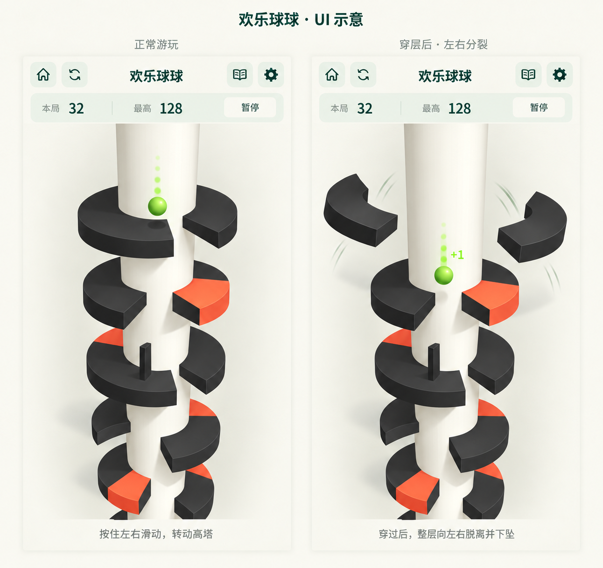

# 欢乐球球：玩法、视觉与开发方案

日期：2026-10-28。状态：用户已确认 UI 并授权实现；实施与实际验证进展单独记录，不将设计图视为运行截图。

开发工作树：`/Users/bytedance/.codex/worktrees/happy-ball/XanaduYonder`。分支：`p/duanyao.0516/feature/happy-ball`。建树基线为本地 `master` 的 `8d64b5f72c0f45c3c16e29844ee010608ab81b9e`；没有刷新或宣称已与远端同步。原工作区的未提交文档未带入。

## 2026-10-28 原版对齐修订（当前执行依据）

用户确认“整体就按照原版来做，包括重击”，并进一步确认提高层间距与黑色竖板。以下及第 4、5、7 节为当前有效约定；顶部已确认 UI、共享组件和底部无说明保持。原视频用于节奏与画面对照，世界单位参数不表述为原版测量结果。

- 普通弹跳以视频约 0.67 秒周期、约 5 球径屏幕上升幅度校准。当前球径 0.44、重力 40、上弹速度 13.2、终端下落速度 24，层间距为 2.4；透视画面目标约显示 4～5 层，须在实际截图中再核对。
- 重击首次向下命中实体横板（含红板）时立即碎层、按当前自然连落的下一档加分，球从命中高度上弹，之后下落。砸板能力立刻消耗；待完整通过已碎层恢复 Normal，不获得第二次砸板权、不重复计分/分裂。视频无法确定精确蓄力阈值，保留 3 层作为集中配置的初始值。
- 每层可含 1～3 个豁口、多段黑色和红色面。宽度随深度整体收窄并有层间差异；球运动轨道上的每个豁口几何净开口至少为 3 球径。移除固定三层对齐及固定同方向转折；连落机会和安全落台交替出现，路线验证须支持多个缺口、双向旋转和安全落点。
- 新生成竖板从早期 0.85～1.05 渐进到深层 1.25～1.50。黑色不致死，侧碰拒绝本步横向旋转，球底越过板顶方可通行，顶面安全反弹。最高竖板仍为前层完整通过保留 0.22 的竖向余量；晚期录像暂缺，不将数值称为原版实测。
- 使用透视相机表现上近下远，保留足够顶部弹跳空间和下方预览。落地即压缩回弹；升降阶段拖尾方向随速度变化，最高点趋圆。
- 落地同时产生短时液滴和附着盘面的不规则颜料；多个落点共存，随塔转动，分裂时随所属半块飞走。对象数有上限，暂停冻结、离页清理、读档不重播；颜料为非持久化表现。
- 普通穿层保留板材颜色并左右分裂；重击碎板变成明亮球色、外甩翻转下坠，保持层几何和厚度。普通穿层、破碎、物理通过分别一次执行。
- 普通触红立即冻结规则与输入，保留约 0.33 秒落点喷溅反馈后显示结算。后台、设置和离页不得让延迟结算重新开启页面或重复保存。
- 以实际 Unity 连续帧验证弹跳、液滴/颜料旋转、透视、重击和死亡；数值测试只证明规则/存档/输入，不代表趣味性或真机手感已验证。
- 当前规则版本为 `RulesVersion = 2`，磁盘 `schemaVersion = 1` 与文件名保持。旧局先按 v1 的 1.65 层距和 0.5 竖板上限严格验证，再迁移到 2.4 层距；保留当前层相对球高、速度及已有旧矮墙。后续新生成层使用 v2 参数，重复读档不重复位移或补分，详见第 7 节。

### 已取代的历史基线

首版曾使用 1.65 层距、约 0.29～0.42 的生成竖板（存档上限 0.5），以及三层近乎对齐、每四层同方向转折的生成模式；这些不是当前新局或新生成层的承诺。更早的重击方案曾让球碎板后继续下落并在通过时仅加 1 分，也已被“立即记下一档连落分并从命中处反弹”取代。**连续自然穿 3 层蓄力**仍是当前重击阈值，与已移除的固定三层生成节奏不同。

## 1. 结论与首版范围

推荐“沿用 APP 调性的竖屏全屏场景”：大厅、中文字体、按钮、暂停和结算继续使用 XanaduYonder 的纸色与深绿；游戏内压缩页头，将主要高度交给纵向 3D 塔和下落预览。

首版做离线单人无尽挑战：自动弹跳、单指连续横滑转塔、缺口下落、连续穿层重击、普通触红死亡、后期黑色竖板、渐进难度、分数和最高纪录、暂停续局、完整音效触感。编辑器支持鼠标拖动。稳定游戏 ID 建议为 `happy-ball`，目录/类型前缀为 `HappyBall`。

本轮基线已有七款游戏，大厅暂按第八款接入；真正合并时按目标分支的实际卡片顺序调整显示序号，稳定 ID 不变。首版不引入关卡选关、皮肤商城、广告复活或联网排行。

### 三种界面方案

| 方案 | 优点与代价 | 建议 |
| --- | --- | --- |
| 同 APP 风格，3D 场景铺满游戏页，紧凑 HUD | 保持合集归属感；纵向空间充足，容易预判后续层 | 推荐，首版只维护这一套布局 |
| 完全套用跳一跳的大标题、双分数卡与嵌入式视窗 | 最接近现有页面结构；但塔身可见层数少，下落视野受限 | 不推荐直接照搬尺寸 |
| 独立黑灰背景、荧光色与参考视频式全套 UI | 视觉接近视频；与合集风格距离大，导航和设置需重新统一 | 可作为未来主题，不作为首版 |

这里的全屏是游戏页面内部的空间分配。沿用当前 APP 的系统栏和安全区策略，不为本游戏修改全局方向、Android 沉浸设置或其他游戏布局。

## 2. 参考材料与证据边界

- 用户视频：`/Users/bytedance/Downloads/欢乐球球.mp4`，23.58 秒、540×1176、24 fps。已逐帧检查全部 566 帧，并放大落地、上弹、穿层、重击和死亡片段。
- 用户图片：`/Users/bytedance/Downloads/142245-202506201308046854ecb4ce423.jpg`。可参考厚环形平台、中央柱体、缺口和上下层遮挡关系；图片的黄绿配色不是首版配色约束。
- 视频可见：球自动弹跳、塔旋转、缺口下落；约 11～14 秒连续穿层、加分与碎片反馈；末尾普通状态触红后进入结算。视频还出现复活入口，首版不据此引入广告或复活。
- 黑色竖板及其“撞上回退、利用高度越过”规则由用户补充，不能声称视频已经展示或验证。
- 用户后续明确：**重击可以砸穿红板，普通状态碰红板才死亡。** 此结论覆盖最初可能存在的解释歧义。
- 用户进一步要求：**穿过某一层时，板子向左右分裂脱离；顶部等 UI 优先复用已有组件。** 普通穿过缺口后的脱离与重击撞板后的砸开分别定义，不能只在重击时才播放板层脱离效果。
- 最新 UI 修订：导航中间用“欢乐球球”替代品牌文字，品牌不显示；取消下方独立标题/副标，本局、最高和暂停压缩为一行，释放的高度全部交给 3D 场景。
- 用户最终确认：实际游戏移除底部“按住左右滑动”“穿过后”等所有说明及其占位，其余严格按 v2 UI 实现。玩法只通过顶部书本入口说明。
- 视频不能严格确定重击的穿层阈值、计分公式、阻挡厚度和高分难度曲线。下文相关数值与补充交互均是本项目建议，需要手感验证，不表述为原游戏实测参数。

参考材料用于分析，不将视频、带水印截图或其中 UI 直接作为游戏资源。塔、球、平台和碎片采用原创网格与材质。

## 3. 画面与操作设计

### 页面

- 背景延续纸色 `#F6F4EC`，文字深绿 `#173D35`，控件主色 `#276653`，中文字体继续使用项目 Noto Sans CJK。
- 中央柱体为浅暖白，安全横板与竖板为炭黑，危险横板为醒目红色；小球使用与背景、黑板和红板均能区分的明亮绿色。
- 3D 场景铺满导航和紧凑状态区之外的可用页面，朝纵深俯看的透视相机，上近下远。顶部沿用已有导航：左侧主页、重开，中间显示“欢乐球球”，右侧玩法书本、设置齿轮。中心游戏名替代原品牌，`XANADU / YONDER` 不显示；四个按钮保留现有图标、浅绿圆角方形和排布。
- 不再设置导航下的独立大标题行，也不显示 `08 / 轻巧下落` 副标。导航下仅保留一条紧凑浅绿信息行，内容为“本局 32　最高 128　暂停”，标签和数字处于同一行、共享基线，不能重新做成标签在上、数字在下的两行卡片。
- 信息行由已有 `UiFactory.Panel`、`Label` 和 `Button` 组合；不是直接套用跳一跳私有的两行 `ScorePanel`。本页显式控制单行文本与大分数适配，暂停按钮保留独立可用热区，不被数字挤压。当前通用 `UiIconKind` 没有暂停图标，继续使用“暂停”文字按钮。
- 信息行结束后立即接 3D 场景，不保留被删除标题和高分数卡的空白占位；释放的高度用于塔身与后续层预览。这些布局调整只作用于 `HappyBallPage`，不改变公共组件默认样式或其他游戏页面。
- 游戏底部不创建操作指引、穿层说明或对应留白；3D 区域延伸至安全区底部。顶部书本打开现有风格的玩法弹窗，包括横滑、红板与重击例外、黑竖板越障；打开玩法或设置均先暂停模拟。真实存档错误仍需以临时紧凑提示呈现，不用常驻说明占位。
- 球位于画面上半部，镜头随下落向下推进，不跟随每一次弹跳上下晃动。通过 2.4 层距与透视镜头共同控制可见密度，目标约显示 4～5 层（含当前层）；短屏至少明确看到当前层和后续 3 层，并以实际画面检查为准。
- 平台厚度、侧面明暗、接触阴影明确区分横板与竖板。重击用更长拖尾、环形光效和短提示共同表达，不能只依赖球变色。
- 死亡后立即冻结玩法、保存结果，播放约 0.33 秒碰撞反馈后显示本局/最高分、“再来一局”和“返回大厅”；重开保留最高分。

### UI 示意图与组件复用

图为内置 `image_gen` 生成的设计示意，不是运行截图；四个导航按钮参考现有 `jump-720x1582.png` 实际页面，中心文字与信息行按用户最新要求更新。实际实现仍直接调用已有组件，不根据生成图重新描摹图标。图中分数是布局样例，左右两幅不代表计分前后的精确数值。当前生成提示词保存在 [ui-v2-prompt.txt](assets/2026-10-28-happy-ball-ui-v2-prompt.txt)；旧图和旧提示词仅保留为设计历史，不作为当前布局依据。

UI 相对 v2 图片的明确删减是两个屏幕下方的说明字样与底部说明条；这些是设计图注，实际游戏不展示。场景层距、竖板高度和物理节奏以后续原版对齐修订为准，不能从该示意图反推当前规则参数。

720 设计单位下复用 `JumpPage` 导航几何：Home `(56,34,58,58)`、Restart `(126,34,58,58)`、游戏标题“欢乐球球” `(210,34,300,58)`、Book `(536,34,58,58)`、Settings `(606,34,58,58)`。标题使用现有 `Label` 水平垂直居中，不新建第二个标题 band。按钮使用 `UiFactory.IconButton` / `UiIconGraphic`，浅绿 `#E7EDE4`、深绿图标 `#173D35`，图标为按钮边长的 55%。信息行使用现有 `Label`、`Panel`、`Button`，并继续由 `SafeDesignFrame` 处理安全区。

### 每层穿过后的左右分裂

- **普通穿层也有该效果。** 球完整向下通过缺口所在层后，该层立即退出有效碰撞与后续游戏判定；同时把剩余环形板分成左右两组大弧形块，向两侧脱离柱体，轻微外翻，再下坠淡出。不是整层突然隐藏，也不是用细碎粒子代替可辨认的两大块。
- 左右方向以当时相机的水平轴为准，几何仍沿用刚通过层的缺口与材质。平台厚度、黑色面与红色区域随各自半块保留；中央柱体和下方未通过层保持完整。板上的竖板作为子块随所属半块脱离。
- 普通穿层前约 0.15～0.20 秒明显向左右打开，随后外翻下坠并淡出；重击开裂更强，绿色大弧块保留约 0.6～1 秒可见运动。具体参数以实际渲染序列校准，不把遮挡造成的可见时长等同对象寿命。
- 分裂开始时记录该层世界变换，表现对象脱离转塔父节点，后续横滑不再带着已经飞开的半块旋转。视觉碎块没有碰撞、伤害或计分能力，不阻挡球继续下落，也不遮住下一层主要落点。
- **重击触发时机不同。** 重击首次向下接触横板时先砸开该层并立即取消碰撞，左右分离更快、外翻更明显，可附少量细碎片与更强音效触感；球随后通过该碎层时只记一次通过，不能再次分裂。
- 模型区分有效层、普通已通过层、重击已碎层，以层 ID 保证一次移除/一次脱离事件。普通穿层的视觉分裂不消耗重击、不清零自然连落、不增加第二份奖励。
- 读档不重播已经完成的历史脱离；暂停时冻结当前脱离动画，离页时回收表现对象。连落多层分别触发各层脱离，对象池与特效预算限制同时可见数量，但每层的两侧分离方向必须清楚。

### 连续横滑

- 按住游戏区域后立即消费水平位移，松手停止旋转；球的自动弹跳和下落继续。不是松手才执行的离散 Swipe，也不增加旋转惯性。
- 球保持固定的世界水平位置与绕塔半径，整座塔绕竖直轴旋转，所有层共享旋转角；球本身仅进行竖直运动及视觉形变。
- 右滑时塔前侧表面随手指向右移动，左滑相反。灵敏度按可用视口宽度归一化，首轮建议横跨一屏对应约 270°，经真机调校。
- 第一根从合法游戏区域按下的手指拥有该次拖动；其他手指不能接管或结束它。UI 按钮、弹窗与系统边缘的触点不能穿透转塔。
- 第二指参与时取消当前旋转，保留已合法转过的角度，等待全部抬起后重新开始。取消、失焦、离页同样清除拖动；不恢复旧指针或积压位移。
- 鼠标左键拖动遵循同一规则；真实触摸期间屏蔽合成鼠标，避免一份输入被处理两次。

## 4. 玩法与碰撞规则

### 普通弹跳、穿层与分数

1. 开局落在安全起始层，点击开始后进入自动弹跳；按下或松手不改变跳跃高度。
2. 普通状态从上方落到黑色安全面时自动弹起；同层重复弹跳不加分。
3. 缺口旋转到球下方后，球自然下落。必须考虑球体半径和平台厚度，不能仅凭球心位于缺口就判穿过。
4. 一个层 ID 仅在球完整向下穿过该层后记一次通过。普通穿层同时使该层退出碰撞，并触发第 3 节的左右分裂脱离；重击已碎层不重复分裂。上升、重复触碰、相机变化和读档均不重复计分。
5. 同一次未落台的连续自然穿层按 +1、+2、+3……递增；重击实体板时立刻记该次连落的下一档分数并清零连落，例如 +1、+2、+3 后重击 +4。随后从上弹返回、通过已碎层只推进层数，不再次加分。此规则依据逐帧可见的计分节奏。
6. 难度使用已通过层数等稳定进度驱动，使连落加分不会突然跳过教学阶段；用户感受上仍随分数提高进入后期。

### 一次性重击

首轮建议连续自然穿过 **3 层** 获得一次重击，阈值集中配置。普通未蓄力落台弹跳中断自然连落计数；已经 Armed 时安全墙顶弹跳保留该次蓄力及连击档位，首次撞横板才消耗；在缺口里继续下落不会提前消耗重击。

| 重击状态 | 进入条件 | 能力与退出条件 |
| --- | --- | --- |
| `Normal` | 开局、普通落台，或上次重击解除 | 黑色横板弹跳，红色横板致死；自然穿层累积到阈值后进入 `Armed` |
| `Armed` | 连续自然穿层达到阈值 | 第一次有效向下撞到横板时，整层横板碎裂、变绿，红色部分同样可砸；立即计下一档连落分、消耗砸板权并进入 `Spent`，球从接触位置上弹 |
| `Spent` | 该次砸板已经发生 | 完成上弹和返回下落，不拥有第二次砸板权；球顶完全低于该碎层底面后恢复 `Normal`；自然连落在重击发生时已清零 |

按用户最新“包括重击整体按原版”的确认：砸碎时先上弹，再下落穿过本次碎层厚度后解除视觉状态，并在到达下一个完整横板前恢复普通判定。**下一层黑板应弹跳，下一层红板应死亡**；不因拖尾还在播放而保留无敌。

若一次更新跨过多层，也必须依时间顺序处理上述状态。碎层所附属的竖板随整层移除，避免悬空碰撞体；下一层的竖板仍有效。碎片仅负责表现，不再伤害或阻挡球。

### 红色危险面

- 普通状态接触红色平台的实体表面即死亡，立即停止输入与推进，并只结算一次。
- `Armed` 状态下向下撞击横板优先执行砸层，红色不触发同一事件的死亡。
- 首版补充约定：“可砸”限定为向下撞击横板，不满足向下砸层条件的红面接触仍按死亡处理。若同时接触红/黑分界，普通状态只要球体确实接触红色实体，就按红色处理。
- 缺口是无几何区域，不用透明危险块模拟。规则材质 ID 是判定依据，不从渲染颜色反推安全性。

### 黑色竖板

- 新生成竖板的早期高度为 0.85～1.05，随层索引渐进到 1.25～1.50；最大高度集中在 `HappyBallRules.MaximumWallHeight`。碰撞与网格读取同一 `HappyBallWall.Height`，不能只放大可见网格或只放松存档校验。
- 层距 2.4、板厚 0.24、球径 0.44 时，完整穿过前层再接触下一层竖板的极限高度为 `2.4 - 0.24 - 0.44 = 1.72`。当前上限 1.50 留出 0.22 余量；按最早事件时刻先提交前层通过，再处理下一层竖板接触。
- 竖板与所在层一起转动。球与竖板的水平扫掠路径相交且竖直范围重叠时，本次旋转被阻挡；黑色接触不死亡。
- 回退定义为撤回本次受阻旋转增量，保留此前合法角度，不把整次按住以来的所有旋转撤销；已经提交的竖直运动和弹跳时间不回退。当前固定步的高度/速度必须按保留角度重新求出合法结果，不能直接拼接旧角度与候选新高度，详见第 5 节。
- 被拒绝的手指位移立即丢弃，并重新对齐输入基线，不能越挡越积累、过顶后突然旋转一大段。反向滑动应立即离开障碍。
- 只有球的底部高于竖板顶部并留出小量几何容差，才允许从上方横向越过；不能以球心高度作为可越过条件。
- 首版竖板也提供安全顶面：从上方落到顶面时按黑色面弹跳，不致死。向上撞到黑色横板底面或其他黑色实体时停止向上速度、转为下落，不穿模。
- 球已经进入缺口厚度后，若黑色横板的侧边随旋转扫入球体，同样阻挡角度、不死亡；`Armed` 侧碰也不算向下砸板，不能借横滑切穿实体。
- **即使重击也不主动砸穿竖板侧面**，竖板始终承担时机障碍；只有其所属横板整层被向下重击砸碎时一起消失。这是首版补充设计。
- 反馈采用短促碰撞音、轻触感与局部受阻动效；不能靠屏幕大幅抖动掩盖非法穿透。

## 5. 物理与生成方案

### 技术选择

继续使用项目固定的 Unity 6000.3.27f1 和 C#。推荐“真实 3D 网格表现 + 可测试的受约束几何模拟”：纯 C# 模型计算球的竖直运动、角度、碰撞、分数和结果，Unity 只输入操作并呈现模型。

这类玩法只有一个主旋转自由度和球的竖直运动，不需要把球做成可自由滚动、侧向飞出的刚体。现有跳一跳已经使用自建 Mesh、独立相机、RenderTexture 和 UGUI RawImage；可参考这一模式，但不向 `JumpSceneView` 加入另一个游戏的判断，也不依赖其 JumpSnapshot。

替代方案是 Unity 3D Rigidbody/Collider 求解。它适合自由物理互动，但本任务需要明确阻挡回退、精确一次重击及稳定续局，仍需额外约束与状态同步；当前依赖清单也没有启用 3D physics 模块。首版优先受约束模拟，在小型碰撞验证完成后再投入表现制作。

### 时间与碰撞

- 当前集中物理参数：球半径 0.22、绕塔半径 1.35、层距 2.4、板厚 0.24、重力 40、反弹速度 13.2、下落终速 24。普通反弹约 0.66 秒回到同一高度，理论上升约 2.178 世界单位；屏幕幅度还受透视影响。
- 使用固定逻辑步长 1/120 秒，渲染可在 30/60/120 Hz 运行。性能与一致性仍需对应层级的实际验证。
- 每步同时考虑本步角度轨迹及球的竖直轨迹，按最早接触时刻依次处理横板、边缘和竖板；不能先把塔一次性转到终点再检测竖直位置。角度增量保留输入的真实方向与圈数，不能将大幅拖动改成角度最短路径。
- 每个固定步以一致初始状态试算，并暂存事件；如旋转遭黑色实体阻挡，撤销该步候选旋转和候选事件，用步初合法角度重新推进同样时长的竖直轨迹，再统一提交结果。这是内部求解重算，玩法时间仍推进一个步长；不能重复触发计分、随机数消耗或音效。原角度下方若有横板，按其实际材质处理落台/砸层/死亡，而不是把球塞进板内。
- 采用球体与环形扇区/竖板的扫掠或有保守误差界的细分检测；必须覆盖薄板、高速下落、快速转过整块竖板、角度跨 0°/360°以及红黑边缘。
- 同一事件只能拥有一个明确结果。向下横板碰撞先判断是否拥有砸板权；普通红面致死后停止本步剩余事件。竖板侧面不消费重击；旋转被拒绝后，用实际保留的角度重算后续接触，不能因未发生的候选位置触红而判死。
- 只在固定步完成后导出一致快照。短时丢帧进行有界补步，严重停顿触发暂停；后台时间不转成一段需要追赶的坠落时间。
- 反弹、重击、死亡及物理穿层事件携带发生时的球高、塔角度和高度原点；表现层按事件原点与当前原点之差换算，不能用聚合多步后的帧末位置代替接触或脱层位置。这些事件数据不写入存档。
- 很长的无尽局使用整数层索引和局部高度，定期平移视觉原点，避免持续降低全局 Y 后精度变差。

### 关卡生成与难度

每层由稳定层 ID、相对高度、缺口角度区间、安全/危险横板区间、黑色竖板几何和所属层构成。同一个模型既生成碰撞数据，也生成可见 Mesh，防止看得见却碰不到或看似缺口却被挡。

- 初期：大缺口、充足安全落点，先学会弹跳和转塔。
- 中期：加入红色区域、相邻层错位及连续下落机会，教会重击收益与消耗后的风险。
- 后期：加入有清晰顶部的黑色竖板，再增加数量和组合；保留可站立等候弹跳的安全区域，不同时突然提高下落速度、缩小缺口和堆满障碍。
- 当前从层索引 16 开始配置竖板；索引 16～35 使用 0.85～1.05 高度，36～135 渐进提高，136 起使用 1.25～1.50。具体位置仍受黑面和完整入场保护带约束；不能为了凑数量堵住前层缺口的合法入口。
- 球的基础重力和弹跳周期保持稳定，主要通过布局提高难度，保证越过竖板的时机可以学习。
- 生成验证包含球半径、竖板高度、可达到的腾空窗口、旋转速度和允许反应时间，不能仅验证“每层存在一个缺口”。
- 每个生成层先构造 1～3 个通行豁口，保护前层所有缺口的完整入场角区间，再配置额外红块和竖板。保护带裁切后宽度不足 0.18 rad 的红段合并为黑面，避免像素级危险细线。通过离线生产模拟器回放中心及近边缘入口、多个出口，并检查长局与随机快照；运行时采用该结构化构造，不逐帧穷举验证，不宣称有限抽样能证明全部随机布局。
- 生成不使用随机重试循环；缺口数量、宽度、红黑分段和竖板数量均有固定上限。入口保护与可跳过的竖板保证安全落台空间，离线多入口回放作为生成规则修改的回归门槛。
- 同一规则版本下，保存和恢复随机状态应产生相同后续塔；版本迁移保留已生成层的角度、红黑区间和旧墙高，后续新层使用当前版本生成规则。只维持附近窗口的模型与可见对象，并用对象池回收远层/碎片。

## 6. 模块、接入与数据所有权

下表列出当前模块职责；源码存在不代表图形、构建或真机验证已经完成。Unity 资源与脚本带各自 `.meta`。

| 范围 / 文件 | 单一职责 |
| --- | --- |
| `Assets/Scripts/Core/HappyBall/HappyBallGame.cs` | 固定步推进、一次性事件、连落/重击/结算与旧规则归一化；唯一权威状态 |
| `Core/HappyBall/HappyBallGeometry.cs`、`HappyBallCollision.cs` | 环形扇区、球半径、连续碰撞和角度阻挡 |
| `Core/HappyBall/HappyBallGenerator.cs`、`HappyBallRules.cs` | 可复现生成、可通行验证及集中参数 |
| `Core/HappyBall/HappyBallSnapshot.cs` | 防御复制、合法状态约束与恢复 |
| `Assets/Scripts/Runtime/HappyBall/HappyBallPage.cs` | 页面、会话、暂停/恢复、菜单和宿主协议 |
| `Runtime/HappyBall/HappyBallDragGesture.cs`、`HappyBallTouchInput.cs` | 可独立测试的指针所有权和 Unity 触点适配 |
| `Runtime/HappyBall/HappyBallSceneView.cs`、`HappyBallSceneGeometry.cs` | 相机、网格、材质、模型到画面的映射 |
| `Runtime/HappyBall/HappyBallEffects.cs`、`HappyBallPaint.cs`、`HappyBallAudio.cs` | 左右半环脱离、附着颜料与液滴、重击强化、对象池和音效；不判胜负 |
| `Runtime/HappyBall/HappyBallSaveData.cs`、`HappyBallSaveCodec.cs`、`HappyBallSaveStore.cs` | 独立协议、严格读取、原子写入及恢复 |
| `Assets/Resources/HappyBall/` | 表面、柔和阴影与颜料专用 Shader；不混入其他游戏资源目录 |

原有文件仅做必要接线：

- `Assets/Scripts/Runtime/AppController.cs`：现有显式 `Page` 枚举与页面引用、大厅卡片、进入/离开、公共设置/弹窗、返回键、保存、后台/失焦与错误提示。当前仓库没有可直接填入的通用游戏注册表。
- `Assets/Editor/ProjectBuild.cs`：增加独立验证构建入口，临时包名/产品名使用 try/finally 恢复。
- `README.md`、`docs/architecture.md`、`docs/development.md`：实现完成后更新入口、模块、命令及真实验证范围。
- `THIRD_PARTY_NOTICES.md`：只在确实引入需要注明来源的资源时更新。

复用 `UiFactory`、`SafeDesignFrame`、已有图标、公共声音/触感开关和通用弹窗。欢乐球球独占自己的 AudioSource 与音效，触感使用现有公共能力；不为本游戏重构所有路由或修改其他游戏协议。

## 7. 暂停、资源与存档

- 会话状态与运动状态分开：会话为准备、进行、暂停、结束；运动包含高度/速度、自然连落数及重击 `Normal/Armed/Spent`。
- 打开暂停、玩法、设置，按系统返回、离页、失焦或切后台时，清除触点并冻结整个模拟，保存最近完成的固定步状态。镜头和粒子可以停在当时画面，不能暗中提交下一次碰撞。
- 返回游戏或读档后先展示静止画面，用户明确继续再启动，并要求旧触点全部释放；弹窗关闭不能顺带成为一次转塔。
- 返回大厅时关闭该场景与相机；销毁时释放 RenderTexture、自建材质、Mesh、AudioSource 和池中对象。再进入时不能出现重复相机或残留音效。
- 独立文件为 `happy-ball-v1.json`，含 `.bak/.tmp`；磁盘 `schemaVersion = 1`，当前 `rulesVersion = 2`。保存 `gameId`、随机状态、当前层窗口及消除标记、塔角度、球局部高度/速度、层基准、通过/生成游标、重击及已碎层 ID、连落数、分数/最高分、会话和结算标记。规则版本同时限定生成参数，不另存初始种子或独立生成器版本字段；触点 ID、临时动画和相机平滑值不保存。
- 采用仓库已有 Newtonsoft.Json 严格解析模式，验证缺失/null、重复键、错误类型、未知版本、非有限数、越界角度/高度、非法层关系、重击状态与碎层 ID 的一致性、超长文件。不能因 C# 字段非空而省略边界验证。
- v1 读取先按实际旧契约验证：层高必须等于 `(OriginLayer - layer.Index) × 1.65`，墙高不超过 0.5；不能先改坐标或扩大旧边界，让损坏数据通过校验。合法 v1 快照由 `HappyBallGame.NormalizeForCurrentRules` 深拷贝，所有层改用 2.4 层距，球高平移 `(OriginLayer - PassedLayers) × (2.4 - 1.65)`，保留当前层相对高度、速度、角度、随机游标和已有墙高，再按 v2 完整校验。迁移后若穿透或越界则拒绝，不猜测新落点。
- 旧 `Spent` 若仍保留至少 3 的自然连落数，表示早期版本破碎分尚未结算：仅迁移时按下一档补分并清零连落，分数饱和处理；旧 `Spent` 连落已为 0 时不补分。最高分取原最高分与迁移后当前分的较大值。v2 的 `Spent` 连落必须为 0，已经是 v2 的快照不再平移或补分，确保重复解码/构造幂等。
- Codec 与直接由快照恢复游戏共用上述归一化；页面接收旧 `initialData` 时也须将归一化后的快照和最高分写回会话。已有旧矮墙在该局窗口中保持原高，只有之后新生成的层使用新高竖板。
- 写入先验证模型，flush 后原子替换；只用有效主档刷新备份，损坏主档可回退备份。保存失败可继续游玩并显示真实错误，不能显示“已保存”；独立游戏档与公共设置错误在紧凑 HUD 仍可见。
- 进行中在通过层等稳定事件后节流保存（建议最长间隔 1 秒），暂停、离页、死亡时立即写入最新一致状态；不在每个 120 Hz 逻辑步写磁盘。进程被强杀时最多损失最近尚未落盘进度，恢复不重抽局、不重复结算。

## 8. 开发阶段与完成条件

| 阶段 | 工作 | 阶段完成条件 |
| --- | --- | --- |
| 1. 核心规则和输入验证 | 球运动、连续拖动、横板/缺口、红色碰撞、重击状态与固定测试塔 | 同一输入回放在不同渲染帧率得到相同结果；砸一次后下一层恢复普通判定 |
| 2. 真正 3D 纵向场景 | 自建柱/环形网格、球、相机、阴影、紧凑 HUD，接入开发入口 | Android 可用单指转塔并连续游玩；下层可见、碰撞面与画面一致 |
| 3. 竖板和无尽生成 | 角度扫掠阻挡、高度越障、可通行校验、难度和确定性随机 | 快速横滑不穿墙；顶高临界及跨层顺序正确；批量多入口回放能发现生成规则回归，不把有限样本宣称为运行时全路径证明 |
| 4. 完整会话与反馈 | 普通穿层左右脱离、重击强化、音效触感、死亡/重开/暂停、独立续局及大厅纪录 | 每层只分裂一次；暂停/后台不暗中坠落；重击与受阻状态读档一致；设置即时生效 |
| 5. 回归与交付 | 独立 APK、真机手感/性能/长局、既有游戏回归、文档 | 分层报告已通过项和未覆盖项；不以构建成功代替真机验收 |

阶段是实现顺序，不代表可以省去后期竖板或先交付错误的碰撞行为。阶段 1 先验证关键手感和状态模型，再投入完整美术与特效，减少返工。

## 9. 验证矩阵

| 验证层 | 必须覆盖 |
| --- | --- |
| 纯 C# 规则/几何 | 同层弹跳不刷分；缺口宽度临界；红黑分界；阈值前后；普通触红死亡；重击碎红；下一层红板重新致死；同帧跨多层；破碎/计分/死亡幂等；0°/360°；长局原点重置 |
| 竖板/输入 | 正反滑阻挡；大步长扫过整块高墙；球底低于/等于/高于墙顶；受阻不回退时间、不积累位移；1.50 高竖板顶面安全且不消费 Armed；前层先完整通过再接触下一高竖板；重击侧撞仍受阻；球半穿缺口时黑横板侧边扫入；边下降边受阻且原角度下方另有实体；重算只提交一次事件；第二指/第三指/取消/移出/弹窗/后台；UP 终点位移与同帧取消优先 |
| 生成 | 同版本种子/随机游标恢复一致；1～3 缺口及最小 3 球径开口；双向层间变化；红段最小 0.18 rad；实生成竖板早期/深层高度与净空；每个前层缺口中心及可穿近边缘到多个出口的离线回放；竖板越障时间窗；长局、复杂度与窗口上限 |
| 实际序列化与文件 | Normal/Armed/Spent/暂停/终局往返；v1 旧字面 JSON 在普通、Armed、Spent 上升/下降/欠分状态及重基准下迁移；旧墙高与相对球高保留；构造器/Codec 一致；重复迁移不二次位移或补分；旧非法层高/超限墙高/穿透先拒绝；v2 高竖板往返；严格 JSON 异常；主档损坏恢复；写失败不丢有效备份；不读写其他游戏档；强杀后不重复结算 |
| Unity 页面/渲染 | 现有顶部组件复用；中心仅显示一次游戏名、品牌/独立标题/副标不显示；本局/最高的标签和数字保持单行，长数字不挤压暂停；释放高度交给 3D；长短屏、安全区、最低可见层数、HUD 热区不重叠且不穿透；普通穿层左右脱离、外翻下坠；重击后通过不再分裂；飞开半块不跟塔转、不碰球；连落各层反馈；相机/纹理/音源离页释放；设置开关与错误提示 |
| Android 真机 | 横滑方向和灵敏度、重击/竖板时机、30/60 Hz 与人为卡顿、通知/锁屏/切后台/返回、进程重启续局、连续重开和长时间游玩、发热与内存趋势 |
| 合集回归 | 大厅顺序和滚动、公共设置/弹窗、原有七款游戏的进入/退出及存档；尤其跳一跳相机、合成大西瓜独立模拟和扫雷全屏/返回 |

独立测试入口为 `Tests/HappyBall`、`Tests/HappyBallInput`、`Tests/HappyBallPersistence`，脚本为 `scripts/test-happy-ball.sh`、`scripts/test-happy-ball-input.sh`、`scripts/test-happy-ball-persistence.sh`、`scripts/test-happy-ball-ui.sh`。沿用项目 .NET 10 / C# 7.3 直接编译生产源码的方式，而非复制规则到测试中；具体执行结果另记验证文档。

独立构建入口为 `scripts/build-happy-ball-validation.sh`，隔离包名为 `com.duanyao.xanaduyonder.happyballtest`。每轮必须在本工作树核对真实命令结果与产物，不能因入口存在就宣称构建成功。Unity UI 检查和 Android 构建在同一工作树串行运行，不共享其他工作树的 Library/Temp，不覆盖正式安装。

## 10. 当前证据与后续决策

首版方案编写时的历史记录：当时已完成新工作树/分支建立、基线核对、视频与图片分析、现有 UI/3D/存档/生命周期源码核对、红板重击例外确认、规则与接入方案交叉检查。

同一历史时点尚未进行游戏代码实现、Unity 编译、APK 构建、触摸实机测试或性能测试；该记录不代表当前进展。当前已确认的规则以本文修订内容为准，包括 2.4 层距、渐进高竖板、即时重击计分及反弹、v1 到 v2 的合法旧档迁移。3 层蓄力仍是集中参数，真人难度和手感可在实际验证后调校，不能重新引入固定三层生成块。

当前 UI/Scene 仍在调整，本次规格修订不宣称最新图形、APK 或真机已经通过；各轮真实结果、产物及未验证项统一由 [欢乐球球验证记录](../../verification-happy-ball.md) 记录。原游戏全部关卡的数值未被测量，有限路线回放也不等于所有随机局面可达证明。

首版方案的源码依据：`README.md` 当时记录的七款游戏与开发约定；`docs/architecture.md` 的规则/表现/存档分工；`Assets/Scripts/Runtime/UiFactory.cs` 的色彩与尺寸；`AppController.cs` 的实际路由、声音开关和生命周期；`Runtime/Jump/JumpPage.cs`、`JumpSceneView.cs`、`JumpSceneGeometry.cs` 的 3D 实现；`Runtime/Minesweeper/MinesweeperSaveCodec.cs`、`MinesweeperSaveStore.cs` 的实际严格解析与文件恢复；`ProjectSettings/ProjectVersion.txt`、`Packages/manifest.json` 和 `Tests/Jump/JumpTests.csproj` 的固定工具链。当前规则数值和迁移以 `Core/HappyBall/HappyBallRules.cs`、`HappyBallGame.cs`、`HappyBallSnapshot.cs` 及真实 `HappyBallSaveCodec.cs` 为准。
