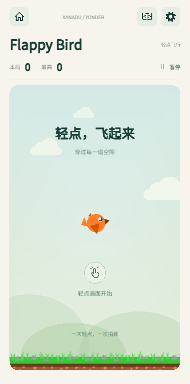
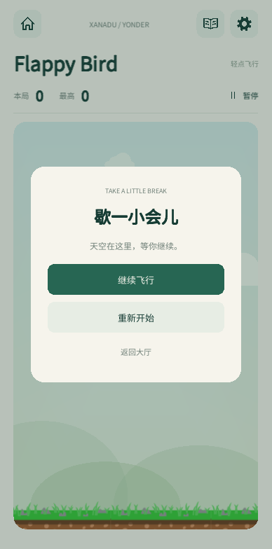
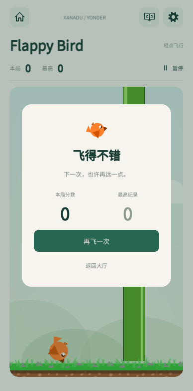

# Flappy Bird 实现与验证记录

日期：2026-10-28。工作树分支：`p/duanyao.0516/feature/flappy-bird`，基于远端 master `0f6e4fd`。设计已获用户批准；[静态原型](prototypes/flappy-bird/index.html) 与 [设计规格](superpowers/specs/2026-10-28-flappy-bird-design.md) 保留在仓库。

## 已实现

第 13 张大厅卡片、独立竖屏页、固定 360×600 的 3:5 场地、拍翼与圆形扫掠碰撞、完整计分、准备/运行/死亡/结算/暂停/三秒恢复倒数、帮助/公共设置/退出确认。单一 UGUI 指针入口处理点击、按住和多指仲裁；结果显示 0.35 秒后才能重开。无广告、服务端和续局存档。

最高纪录独立保存在 `flappy-bird-v1.json`；真实 Newtonsoft 严格校验，临时文件 flush 后原子替换，合法备份保留。加载主/备份中最高合法纪录，异常加载保持警告；无新纪录的准备页不创建零分档。保存失败保留内存最高分，返回大厅仍提示，重试不会挤压场地。

Peleila 原图保持原字节，位于 Resources 外的 `Assets/ArtSources/FlappyBird/Peleila.png`。Unity SpriteAtlas 只打包 BirdRest、BirdWing、PipeCap、Ground，运行时纹理 256×256；来源、许可与裁切见 [素材清单](flappy-bird-assets.json)。原图中的其他角色和金币没有进入运行时图集。

## 已执行检查

| 层次 | 命令 / 结果 |
| --- | --- |
| 纯规则 | `scripts/test-flappy-bird.sh`：1,602,963 项通过（OPPO 反馈后参数） |
| 会话 | `scripts/test-flappy-bird-session.sh`：13,505 项通过（OPPO 反馈后参数） |
| 持久化 | `scripts/test-flappy-bird-persistence.sh`：26 组通过，C# 7.3 + 真实 Newtonsoft 13.0.2 |
| 实际 UGUI | `scripts/test-flappy-bird-ui.sh`：176 项通过，四个尺寸，实际 Camera.Render / GraphicRaycaster / EventSystem |
| 公共规则回归 | `scripts/test-core.sh`：43 组通过；开发初期修复漏配依赖；合并采用最新 master 的 Core 根目录编译范围修复 |
| Dino 回归 | 规则 21 组、会话 2,125 项、持久化 20 组通过 |
| 推箱子 UGUI 回归 | `scripts/test-sokoban-ui.sh`：4,158 项通过 |
| 构建 | Unity 6000.3.27f1，Android ARM64 IL2CPP，独立包 `com.duanyao.xanaduyonder.flappybirdtest` |
| 审查 | 规格审查、代码审查、素材打包复审均已闭环；记录下方发现与修复 |

规则检查包括五档高度的 13 条同高/相邻连接的区间构造证书、4,004 组连续管道、精确接触先后、终局冻结，以及 30/60/90/120Hz 同时间戳输入回放。存在可通行路径不等于任意误操作都可挽救，也不代表已证明不同设备的触摸延迟相同。证书边界见 `Tests/FlappyBird/README.md`。

UGUI 检查覆盖 388×784、320×640、388×896、720×1455：场地比例、真实射线入口、导航占用时第二手指拦截、按住不重复、帮助/设置恢复、倒数中断、长帧暂停、结算误触保护、无存档预览、错误写入重试、坏档警告、最大 Int64、真实 AppController 后台/焦点和大厅末卡可点击。夹具只使用内存数据或独立临时目录。

## 实际 Unity UI 示例

以下为生产 UGUI 的 Camera.Render 输出，使用临时测试数据；Android 安装运行截图留在 `artifacts/validation/flappy-bird-device/`。静态原型仍用于对照设计，不能替代这些实现截图。

| 准备页 | 暂停页 | 结算页 |
| --- | --- | --- |
|  |  |  |

[320×640 窄屏](flappy-bird-ui/ready-320x640.png) · [帮助页](flappy-bird-ui/help-388x784.png) · [大厅末卡](flappy-bird-ui/lobby-bottom-720x1455.png)

## Android 与 OPPO

隔离模拟器 `XanaduFlappyBirdValidationApi36` / `emulator-5580` / Android API 36 上安装运行成功。通过普通 `adb input` 点击生产场地获得 1 分，点击暂停后显示 1 分；实际外部存档为 `{"schemaVersion":1,"gameId":"flappy-bird","bestScore":"1"}`。强停重启后文件仍保持 1 分。运行日志没有游戏异常或 FATAL；符号文件缺失提示不代表运行失败。该流程不覆盖物理触感、扬声器音量和真实触摸手感。

2026-10-28 23:05 已按用户请求安装到 OPPO PKM110，并打开「Xanadu 飞行测试」；独立包保留原 App 数据。用户反馈初版下落过快，调参后于 23:20 覆盖安装新版；用户随后明确确认测试通过，并要求停止追加验证、合并远端 master。初版测试包 SHA-256：`d34572cf63c43636f1aa820ee7da3f9fd0a2173fab27882e56be01c7feb0e396`。

## 修复与验证边界

- 大厅 footer 与滚动高度必须在第 13 张卡之后计算，防止按钮不可达。
- 管道碰撞按可见端帽与细管身组成，避免透明侧边导致提前死亡。
- 加载警告须透传大厅；默认 0 不覆盖坏档。主档 12 / 备份 37 的情况恢复 37，且随后能成功修复主档。
- 结算误触保护从 Result 显示起计时，不从死亡时刻计时。
- 窄屏按原型重排，而非缩小整个导航；原图地面装饰草叶可超出逻辑地面，土层保留在底部。
- 图集配置使用 native 默认 TextureSettings 后修改公开字段；零初始化结构体会清空内部纹理参数。项目启用 AlwaysOnAtlas，保证编辑器与构建实际使用紧凑纹理。[Unity SpritePackerMode](https://docs.unity3d.com/6000.3/Documentation/ScriptReference/SpritePackerMode.html)
- Editor 启动日志包含 Unity QuickSearch 索引异常，栈不在游戏代码；真实 UGUI 报告与 Android 构建均完成。未把该工具异常当成游戏验证结果。
- 用户已确认 OPPO 调参版测试通过，并授权合并推送；未创建正式 Release。本轮未继续执行用户要求停止后的测试。

## OPPO 首轮反馈后的手感调整

用户实机反馈下落太快、过障碍时来不及反应。保持场地与图像不变，仅调整规则节奏与跟随速度的俯仰显示：

| 项目 | 初版 | 调整后 |
| --- | --- | --- |
| 重力 | 3.5H/s² | 2.2H/s² |
| 单次拍翼速度 | 0.95H/s | 0.80H/s |
| 最大下落速度 | 1.4H/s | 0.95H/s |
| 管道速度 | 0.38W/s | 0.30W/s |
| 缺口高度 | 0.29H | 0.32H |
| 管道间隔 | 1.6s | 2.2s |
| 第一管完整通过时刻 | 2.6s | 3.2s |

生产积分实测：首次拍翼后无后续输入的落地时间约 0.917→1.267 秒；第一管首次横向重叠约 1.872→2.278 秒；两管间完整接触区以外的自由调整时间约 0.872→1.278 秒。俯仰不再使用旧的硬编码速度范围。

新参数重新构造全部 13 条连接的动作证书，保留原先完整连续入口区间与全段全宽包络要求；未绕过静态契约验证。新行为测试先出现早到顶失败，再修改生产参数转绿；4,004 管连续回放与四种刷新率的 101 管回放重新通过。用户在新版 OPPO 上完成体验后明确确认测试通过。

## 最终交付包与用户验收

最终 APK：`artifacts/builds/XanaduYonder-0.5.0-flappy-bird-validation.apk`。SHA-256：`5b2aefcafafdae49530cdb72ded09b909af84e7eaebdc7d9d848c19a9ad4a6c7`。OPPO PKM110 上实际安装的 `base.apk` 哈希已核对一致；安装使用 `-r`，没有清理 App 数据。测试包名称「Xanadu 飞行测试」，版本 0.5.0，包名 `com.duanyao.xanaduyonder.flappybirdtest`，最后更新时间 2026-10-28 23:20:55。

当前没有随分数升高的动态难度：重力、拍翼、下落上限、管速、缺口和间隔全程固定；只有五档管道中心按同高/相邻档随机变化。

用户最终确认：“我这边测试已经可以了，不用验证了，直接合并代码到远端master并推送”。据此停止追加测试，进入 Git 合并交付。

## master 整合记录

用户授权交付后拉取到 `b1498bf`。该主线已包含黄金矿工、数字华容道、俄罗斯方块以及 v0.6.0 发布配置。本次保留这三项及所有原入口，Flappy Bird 在最终主线追加为第 16 张卡；测试包脚本对应主线版本字段改为 0.6.0。上方 OPPO 验收与 APK 哈希对应功能工作树的 0.5.0 独立测试包。按用户“无需继续验证”的要求，合并仅处理源码冲突与 Git 推送，不再构建或重装合并后的完整合集。
