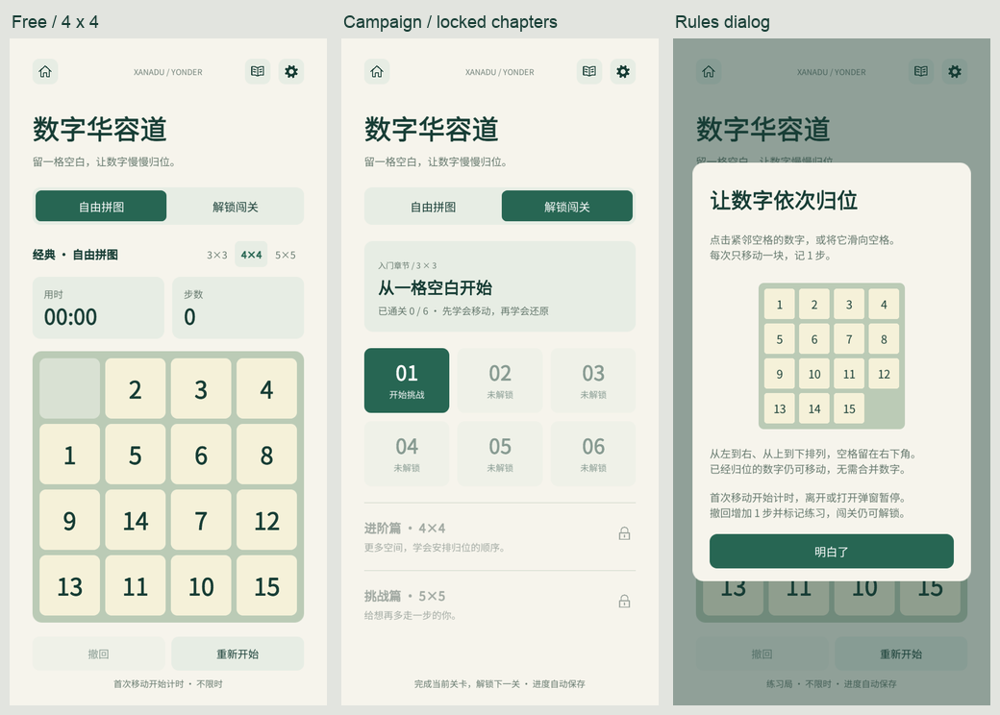
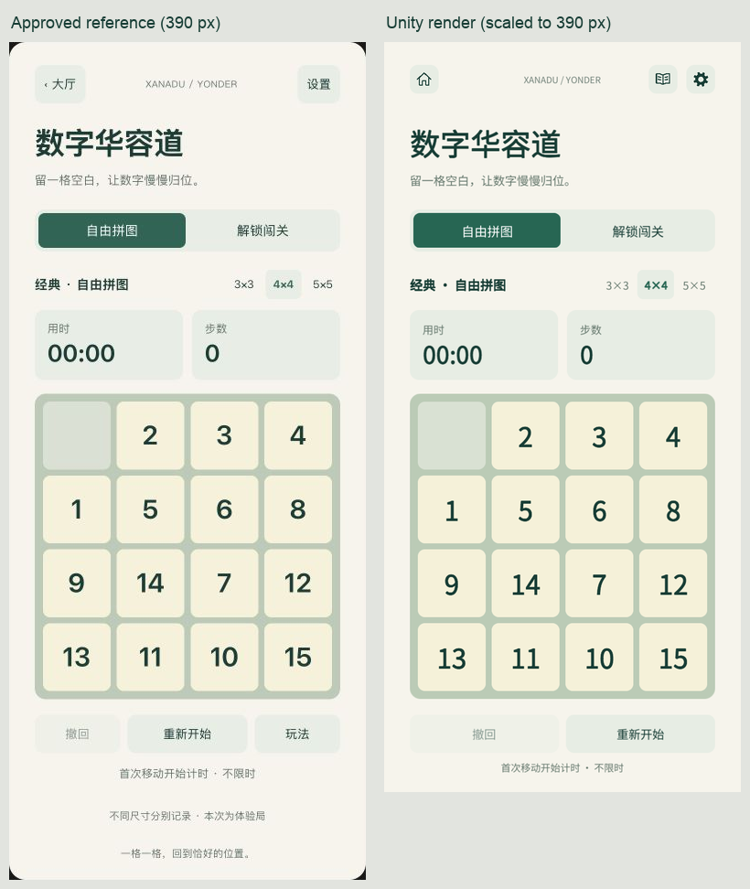
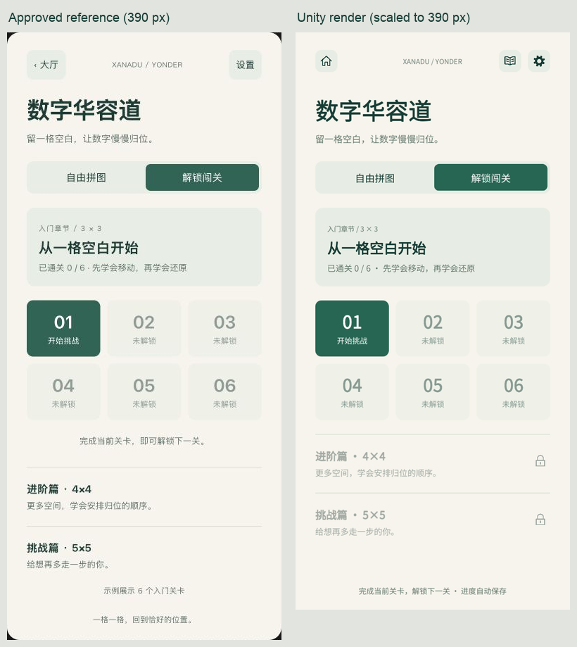
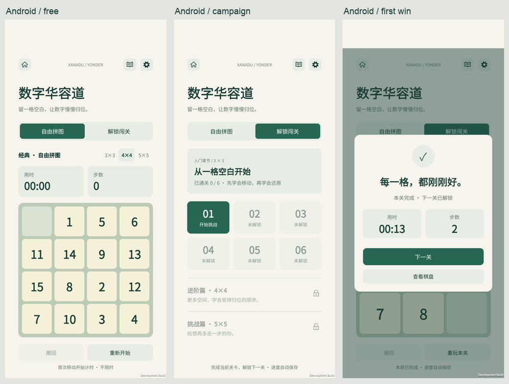

# 数字华容道实现与验证

日期：2026-10-28。开发基线为本轮 `git fetch origin master` 得到的 `0f6e4fd691e405020da49128c3034cb808797738`。隔离工作树分支 `p/duanyao.0516/feature/sliding_puzzle`，原工作目录的分支和未提交改动保留。本次没有推送或合并 master。

## 功能与用户调整

第 13 款小游戏接入大厅，提供各自续局的自由 3/4/5 阶和 3 章 × 6 关的顺序解锁。所有关卡均有真实解法；第一章最短距离另经完整 3 阶 BFS 验证。规则、会话、独立存档及操作说明见[玩法文档](sliding-puzzle-game.md)。

- 导航复用 `UiFactory.IconButton` 和公共图标：Home / Book / Settings；Book 紧邻设置左侧，打开玩法 dialog。声音和触感使用 App 公共设置。
- 原操作行中的玩法按钮移到顶部，撤回和重开平分剩余操作行。
- 首次计时、不限时、练习与自动保存等提示合并到最下方一行。正式存档可用，移除原型的“体验局”提示；删除“一格一格”底部文案。
- 未解锁进阶篇、挑战篇的标题、描述使用 `#A2AAA3`，右侧使用网格绘制的锁图标，整行不可点击。解锁后章节可进入，没有占位章节。
- 重新选择当前已通关关卡会开新局；未完成同关续局。布局和安全区尺寸变化会保留已显示的规则、重开、通关弹窗。

## 严格 UI 对比

[批准的 HTML 原稿](prototypes/sliding-puzzle/approved-reference.html) 保留未改。浏览器读取 DOM 实际矩形与 computed style；Unity 使用生产 UGUI、Camera.Render 与 GraphicRaycaster，既检查控件几何也检查真实射线命中。以下对照图仅裁切、等比缩放、并排和加标签，没有重绘界面。

以内容宽 390 CSS px 为基准，Unity 缩放 `min(rootWidth/390, rootHeight/820)`；长屏保持宽度比例，底注贴近底部，短屏等比缩小以保留完整棋盘和操作。原型外层手机圆角、阴影、网页背景不属于 App 内页面。

| 元素 | 原稿坐标/样式与实现核对 |
| --- | --- |
| 主色 | 纸色 `#F6F4EC`；主字 `#173D35`；次字 `#65786D`；强调 `#276653` |
| 标题 / 副标题 | x=28；y=89 / 140.25；字号 33 加粗 / 13 常规 |
| 模式切换 | (28,183.05)，334×46；外圆角10、内圆角7；文字14 |
| 上下文 / 尺寸选择 | y=249.05，高32；文字14加粗 / 12；尺寸选择圆角6 |
| 统计卡 | y=293.05，162×76.3，间距10；标签12，数值26加粗 |
| 棋盘 | (28,384.35)，334×334，圆角12；底 `#BBCBB6`，空格 `#D9E1D3`，数字块 `#F5F1D9` |
| 棋盘内边距 / 间距 | 宽度的2.63% / 1.97%；数字块圆角8；3/4/5阶字号36/29/24加粗 |
| 操作按钮 | y=735.35，高42；按用户调整为两个163宽按钮，间距8；圆角9、文字13 |
| 底注 | 距内容底37，高20；文字11、始终单行；坏档提示缩短并在前台8秒后消退 |
| 章节卡 / 关卡 | (28,249.05)，334×111.6；章节20加粗、说明12；关卡网格y=380.64，3列×2行，每格104.67×80 |
| 禁用状态 | 关卡和撤回按原稿整体透明度0.48；章节按用户要求灰字与右锁，保持不透明 |
| 章节行 | 说明段移到底注后，两行从y=570.64 / 654.04开始，高83.4；标题15加粗、描述12 |

对照中修复了禁用卡片被 Unity 默认 tint 额外压暗、短屏尺寸标签被固定 padding 挤成两行、章节文本偏移、极长计时换行、损坏存档底注溢出。极长计时仅在超宽时缩小字号，正常计数仍为26；100000步不缩小。Unity 沿用 App 自带 Noto Sans CJK，原稿浏览器使用系统字体回退；字形、合成字重和抗锯齿存在细微引擎差异，不宣称逐像素相同。

## 本轮验证

| 检查 | 结果 |
| --- | --- |
| `scripts/test-sliding-puzzle.sh` | 15组通过，包括非法移动、边界、胜利/撤回、恢复重放、可解性、18关解法和第一章最短距离 |
| `scripts/test-sliding-puzzle-persistence.sh` | 18组通过，使用真实 Newtonsoft.Json；包括计时门禁、四槽续局、解锁、练习、最佳元组、严格字段/类型/版本、100000步完整历史、坏档/备份/原子保存 |
| `scripts/test-sliding-puzzle-ui.sh` | 4716项断言通过；720×1150/1320/1514/1582，真实 UGUI 截图及射线、点击/滑动单次提交、多指/取消、计时、模式/章节/18关终局、规则/重开/设置、重布局、极端计数、存档警告 |
| `scripts/test-minigame-ui.sh` | 251项断言通过；大厅顺序、跳一跳、数独计时/输入/弹窗、图标网格、旸了个旸渲染 |
| `scripts/test-core.sh` | 43项通过。基线测试原先递归包含 Sokoban JSON 类但未引用 Newtonsoft，本轮将仅测试2048的项目编译范围改为Core顶层文件 |
| `scripts/test-input.sh` | 10项通过 |
| 独立交叉审查 | 规则/存档互审，页面输入/生命周期/宿主接线及同宽视觉复核；已确认问题均修复并复测 |

本轮依次见到并修复了“通关弹窗重布局丢失”“点击已完成当前关仍进入旧终局”“恢复提示溢出”“最大计时换行”的真实渲染回归失败，再取得通过结果。UI夹具注入内存数据；坏档场景只在独立临时测试目录进行，不读取玩家存档。完整截图、DOM测量和报告位于 `artifacts/validation/sliding-puzzle-ui/`，共享回归在 `artifacts/validation/minigame-ui/`。

Unity批处理启动曾出现Editor QuickSearch索引内部异常，位于`UnityEditor.Search.SearchDatabase`；最终检查报告成功。它不来自游戏运行代码，仍保留在原始日志中，不将其描述为零告警运行。

## Android 构建与运行

独立包使用 `com.duanyao.xanaduyonder.slidingpuzzletest`，Gradle目录与Unity所用ADB服务端口隔离。专用Android36 ARM64模拟器 `XanaduSlidingPuzzleValidationApi36` / `emulator-5564`，不复用其他任务设备。

`scripts/build-sliding-puzzle-validation.sh` 完成 IL2CPP / ARM64 / Development / StrictMode 构建，日志记录 `Build Finished, Result: Success.`。

- 最终 APK：`artifacts/builds/XanaduYonder-0.5.0-sliding-puzzle-validation.apk`
- 大小：84,371,612 字节；版本 0.5.0 / code 5；minSdk 26、targetSdk 36。
- SHA-256：`efdf560c4bf9c3da68cba46261f2e467aab86ceb3b60b32427c44fcede495361`。
- 最终包重新安装返回 `Success`，指定 Unity Activity 冷启动返回 `Status: ok` / `LaunchState: COLD`。

本轮使用真实 Android 输入与实际磁盘存档核对：大厅第13张入口；4阶初局；持按点击与朝空格滑动各提交一次；玩法目标图；公共设置暂停；第一关移动5、6以2步完成；最佳记录与解锁写盘；下一关入口；自由局与闯关独立续局；撤回+1步并标练习；返回大厅保存；强制结束进程再冷启动后完整JSON与棋盘、时间、步数、练习、解锁和活动闯关一致。首次完整流程在前一个构建完成，最终构建再验证安装、冷启动、原存档恢复和下述后台修复。

首次 Android 后台实测暴露 `Time.unscaledDeltaTime` 的恢复首帧将挂起时间计入：用时由73.6167跳至139.5667秒。修复由数字华容道页面负责：用单调时钟差值，在 Enter 与每次前后台回调重建基准；纯规则和其他游戏不变。增加“后台180秒不产生帧、恢复零跳变、继续前台2秒”的UI回归，最终4716项全过。最终APK重新安装后实测 **13.633秒墙钟间隔，只增加0.802秒前台时间**，局面不变，公共设置正常打开。原失败证据和成功复验同时保留于 `artifacts/validation/sliding-puzzle-android/`。

`runtime.log` 与最终日志未发现游戏异常、AndroidRuntime致命异常或保存失败；保留 Development 构建查询 `il2cpp.usym` 的调试信息。前述UI批处理的Editor QuickSearch问题单独列出，不与Android运行混淆。

范围限制：Android模拟器输入与桌面真实UGUI验证均已完成；实体手机多指/系统取消、触感、音频听感、不同厂商安全区和低端性能尚未验收。第2/3章解法保证可解，真人难度体验仍待后续校准。最终交付代码保留在隔离工作树，未提交、推送或合入master。

## OPPO 安装记录

2026-10-28 21:55（Asia/Shanghai），按用户要求将上述最终 SHA-256 的 APK 安装到 OPPO PKM110。指定设备执行 `adb install --no-streaming -r` 返回 `Success`；包管理器确认 `com.duanyao.xanaduyonder.slidingpuzzletest`、0.5.0 / code 5、`lastUpdateTime=2026-10-28 21:55:35`。桌面名称为 **Xanadu 华容道测试**。随后启动返回 `Status: ok`、`LaunchState: COLD`。这是安装和启动确认，不替代完整实体手机交互验收。原始输出保存在 `artifacts/validation/sliding-puzzle-oppo/`。
