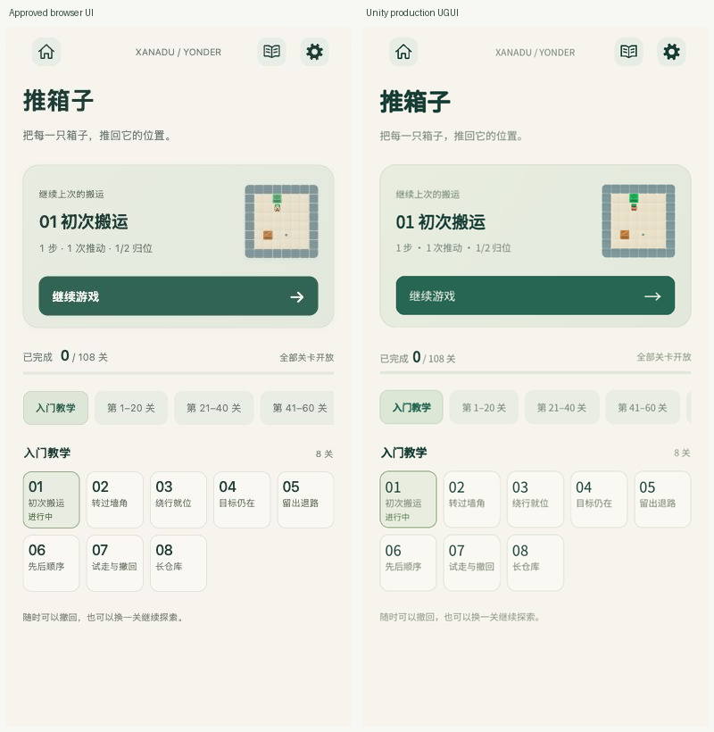
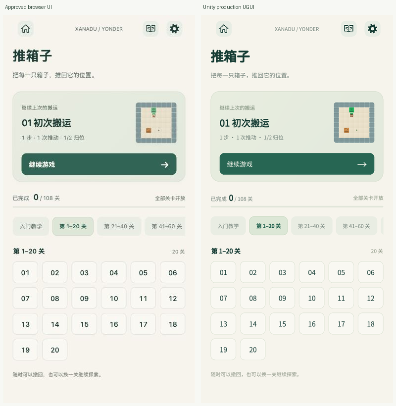
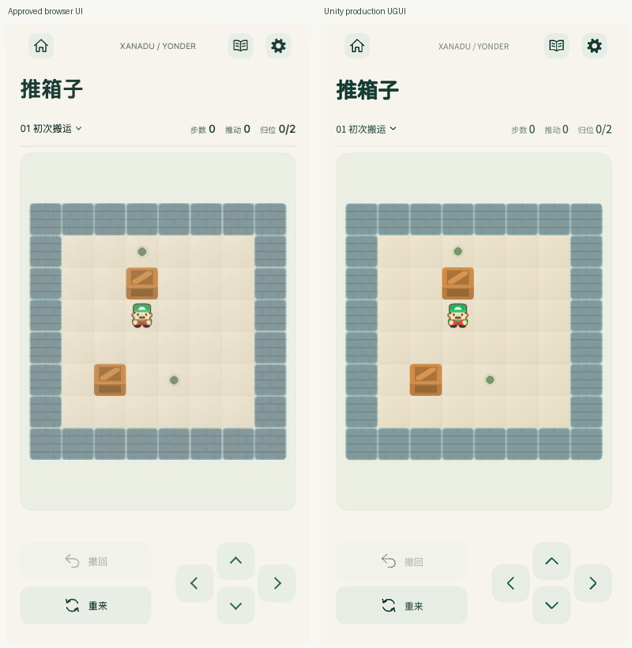
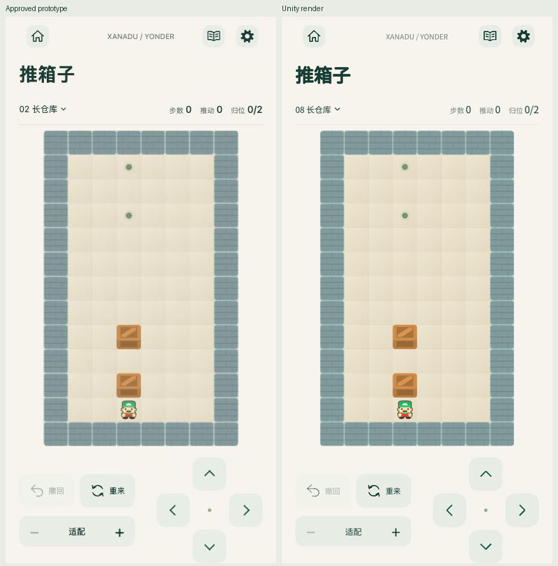
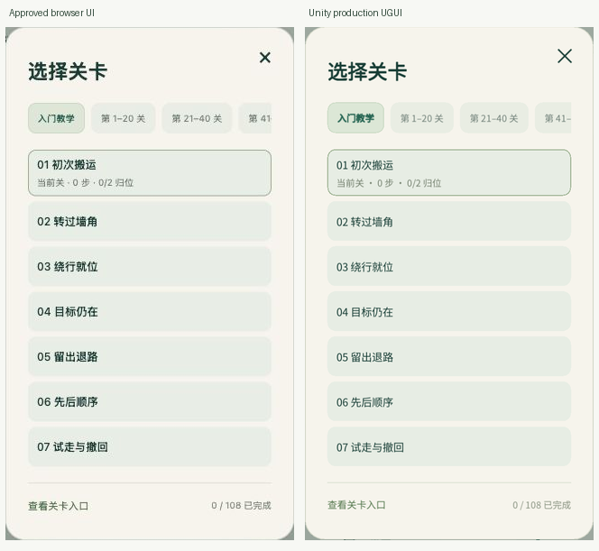
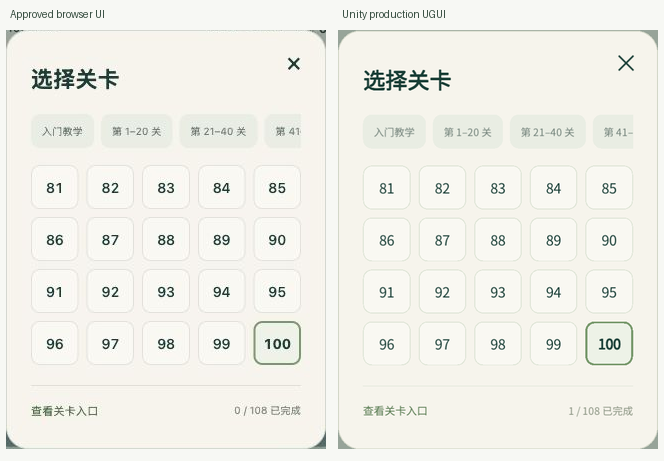

# 推箱子实现与验证记录

日期：2026-10-28。工作树分支 `p/duanyao.0516/feature/sokoban`，创建基线 `8d64b5f`。本次将用户确认的原型 `597249b` 接入 Unity 的入口页、选关弹窗和游戏页，下面记录当前实现及本轮重新执行的验证。

## 已落地的界面与状态

- 大厅进入推箱子先展示关卡入口。主卡读取真实活动尝试，继续时保留局面、步数、推动数、尝试 ID 和完整撤回历史。首次打开只展示教学预览，不创建假进度；后台和设置返回保留原先视图。
- 教学为 8 张带名称的 64 CSS px 卡片；普通关卡为 44 px 高的纯数字按钮，独立编号 1–100。章节展示实际范围“第 1–20 关”至“第 81–100 关”，稳定 ID、顺序和发布内容不变。
- 游戏保留统一导航、标题和单行计数。棋盘使用 `#EBEEE2` 圆角背景、15 px 圆角与 12 px 内边距，始终自动完整适配。
- 删除专注、适配、缩放、视口拖动、棋盘滑动移动和方向盘中心圆点。左侧第一行撤回、第二行重来；上/下方向键分别对齐，左右键保持原位。
- 选关弹层宽 320 CSS px。教学保留名称和有效状态，普通关使用数字网格；没有泛化的“进入”文字。已有有效步数的未完成尝试切到另一关时沿用确认，选择当前关直接续局。
- 旧版缩放字段仍可合法读入，恢复完整轨迹后统一居中适配；不更改存档格式。迁移后仅有旧选中关、没有活动尝试时，预览与实际开始动作都指向教学第一关，浏览入口不会改写旧选择。

## 同尺寸视觉对照

浏览器手机框内部宽 388 CSS px，扣除模拟系统栏后可用高度 784 px；Unity 使用相同比例的 720×1455 可用画面。系统栏装饰不重复绘制在 Unity 安全区内。界面尺寸按 `rootWidth / 388` 映射，并用真实 UGUI 几何断言和 `Camera.Render` 截图核对。

| 元素 | 相对可用区域的 CSS px |
| --- | --- |
| 导航 | y=0，h=63 |
| 标题区域 | y=63，h=47.421875 |
| 单行信息 | x=19.5，y=110.421875，w=349，h=45 |
| 棋盘背景 | x=19.5，y=163.421875，w=349，h=452.578125 |
| 操作区 | x=19.5，y=632，w=349，h=152 |
| 撤回 / 重来 | 操作区内 x=0，y=24/80，w=166，h=48 |
| 上 / 下方向键 | 操作区内 x=249，y=24/80，48×48 |
| 左 / 右方向键 | 操作区内 x=197/301，y=52，48×48 |
| 入口续局卡 | x=19.5，y=154.015625，349×183 |
| 入口关卡网格 | y=497.515625；教学 5 列，普通关 6 列 |
| 选关弹层 | 宽 320；教学高 569，普通数字高 419 |

以下均为左侧浏览器原型、右侧本轮生产 Unity 渲染。入口主卡使用同一合法 1 步局面；游戏为零步；数字弹窗中 Unity 的 1/108 是测试实际完成教学第一关的结果，浏览器为 0/108。对照图没有改动渲染内容，只裁切、等比缩放并加标签。

布局、圆角、内边距、控件位置与整图显示已核对。Unity 沿用项目统一的 Noto Sans CJK，浏览器使用系统字体；字形、字重合成、纹理采样和抗锯齿会有引擎差异，不能把同尺寸布局还原表述为每个像素完全相同。原始截图、DOM 测量和 Unity 报告位于本地 `artifacts/validation/sokoban-ui/`。

## 本轮检查

| 检查 | 当前结果 |
| --- | --- |
| `bash scripts/test-sokoban.sh` | 8 组规则检查通过 |
| `bash scripts/test-sokoban-persistence.sh` | 18 组会话/存档检查通过，含 50,000 步恢复、内容迁移、坏档及原子保存 |
| `bash scripts/test-sokoban-input.sh` | 593 项断言通过；完整地图适配、方向键单次提交、棋盘手势忽略、多指与取消不补发动作 |
| `bash scripts/test-sokoban-content.sh` | 20 项 Python 测试、19 项目录拒绝检查、108 关生产规则解法和完整非终局撤回通过；4,596 步 / 1,203 次推动；导入目录、哈希和报告逐字节可复现 |
| `bash scripts/test-sokoban-ui.sh` | 4,158 项断言通过；真实 UGUI、`Camera.Render` 和 `GraphicRaycaster` |
| `bash scripts/test-minigame-ui.sh` | 213 项断言通过；八张大厅卡、跳一跳回调、数独及旸了个旸 UI |
| `git diff --check` | 通过 |

UI 检查覆盖 720×1150、720×1320、720×1455、720×1582，以及 640×1320 窄布局的教学 4 列/普通关 5 列和末行真实射线命中。交互包括入口不产生假存档、继续及撤回、章节选择、切关确认、弹层返回、旧缩放存档恢复、迁移存档预览、最后第 100 关完成后的有效动作、最大步数单行显示、真实 AppController 设置/后台/保存提示，以及短屏宿主初始化。夹具注入内存 profile，不读写玩家文件。

独立规格和生命周期源码审查已完成；发现的“迁移后无活动尝试时入口预览与开始动作不一致”已修复并加入渲染回归。此前原型改为 `fallbackLevels` 数组后，内容导入检查仍寻找旧 `compact/tall` 对象，本轮修复为按稳定教学 ID 读取静态字面量，并保留两张地图的防漂移、缺失和重复检查。发布关卡、素材、manifest 没有变化。

本轮输出在 `artifacts/validation/sokoban/`：`test-sokoban-ui-port.txt`、`test-sokoban-persistence-ui-port.txt`、`test-sokoban-input-ui-port.txt`、`test-sokoban-content-ui-port.txt`、`existing-ui-port.txt` 和 `ui-port-run.txt`。之前首版实现阶段的 20 组全项目独立测试结果仍保存在 `regression.txt`；那是历史证据，本轮重新执行范围以上表为准。

## Android 验证包

`bash scripts/build-sokoban-validation.sh` 本轮完成 IL2CPP/ARM64 构建，日志 `artifacts/logs/build-sokoban-validation.log` 记录 `Build Finished, Result: Success.`。

- APK：`artifacts/builds/XanaduYonder-0.4.0-sokoban-validation.apk`
- 包名：`com.duanyao.xanaduyonder.sokobantest`，与正式应用隔离。
- aapt 核对：版本 0.4.0 / code 4，minSdk 26，targetSdk 36，`arm64-v8a`，启动 Activity 为 `com.unity3d.player.UnityPlayerActivity`。
- 大小：78,106,201 字节。
- SHA-256：`72c9b4400227aab9066f8f861806bc6e435eb84f0635d4241ac0794f1d2e048e`。

上述 SHA-256 的新包已于 2026-10-28 安装到 OPPO PKM110 / Android 16：`adb install --no-streaming -r` 返回 `Success`，包管理器记录版本 0.4.0 / code 4、`lastUpdateTime=2026-10-28 17:06:34`，随后指定 Activity 冷启动返回 `Status: ok`、`LaunchState: COLD`。这些是本次安装和启动证据；先前旧包的 `android-startup.log` 不作为新版 UI 证据。真实触摸、多指取消、系统安全区、后台恢复、音频听感和低端性能仍需逐项设备验收；编辑器渲染、模拟事件及成功构建不替代这些结果。

## 内容与许可

首版为 8 关原创教学和 100 关 Boxoban，共 108 关；机器证明可解不代表最优解或真人难度校准。来源见 `THIRD_PARTY_NOTICES.md` 与资源 manifest。7 张精灵、4 个短音效来自已归档 CC0 资源，关卡稳定身份及源字节保持不变。
