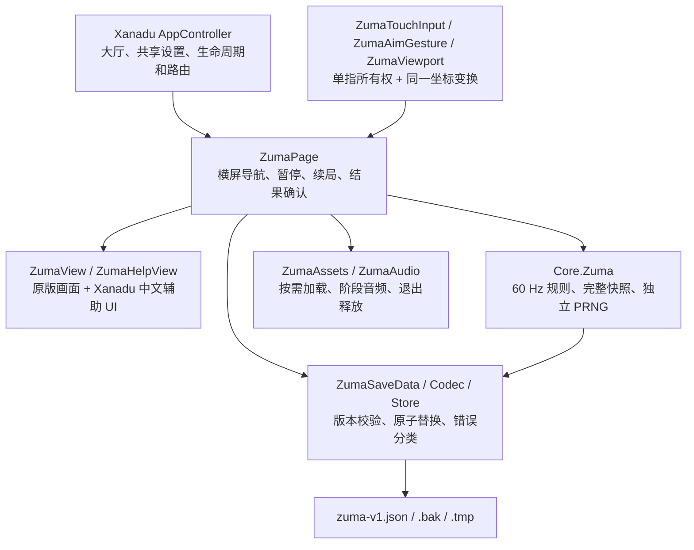

# Zuma 接入 Xanadu：完整开发记录

日期：2026-10-28。本文件集中记录从上游研究、方案选择、原版 UI 移植到手机交互优化、架构审查和主线交付的过程，作为后续开发入口。历史实测数字绑定当时的提交与构建条件；本次主线合并结果单独记录在末节，不能把旧分支的包体和验证范围直接套用到合集新版本。

## 1. 需求、方案变化与最终范围

最初需求是判断 [GalaxyShad/Zuma-Deluxe-HD](https://github.com/GalaxyShad/Zuma-Deluxe-HD) 的素材和玩法完整度，估算压缩后接入 Xanadu 的体积，并核实模式、关卡数量。讨论过程中比较过三档接入方案，查看过第二档 UI 概念，随后将选关、游戏、瞄准、暂停、结算拆成独立场景展示。最终用户明确选择原版 UI：从 Xanadu 大厅进入后横屏游戏，移植已有玩法，存档等系统能力与 APP 兼容，并使用隔离工作树开发。

早期三档方案及五张概念图用于讨论，没有成为实现和验收的素材规范；当前仓库没有足以逐项复核早期三档报价或体积数字的完整记录，因此这里不补造这些数字。最终可执行依据是固定上游提交、实际资源和 [原版 UI 技术设计](superpowers/specs/2026-10-27-zuma-design.md)。本次“原版”指该高清项目的 16:9 呈现，不表示与 2003 年商业版逐像素一致。

后续需求依次收敛为：

| 阶段 | 用户决定与实现结果 |
| --- | --- |
| 方案确定 | 原背景、青蛙、彩球、图集、位图字体、石框和菜单布局；选关、游戏、暂停、结算都横屏，离开恢复竖屏大厅 |
| 名称 | 游戏名称统一为 **Zuma**，不用中文译名替代 |
| 手势 | 按下即瞄准，拖动调整方向，正常松手单发；无等待长按阈值；提供 SWAP 换球 |
| 系统兼容 | 独立存档和完整续局，共用声音/触感，正确处理前后台、Android 返回键和资源释放 |
| 中文可读性 | 核查原字体覆盖；保留原游戏英文视觉，新增内容复用 APP 中文字体 |
| 选关辅助 | 左上角增加 Xanadu 样式的“返回大厅”和“玩法说明”；说明包含英文—中文—功能以及实际规则 |
| 手机上瞄准 | 放大圆点、延长提示、增加暗色外沿，取消手势时同步清除提示 |
| 预览质量 | 修正 Development 模式交付，保留错误日志并增加实际 APK 校验 |
| 架构审查 | 检查不同游戏的规则、文件、资源、生命周期和宿主边界，记录风险，不借 UI 修改全面重构其他游戏 |
| 本次交付 | 将完整记录与实现一起合并、提交并推送远端 master；执行结果见末节 |

### 中文文字为何不能只替换字符串

已核查导入的九套位图字体：`arial12bold`、`cancun10`、`cancun12`、`cancun13`、`cancun8`、`cancunfloat14`、`nativealien48`、`nativealienextended16`、`nativealienextended18`，中文字形数量均为 0。部分菜单标签直接画在图片里。只将英文字符串改成中文，会出现缺字，图片上的文字也不会随字符串变化。

可以保留金色、描边、阴影和石框风格另做中文字库或标签素材，但需要新字形和排版，不是无成本保持同一套原字形。本轮没有整体汉化游戏界面：原游戏英文皮肤保留，继续/错误等中文提示和新说明页复用已打包的 `NotoSansCJKsc-Regular`，没有新增第二套中文字体。

## 2. 基线、提交与可追溯来源

| 对象 | 固定证据 |
| --- | --- |
| 上游 | `GalaxyShad/Zuma-Deluxe-HD@28001e0e5061341d502116586626150027242cce` |
| Xanadu 开发基线 | `42896603043a2a4b8dc4d8c3490f2399880adc5f`，当时包含 2048、跳一跳、旸了个旸 |
| 开发分支 | `p/duanyao.0516/feature/zuma-original-ui` |
| 隔离工作树 | `zuma-original-ui/XanaduYonder`；未在主 checkout 切分支或提交其他任务的文件 |
| 原版移植提交 | `1644d5f`：规则、原素材、横屏、独立存档、资源处理与验证 |
| 辅助 UI 提交 | `3479291`：中文帮助、导航按钮、手机瞄准优化与非 Development 预览 |
| 架构审查快照 | Zuma 分支 `1644d5f`，以及当时主线 `ca50db0`；该主线有六款，不含 Zuma |
| 本次整合起点 | 主代理拉取主线后记录为 `8d64b5f`，已有七款（新增扫雷）；整合 Zuma 后为八款。最终基线和验证以末节为准 |

2021 年 Windows 发布包与上述上游源码提交不是同一个对象；不混用可执行包的表现证明当前源码能力。上游后续更新时，应重新核查规则和资源，不能因为仓库名称相同就假定兼容。

代码许可、图片/字体/音乐权利分别记录于 [THIRD_PARTY_NOTICES](../THIRD_PARTY_NOTICES.md)。移植规则和工具保留上游 MIT 署名；上游明确将 `content` 原素材排除在代码许可之外，素材属于 PopCap / EA，不能把它们标成 MIT。Git 整合、安装本地预览和公开发布 APK 是不同交付行为；本文件不构成素材再分发授权。

## 3. 上游究竟提供了什么玩法

固定源码只有一套可进入的“选图 → 选难度 → 单局 → 结算”流程，内部名为 `MR_GAUNTLET`。主菜单 Adventure 实际路由到这套流程，Gauntlet / More Games 并没有完整的独立玩法。不能按菜单按钮数计算游戏模式，也不能把 XML 中尚未接通的 progression 当作完整冒险模式。

实际接入 **18 张单链地图 × 4 档难度 = 72 种组合**，全部可直接选择。72 不是 72 张不同地图，也没有逐关解锁系统。

```text
spiral, claw, riverbed, targetglyph, turnaround, longrange,
tiltspiral, underover, warshak, loopy, groovefest, spaceinvaders,
triangle, coaster, squaresville, tunnellevel, overunder, inversespiral
```

地图资源和存档使用稳定字符串 ID，不以列表下标代替。未接入双轨地图 `blackswirley/snakepit/serpents`、`space`、完整商业版冒险、额外生命、商店或联网功能。

| 难度 | 颜色 | 初始球 | 速度/模拟步 | 停止生成阈值 | near-end slowFactor | 默认 ACE |
| --- | ---: | ---: | ---: | ---: | ---: | ---: |
| Rabbit / 兔子 | 4 | 40 | 0.80 | 严格超过 3000 分 | 4 | 70 秒 |
| Eagle / 雄鹰 | 5 | 50 | 0.95 | 严格超过 5000 分 | 3.5 | 100 秒 |
| Jaguar / 美洲豹 | 6 | 60 | 0.75 | 严格超过 5000 分 | 1 | 120 秒 |
| Sun God / 太阳神 | 6 | 60 | 1.25 | 严格超过 5000 分 | 1 | 150 秒 |

接近终点的缓速与颜色数都会影响难度，因此 Jaguar 的基础速度低于 Eagle 并不表示更简单。有该图、该难度的最佳时间时，下一局采用它作为 ACE 基准；ACE TIME 是成绩参考，不是超时失败倒计时。帮助页的数值直接来自 `ZumaDifficulty.Get`，避免维护第二份参数表。

### 核心规则与准确的说明口径

- 射入球链，插入完成后相邻同色球达到三颗或以上消除；普通消除每球 10 分。
- 连续有效射击消除构成 CHAIN，第五次起增加连续奖励。未消除的插入、射空和金币命中会中断此计数。
- 消除形成断口后，两端同色会自动回退吸合，接触后再次消除形成 COMBO。没有手动回退按钮，也没有单独倒退道具。
- SWAP 交换当前球和下一球，不自动发射、不消耗次数，并取消已有瞄准。
- 金币闲置超过约 10 秒出现，出现约 10 秒后闪烁，再约 3 秒消失；射中消耗弹丸、加 500 分、金币数加一，并中断 CHAIN。金币是本局得分，不是商店货币。
- 分数必须严格超过阈值才停止生成新球；之后清空剩余球链才获胜。球入终点进入失败流程，达到分数不等于立即获胜。
- 隧道内隐藏球和爆炸中的球不能被命中；瞄准线仅表示方向，不提供穿透碰撞预测。
- intro 不计有效游戏时间，暂停/后台不计时；胜利 Outro 继续追加奖励，最终成绩须等收尾完成。

图集中存在图标或代码中存在枚举，不代表炸弹、减速、倒退、精准瞄准、穿隙奖励等能力已经实现。本次没有据此补造商业版玩法。

## 4. 规则、表现、输入与宿主的边界



| 路径 | 所有权 |
| --- | --- |
| `Assets/Scripts/Core/Zuma/` | 所有影响游戏结果的规则状态；不引用 Unity、不访问文件、不持有 GameObject |
| `Assets/Scripts/Runtime/Zuma/` | 页面、视图、触摸、适配、音频、资源和 Zuma 存储 |
| `Assets/Editor/ZumaAssetImporter.cs` | Unity 导入配置、纹理/音频实际校验与构建前资源检查 |
| `scripts/import-zuma-assets.py` | 上游 XML/DAT、图集字体和音频的离线白名单导入 |
| `Assets/Resources/Zuma/` | 仅接入所需的资源、18 图数据和 manifest |
| `Tests/Zuma*` | 编译实际生产源码的独立测试；不能代替 Unity 渲染或设备测试 |

### 固定步与原 C 实现的差异

Core 采用 60 Hz 固定步，因果动画包括插入、爆炸删除、后坐力、金币、Outro 计时都由模型拥有。渲染只消费快照和事件。卡顿时一帧最多补算五步，不用大步跳过规则；有效时间只累积实际执行的模拟步，后台不会追赶时间，不通过全局 `Time.timeScale` 暂停整个 APP。

`rulesVersion=1` 明确命令在 Tick 前应用，补充球使用当前链条颜色集。上游 C 使用 16 ms 限帧、部分 Draw/clock 推进状态，发射顺序和颜色集缓存时机不同；本次不是逐帧复制这些时序。独立 `xorshift32-v1` 保存完整非零 PRNG 状态，装饰性随机不影响球序；相同版本快照恢复后继续输入能重放同一结果，但没有运行原 C 程序作逐帧 oracle 对照。

移植纠正空链访问、越界追加、零向量、未初始化颜色、越过轨道索引、错误成绩初始化和 `isSingle` 丢失等问题。球链上限 256、活跃弹丸 32；到上限时拒绝追加且不消耗下一球或随机数，不以静默删球维持运行。胜利清链前保存最后位置，避免从已清空数组的残留内存启动 Outro。

### 横屏与触摸

使用独立的 1280×720 参考画布，不改其他小游戏的 720×1320 竖屏设计。在安全区内按 `min(safeWidth/1280, safeHeight/720)` 等比显示，余量填深色，地图不拉伸，绘图、热区和输入逆变换一致。只保留宿主的一个 EventSystem 和 AudioListener。

进入请求 `LandscapeLeft`，确认横屏且宽高/安全区连续两帧稳定才开放输入。导航 token 使过期回调失效，方向等待最多三秒前台时间。退出依次取消手势、冻结保存、停音频、释放展示、恢复 Portrait、显示大厅；异常也走恢复路径，方向失败不能无限黑屏。

首个有效指针拥有瞄准，其他手指不接管。区域外松手、取消、后台、旋转、弹窗、换球均取消；恢复后旧 UP 不发射。零向量保留已有合法方向；冷却期松手被拒绝，不排队补发。MENU、SWAP 和弹层先消费点击。

### 生命周期、共享设置与资源

离开、失焦和后台在最近完整规则步立即保存并停模拟；回来显示暂停，须明确继续。Android 返回按当前 Zuma 场景处理：对局暂停、暂停继续、确认取消、结果确认、选关退出；不直接走宿主“非大厅就返回”的通用分支。

声音/触感仍由宿主拥有，Zuma 通过回调读取和更新，不另存冲突副本。SOUND 同时控制音乐和音效，替换原桌面独立音量滑杆；移除桌面 Fullscreen。Zuma 对局保存失败和公共设置保存失败分别显示、分别由对应写入者恢复，不互相清除错误。

Zuma 入场加载共用图集，单图资源按场景加载、切图释放；退出释放展示和音频，轻量 dirty 数据仍可保留以便重试。`ZumaLevelCache` 将持久化所需的轨道定义与视觉资源生命周期分开，退出后保存重试不会因纹理已卸载而失效。

## 5. 完整续局和存档兼容

上游主要保存最佳分数/时间，完整局内续玩是为合集补齐的能力。新增独占 `Application.persistentDataPath/zuma-v1.json` 及其 `.bak/.tmp`，不读取 PC 的 `progress.bin/settings.txt`，不通过 PlayerPrefs 建第二套 Zuma 状态，也不改变其他游戏协议。

正式应用 ID 保持 `com.duanyao.xanaduyonder`。并行预览采用 `.zumapreview` 后缀，因包名不同而拥有独立数据，不会替换手机上较高版本的主 APP；预览记录也不会自动迁入正式包。

| 数据部分 | 契约 |
| --- | --- |
| 根版本 | `schemaVersion=1`、`gameId="zuma"`、`rulesVersion=1`、`contentVersion=1` |
| profile | 最后地图/难度、72 项唯一成绩；稳定 ID；分数为非负十进制字符串，时间为整数秒 |
| session | 显式 null 或完整对局；地图、阶段、tick、链条、插入/爆炸、弹丸、金币、青蛙、recoil、PRNG、Outro 奖励游标 |
| 结果 | `resultCommitted` 和 `resultAcknowledged` 分开；成绩、终局、提交标记同文件持久化 |
| 不保存 | 活跃触摸指针、正在按住状态；恢复不自动继续射击 |
| 数据约束 | 严格 UTF-8，256 KiB 上限、深度 12；拒绝重复键、尾随 JSON、未知字段、错类型、非法数值/枚举和跨字段矛盾 |

最大容量夹具为 76,705 字节，未靠截断字段满足上限。`PlayTicks` 上限和饱和处理保证有效整数秒能被 Int32 表示；分数和长期 tick 保留 Int64 范围。schema、rules、content 分别代表结构、规则和资源兼容，不能仅因 JSON 能解析就以新轨道恢复旧状态。

Store 区分 Missing、Loaded、RecoveredFromBackup、Corrupt、UnsupportedVersion、IoError。未知版本在字段收窄前识别，主档或待覆盖备份存在未来版本都受保护；超大文件无法可靠判版本也不能自动覆盖。I/O 失败不是新用户。损坏档重置须先保留恢复副本，保留失败则不重置，未知版本不走重置捷径。

写入顺序是完整编码校验 → 同目录临时文件 → `Flush(true)` → 原子替换或 Move。只有合法旧主档能轮换为备份，损坏主档不能覆盖好备份，孤立 tmp 不当作已提交数据。运行至少每两秒保存，发射/换球/暂停/退出/前后台/终局等关键点立即保存；revision 和 dirty 避免无变化重写。写失败保留内存快照与提示，并允许重试。

最终成绩在胜利 Outro 完成后提交一次，OK 只确认，不再次加奖励。突然强杀可能回到最后一次成功保存处；写盘正常时周期目标约两秒，持续失败时不能承诺这个上限。原子替换的 .NET 临时目录测试也不等于所有 Android 文件系统的掉电安全证明。

直接 Store 测试要求旧游戏与 PC 文件不变；完整宿主原有 Save 会轮换其他游戏备份，因此集成比较有效状态与协议，不承诺宿主所有旧备份字节永远不变。

## 6. 素材处理、音频与包体记录

### 白名单和可复现数据

导入了 57 张纹理、18 张地图、55,874 个路径顶点、38 个源音效和八段模块音乐；其中 load/main 拆 intro/loop，实际音乐文件十个，音效/音乐合计 48 个 AudioClip。manifest 校验 132 个输出文件，记录源提交、源文件/输出 SHA-256、图集切片、原尺寸、补边、字体及音频转换信息。

历史资源 manifest SHA-256 为 `bd002888e432a18a9abe341fcaa88e54d2797d428f3c6129d81e4f593746bfdd`。原图、数据和转换结果可用 [离线导入脚本](../scripts/import-zuma-assets.py) 与 `--validate` 复核。

DAT 保留原始采样顺序、样本下标加小数的 pathPos、隧道和绘制优先级，不重采样为样条。坐标仅转换一次；原轨道/青蛙存在三设计像素的偏移差异，按原布局保留。白名单之外的地图、桌面可执行程序、BASS、SDL、Expat、MO3 运行时、参考截图和概念图均不打包。

### 图片压缩修复

首期 Android 8 / ARM64 / GLES3 单 APK 采用 ETC2；ASTC 只作为设备明确支持后的对比选项。不能统一 Max Size=2048，因为原图集更大，缩小会破坏位图字和切片。

实测发现仅设置 ETC2 不够：非四倍数图片会回落 RGB24/RGBA32。最终 28 张图只向右/下补边到四的倍数，原区域不重采样；有透明度补透明边，18 张 JPG 缩略图无损转 RGB PNG 并复制边缘行，避免二次 JPEG 损失。显示缩略图仍裁回 476×305，menu 保留原切片坐标。其余 29 张图保留源文件字节。关闭不需要的 mipmap 和 Read/Write。

最终 APK 实查 21 张 ETC2 RGBA8、36 张 ETC2 RGB4，无回落；图像 payload **29,626,416 字节**，与理论值一致。BuildReport 全项目纹理由 71.3 MiB 降为 32.9 MiB；这是构建资源统计，不是场景峰值内存。

### 音频修复

上游 `bass.h` 为 stub，不能把拥有声音文件等同于已有可运行声音系统。移植由 ZumaAudio 调度 Unity 音乐、音效、变调和共享静音。

真机发现 `frogland2` 等 11 个 Vorbis 1.0 RC1 文件不能被 Unity 6000.3.27f1 FSBTool 解码。处理是从相同源 OGG 离线解码为 16-bit PCM WAV，保留采样率、声道和样本数，再由 Unity 压缩；其余 27 个 OGG 原样保留，没有替换声音或加有损中间文件。

`zuma.mo3` 的 `0/24/28/32/34/36/38/39` 是 order 编号，不是秒数。离线 libopenmpt 解成八段音乐，load/main 的实际 intro 和循环部分分别输出，记录精确循环范围。开发用解码器没有进入 APK。构建前实际加载全部 48 个 AudioClip，不能只检查源文件是否存在。

### 历史预算与实测必须分开

源 content 共 138 文件、35,725,451 字节，不等于 Unity 包增量。设计阶段原 UI 方案曾预算约 +20～30 MB，依赖 ASTC 等条件，未作为 ETC2 结果承诺。相对历史 nondevelopment 样本 38,079,817 字节，首轮 56,109,832 字节测量包约增加 **18.03 MB**；两者未同批重建且签名不同，只能作为量级比较。

| 日期 / 基线 | 产物与配置 | 实测字节 / SHA-256 |
| --- | --- | --- |
| 10 月 27 日原版移植 | v0.3.0 并行 Development 预览 | 63,633,408；`794eda779ee5b799bc9e627e6689cb05ae086eb4d0b07d2ee1baa5ba5cc67982` |
| 10 月 27 日原版移植 | v0.3.0 nondevelopment、调试签名、体积测量中间包 | 56,109,832；`c004214b0f8fadf077437537e3379b57fc0e351459cf4528ffe10104215cd632` |
| 10 月 28 日 `3479291` | v0.3.0 非 Development 并行预览，包含帮助和瞄准优化 | **56,121,424（56.12 MB / 53.52 MiB）**；`a90a3d81081aeb8346319eb9e32f197ad4947a0240a9d04be64b87138df291fc` |
| 本次主线合并 | 合集新增其他游戏后的结果 | 另见末节，不能沿用以上体积 |

一次增量打包出现 31,436,912 字节 ZIP 空洞，APK 约 95 MB；清理本工作树生成的 Gradle `:launcher:clean` 后重建，条目间空洞消失。不能将增量打包空洞解释为纹理压缩无效。最终 `3479291` 预览为 271 个条目、空洞 0、APK 签名有效。

APK 体积、安装后占用、CPU/GPU 常驻、加载峰值、帧耗时是不同指标；本轮未把 Editor 内存或源图片压缩率当作运行时性能证据。

## 7. 导航、中文帮助和瞄准优化

选关左上角使用 Xanadu 的纸白/深绿配色、圆角按钮与已有中文字体，新增“返回大厅”和“玩法说明”。返回仍走 ZumaPage.Exit，保留保存、资源释放和恢复竖屏。原 MAIN MENU 和原版布局仍可使用。

帮助由 `ZumaHelpContent` 与 `ZumaHelpView` 分工：内容不拥有对局、资源或存储；视图由 ZumaView 的弹窗生命周期持有，放在自己的横屏 Canvas。三个标签页为基本玩法、英文对照、难度说明，8 段玩法、38 条英文—中文—功能、四难度参数。按字体实际 preferredHeight 换行排版，ScrollRect 裁剪，完整遮罩阻断下层点击；系统返回和关闭只关帮助，不重建选关或改变进度。

瞄准圆点从 5 增至 8 设计像素，加 11 像素暗色外沿；18 点改 22 点，间距由 12 改 14，末端更清晰。只改变呈现，不改射击方向、冷却、碰撞或难度。

独立审查发现并修正三项边界：

1. 暂停后 Update 不再渲染，原已显示的瞄准点可能留在暂停框后；统一 CancelAim 同时隐藏点和暗边，覆盖后台、暂停、换球、视口变化、结果和退出。
2. Scrollbar handle 若保留固定 sizeDelta，会在 Unity 驱动 anchors 后超出轨道；创建后 Stretch 清偏移，按内容比例计算长度。
3. 打开帮助前另一根手指已按住原版 PLAY/NEXT 时，旧 pointerUp 仍可能触发；选关入口增加 AcceptsSelectionInput 门禁，检查弹窗、前台、导航和当前场景，确认弹窗内部动作保持正常。

前两项有源码与模拟器界面验证；第三项做了独立源码复核，未宣称完成真实双指设备复现。

## 8. Development Console 的原因与交付修复

Development Console 是 Unity 开发运行库内置面板，工程未移植自定义控制台。旧 `BuildZumaPreview` 显式开启 `BuildOptions.Development`，APK 带 debuggable 和开发网络权限，作为用户预览配置不合适。物理手机在 10 月 28 日检查时仍装着 10 月 27 日 18:01:09 的早期包，早于音频修复；没有把当前未复现的异常认定为同一个旧错误再次发生。

修复构建入口默认关闭 Development、Script Debugging 和 Profiler，临时包名/产品名/签名/构建标志在 finally 恢复；原开发诊断构建入口保留。没有调用隐藏控制台或关闭日志的 API 来掩盖异常。

新增 [verify-zuma-preview.py](../scripts/verify-zuma-preview.py)，构建后读取实际 APK，检查：独立 `.zumapreview` 包名、仅 ARM64、无 debuggable、无 Android 权限、`libunity.so` 不含 Development Console、签名有效。旧开发包被拒绝，新预览通过。非 Development 不代表正式发布签名：上述历史预览仍使用本地 Android Debug 身份签名。

## 9. 测试、设备证据与未验证范围

以下为合并前 `3479291` 及其原版实现的已完成证据，本次整合重跑结果另列，避免把历史通过当成新组合已经通过。

| 测试组 | 历史通过数 | 覆盖重点 |
| --- | ---: | --- |
| 2048 / 输入 / 公共存档 | 43 / 10 / 9 | 原规则、手势和共享持久化 |
| Jump / Jump 存档 | 25 / 18 | 原跳一跳规则和存档 |
| Sheep / Sheep 存档 / 布局 | 31 / 26 / 10 | 当时基线的羊玩法、持久化和布局；不是后续三模式全部测试 |
| Zuma 规则 | 29 场景 | 18×4 组合自然败局、持续射击、隧道、生成与连锁、Outro、PRNG、完整快照回放与容量边界 |
| Zuma 输入 | 18 检查 | 指针所有权、取消、冷却、零向量和安全区逆变换 |
| Zuma 存档 | 32 场景 | 主备/未来版本/I/O/严格 JSON/跨字段校验、最大容量、幂等结算、退出后重试和旧文件隔离 |
| 资源 | 8 检查 | manifest、DAT、音频解码、像素一致和 ETC2 对齐 |
| 帮助内容 | 102 断言 | 英文唯一、译文功能齐全、四难度与真实 Core 一致 |

测试编译生产源码，持久化使用项目实际 Newtonsoft.Json 和临时文件替换路径。Unity 6000.3.27f1 的资源导入、C#、IL2CPP、Android APK 构建成功；全部 AudioClip 可加载、实际纹理格式正确；`.meta` 缺失和重复 GUID 均为 0。历史结果不是未运行的 C 逐帧对照，也不是全部地图人工通关。

### 已实际操作的 Android 场景

首轮 ARM64 模拟器完成竖屏大厅进入横屏、选关/原界面、拖动松手发射、Android 返回暂停、后台暂停与强杀续局。弹丸飞行状态强杀前后读回一致，后台不补计时；声音开关写回公共设置时 2048 有效状态保持。胜败结算用有来源记录的有效夹具验证：自然败局显示 GAME OVER；临胜状态交给真实 Core 跑 Outro，3001→4801 分，OK 确认后不重复奖励。这不等于人工打通关。

10 月 28 日专用 Android 36 ARM64 模拟器（竖屏 1080×2400 / 横屏 2400×1080）验证：

- 两个新增按钮不挡难度；三个帮助分页能滚到末尾，文字和滚动条裁剪正常。
- 遮罩挡住原 PLAY/NEXT；帮助切后台保留标签和滚动位置；系统返回、关闭按钮均回原选关。
- 空资料和已有对局分别比较帮助前后文件，字节完全相同；返回大厅恢复竖屏，重新进入继续同一 session。
- 按下/移动显示放大瞄准线，松手后立即暂停读回只有一颗飞行弹珠；按住切后台回来暂停，点线无残留。
- 交互过程中对应进程的 Unity:E / AndroidRuntime:E 日志为空。

物理 OPPO PKM110 首轮预览检查发现了旧音效兼容问题；10 月 28 日 12:25:53 用 `adb install -r` 更新独立预览为非 Development。更新前后 11,596 字节 Zuma 存档一致，SHA-256 为 `00de94af6d3ccaa03b4dedba5ef65c89b3035ffcd4f84e64282c92d555f5040e`。主 APP 当时仍是 v0.4.0，未覆盖、降级或清数据。该轮手机前台有其他测试应用，只后台安装，没有把模拟器交互结果写成手机已逐项通过。

历史日志、截图、fixture 来源和读回 JSON 位于本地 `artifacts/verification/zuma/`、`artifacts/verification/zuma-help/`；这些是忽略的本地产物，不保证随 Git 存在。已提交的 [10 月 27 日验证](verification-zuma.md) 与 [10 月 28 日验证](verification-zuma-help.md) 保存了结果、哈希和验证边界。

尚未完成：72 种组合全部人工通关；跨机型/低内存/折叠屏矩阵；稳定帧率、峰值内存和完整安装占用测量；长时音频循环听感和触感；断电级文件系统故障；真实双指旧按钮复现场景。后续不能以编译、单元测试或一次正常体验替代这些验证。

## 10. 整体 APP 架构审查及后续优先级

[2026-10-28 架构报告](architecture-audit-2026-10-28.md) 审查的是 Zuma 分支 `1644d5f` 与主线 `ca50db0` 两个指定快照，覆盖跨基线七款。之后主线加入扫雷并继续变化；历史报告不是对 `8d64b5f` 或本次最终合并 HEAD 的整体验收结论。

当时的总体结论是：Core 与 Unity Runtime 的分层有程序集约束；游戏规则按模块组织、进度文件独立，但各游戏共用 Core/Runtime 两个生产程序集，宿主逐款管理，尚没有每游戏编译边界、统一生命周期契约和完整故障隔离。共用 EventSystem 本身不是缺陷，独立文件也不等于保存调度完全独立。

| 优先级 | 已有证据的问题 | 改进方向 |
| --- | --- | --- |
| P2 | 部分旧 Store 将未来版本和普通损坏合并处理，降级可用旧备份或默认状态覆盖新档；数独/西瓜有同类边界，成语主档已保护但备份保护仍需补齐 | 借鉴 Zuma 明确的加载结果、主备版本保护、I/O 语义；保持各自 Codec 和迁移契约 |
| P2 | Jump/Sheep/数独启动初始化异常会中断后续宿主启动；西瓜首次创建缺资源没有统一恢复路径 | 按需初始化、部分构造清理、模块失败回大厅；不全局吞异常 |
| P2 | 2048 有效移动触发全局 Save，未变化的 Jump/Sheep/数独等也同步写盘；西瓜公开 Save 未用 dirty 去重 | 模块自身标脏，后台统一 flush 变化模块，设置单独提交 |
| P3 | AppController 直接拥有 2048 业务，全局设置与其同文件，增加游戏要改多处宿主逻辑 | 抽离 2048Page，建立最小 Enter/Suspend/Leave/SaveDirty 契约；设置迁移须保留旧读取与回退 |
| P3 | 旧页面资源在大厅常驻，策略不统一 | 先测内存与加载预算，再决定释放 RT、按需加载或轻量缓存；没有证据时不称泄漏 |

已有正面边界也需保留：Zuma 按需加载和退出释放、主备未来版本保护；西瓜拥有独立 PhysicsScene2D 并手动步进，不修改全局物理；成语有异步加载 token、失败页、键盘桥成对卸载和非活动 Save 跳过；数独提示任务有取消、owner/request/revision 校验。

新版 Sheep 不迁移 v1、成语学习记录不迁移旧文件是当时已声明的协议决定，并有对应说明或测试；应标明升级体验边界，不能自动认作本次新发现的实现遗漏。架构审查没有附带全 APP 重构，也没有用源码存在释放逻辑就宣称设备内存或性能已通过。

## 11. 复现、维护与交付检查

工程固定 Unity 6000.3.27f1；Android Build Support 包含 SDK/NDK/OpenJDK，ARM64/IL2CPP、GLES3、min SDK 26、target 36。独立测试使用 .NET SDK。以下命令均在仓库根目录执行；构建文件名中的版本由当前 `ProjectBuild` 决定，不能长期硬编码历史 v0.3.0。

```bash
# 已提交资源校验；不重新导入
python3 scripts/import-zuma-assets.py --validate
python3 scripts/test-zuma-assets.py

# 规则、输入、存档、帮助
bash scripts/test-zuma.sh
bash scripts/test-zuma-input.sh
bash scripts/test-zuma-persistence.sh
bash scripts/test-zuma-help.sh

# 非 Development 独立预览；完成后自动审计实际 APK
bash scripts/build-zuma-preview.sh
```

重做资源导入时，准备固定提交的上游 checkout 和离线 Python/Pillow、oggenc/oggdec、libopenmpt 工具，运行 `python3 scripts/import-zuma-assets.py --source /path/to/Zuma-Deluxe-HD`。随后检查 manifest、资源哈希、字体切片、音频样本和 Unity 实际压缩格式；只更新源文件不足以证明导入成功。

`build-android.sh` 保留诊断开发构建用途；正式签名流程见 [开发说明](development.md)，私钥不进入源码、文档或 ProjectSettings。并行预览应安装 `.zumapreview` 包，不以 `-d` 降级主 APP，也不卸载/清除已有数据来绕过升级兼容问题。

本次将 Zuma 构建输出版本改为读取 `ProjectBuild.Version`，防止主线升级到 0.4.0 后仍检查旧 0.3.0 包。Unity 构建使用本工作树的 `Library/ZumaGradle` 与独立 ADB 端口，不关闭其他任务的设备连接。

每次主线整合至少检查：

1. 获取真实 origin/master，记录 ref，保留其他工作树及未提交内容；逐块合并 AppController、构建入口、版本和文档，不能用单侧文件覆盖整款新游戏。
2. 确认 Zuma 进出后的大厅路由、前后台、公共设置、输入门禁，以及新增小游戏入口均保留。
3. 运行当前主线已有测试和 Zuma 测试，执行 Unity 编译/构建；核对 Package/ProjectSettings/Manifest、独立包名和非 Development 运行库。
4. 开发总结、设计、历史验证、许可和资源 manifest 一起提交；历史文档保持日期语义，最新状态写在整合节。
5. 普通推送 master，不 force push。远端前进时先重新整合并验证新增影响；推送后核对远端 ref 与提交包含关系，不仅看本地提交成功。

改变地图、规则或存档字段时，先确定 schema/rules/content 版本与迁移策略，再改实现。新增中文标签须核查字体 glyph 或图片来源；新增音乐/音效须实际导入；更改压缩须检查 APK 内格式；更改暂停/退出须覆盖进行中的弹丸、插入、爆炸、金币、Outro 和未确认结果。每一层失败应由它的所有者处理，避免在宿主或通用基类堆叠游戏特例。

原设计、实施计划和两次验证是详细证据，本文是集中入口：

- [原版 UI 技术设计](superpowers/specs/2026-10-27-zuma-design.md)
- [原版移植实施计划](superpowers/plans/2026-10-27-zuma-implementation.md)
- [辅助 UI 与审查计划](superpowers/plans/2026-10-28-zuma-help-and-architecture.md)
- [原版移植验证](verification-zuma.md) / [辅助 UI 验证](verification-zuma-help.md)
- [跨基线架构审查](architecture-audit-2026-10-28.md) / [当前架构说明](architecture.md)
- [第三方来源与权利说明](../THIRD_PARTY_NOTICES.md)

## 12. 本次主线合并验证

本轮在 Zuma 工作树内执行 `git merge --no-commit --no-ff origin/master`，保留其他工作树不动。上文 `3479291` 的包体和手机更新时间属于历史实现证据，不作为本次合并后验证的替代。

| 项目 | 本次结果 |
| --- | --- |
| 拉取的远端 master / 整合基线 | `origin/master@8d64b5f` 与 Zuma `3479291`，整合后大厅八款；正式发行记录仍为原 v0.4.0 |
| 合并冲突与处理 | 处理 `AppController.cs`、`ProjectBuild.cs`、README、第三方许可和架构说明的冲突；保留七款主线功能、0.4.0/code 4 和全部原验证入口。Zuma 为第八张卡，沿用主线自动高度和序号；保存、焦点、IME 和错误提示按游戏分别保留 |
| 当前主线测试和 Zuma 回归 | 32 组独立脚本全部 exit 0，覆盖主线七款和 Zuma 的规则、输入、会话、存档、数据/资源与完整数独题库；Unity 大厅/小游戏 UI 215 项、扫雷 UI 4568 项、成语 UI 6238 项、独立西瓜物理 7 场景通过。没有将数百万布局断言当作同等数量的独立业务用例 |
| Unity 编译 / APK 构建 / 实际包校验 | Unity Android 构建成功；非 Development、独立 `.zumapreview`、ARM64、0.4.0/code 4。APK 为 72,895,754 bytes（72.90 MB），SHA-256 `4fe9eaeb7ef1b0445e1c9e51685c1fe4e087ba046dca9dfcd46d3f3ce25330fd`。实际包审计通过：不可调试、无额外权限、无 Development Console 运行库、签名有效、486 个 ZIP 条目无条目间空洞。该包采用本地调试签名，没有发布为新正式版本 |
| 整合后设备验证范围 | 专用 Android API 36 模拟器覆盖安装旧 Zuma 预览，八款大厅及页脚可见；选关、中文帮助、放大瞄准线、按住时切后台后的暂停菜单、返回竖屏大厅和进入扫雷通过。帮助开关不改变旧存档；继续游戏保持同一 sessionId，playTicks 从 188 增至 349；SOUND 通过公共设置文件切换并还原。上述流程当前进程的 Unity/AndroidRuntime 错误日志为空。本轮没有在实体手机上重跑合并后八款版本，也没有宣称全关卡或长时间性能回归通过 |
| 文档 / 实现提交与远端 master | 实现、冲突整合与本文一并提交；直接普通推送 `HEAD:refs/heads/master`，不强制覆盖。推送前发现远端新增 `41a235d`，仅增加扫雷开发总结文档，继续合入并核对运行代码不变；最终提交与远端一致性以交付时的 Git ref 核验为准 |
| 工作树保留与未验证项 | 保留当前 Zuma 工作树、构建包和验证记录，未修改其他工作树；APK、设备存档和日志位于被忽略的 artifacts 目录，不进入 Git。验证证据在 `artifacts/verification/zuma-master-merge/`，包括 32 组测试、Unity 结果、APK 审计、安装前后存档、截图和运行错误日志。发布签名/商店上架、真机全量回归和历史架构审查中的跨游戏重构不在本次交付范围 |

本轮前两次 Unity UI 启动日志曾记录 Editor QuickSearch 的 `SearchDatabase.EnumerateAll` 索引异常；调用栈不含游戏代码，测试仍完成并返回成功。后续成语 UI 与物理检查未出现此异常；构建与 Android 运行结果单独核对，不把编辑器缓存日志隐藏或描述成游戏异常已复现。
